# Loomhelm UI design surfaces

## Current Review: Major Layouts and UX

The owner accepted the displayed standalone UI language board and asked to retain the language, desktop/mobile layout examples, style-selection material and UX in subsequent commits. The exact four reviewed board images are now canonical evidence. This acceptance covers the language board, not the complete UI or production implementation.

The owner's “就先这样吧” provisionally retains the four displayed workbench/conversation layout examples below; it does not finalize the complete UI, complete D01, or authorize production implementation. Subsequent page review continues from that retained version. The separately confirmed cross-project desktop/mobile pair remains unchanged.

The next surface is `design/layouts.html`: an Operate-mode synthetic application inside a small Read-mode review strip. It applies the accepted D palette, typography, shapes and authored controls to the workbench, task list/board/graph, project context and conversation workspace. Desktop uses a persistent navigation tree and adjacent information; mobile uses a navigation drawer and task-local panels with the same capabilities. The review strip keeps fixture selection outside product flows. `UX.md` and `HANDOFF.md` capture journeys, responsive decisions, state behavior and integration dependencies. No real backend, PWA installation or existing desktop-session control is claimed.

Current iteration intent: operate the existing D presentation and extend the existing layouts with the concrete cross-project fixture `DL-08` in Device Lab, parent `LH-30` in Loomhelm and prerequisite `SN-12` in Sidecar Notes, plus the safe unavailable-endpoint fixture; no style reselection is in scope. The incumbent comparison is byte-preserving: the accepted UI-language board, style-selection source, DESIGN/token frontmatter and `.impeccable/design.json` remain unchanged, and this documentation pass does not refresh or rewrite that system. Major layouts and the complete UI remain pending owner review.

THESIS: An efficient working desk where attention, full request context and ongoing conversations stay close. OWN-WORLD: The accepted D glass language, with translucent structural chrome and nearly opaque reading planes. FIRST VIEWPORT: A persistent project/conversation tree, intervention list and complete selected request; mobile keeps request details in reading order. FORM: Direct code extension of the accepted language. SIGNATURE: The selected review plane changes without losing queue or conversation context. FINISH: Bounded batched inspection, independent finish review, verdict and synchronized design documentation precede owner review.

The major-layout source includes workbench, global/project task list/board/graph, project conversation lists, all conversations, task-bound and standalone conversation workspaces, creation and fixed binding. The review strip offers paired themes and synthetic state fixtures; `?canvas=1` hides that strip for deterministic application-layout captures. It does not change the application composition. The accepted language board and prior style-selection source are preserved.

Historical bounded capture batch: the prior final bounded capture batch contains 18 screens across desktop 1440×1000 and mobile 393×852: workbench and conversation workspace in both themes, task list/board/graph on desktop and mobile, mobile information and navigation, plus two binding-confirmation states. Additional 320/768/1024 width checks found no document overflow. Twenty-five targeted synthetic checks cover preserved mobile draft/branch context, composer bounds, theme changes, independent interruption state, offline control disabling, recovery without sending, stale approvals, approval-versus-execution feedback, view persistence, graph zoom/edge semantics, menu focus return, history-sharing consent, stable conversation identity and taskless project conversation creation. Follow-up checks confirm the All Conversations list includes projectless entries, the synthetic update keeps the draft without sending and System theme responds to both media values. Initial mobile composer and graph SVG dimension defects were corrected in the combined fix batch; task rows were compacted. These checks do not prove real multi-client ordering, permission filtering, execution, installation or update compatibility.

Current final recapture: the qualified source is login-free, mock-only `ui_demo`; page-level Storybook is not applicable, and the viewport uses DevTools emulate (EgoCDP) with `canvas=1` for the entire application/browser viewport. The 10 screens cover cross-project light/dark desktop and mobile, permissions desktop dark/mobile light, relations info desktop light/mobile dark, plus 320 dark and 768 permissions light; there is no new workbench screenshot, whose visual coverage remains the historical 18-screen batch, while the new 30-check set touches the workbench only through a permissions DOM route check. Rect checks at 320/393/768/1440 found document overflow 0 and no summary/zoom overlap; the mobile graph capture was horizontally panned to the first task and the information panel was scrolled 250px. Normal Device graph evidence contains four hierarchy edges including project membership plus one dependency; permissions evidence contains three hierarchy edges and no Sidecar DOM. Project-scope list/board functional checks passed; the new screenshots focus graph and relation information.

Current owner-facing evidence: the accepted subset contains only `design/evidence/layout-cross-project-desktop-light.png` (trim_only, unchanged at 1440×1000, SHA-256 `9fef7110425616583d7cfce8565af05b05408029420cc550799615d1e9183bae`) and `design/evidence/layout-relations-info-mobile-dark.png` (trim_only, source 393×852 to 393×829 after removing 23px at the bottom, SHA-256 `c43636a5d9522191d9ca5b5377303de3cb34e91b4497200350b82528f444c581`). The owner explicitly confirmed that this pair may be retained, and the exact normalized bytes are now persisted; this accepts only these two examples, not the complete D01 UI. Both destination paths are absent at actual parent `079d3d85318c365056cd29a238aafdf732581421`, so comparison remains current-only with no readable baseline, heatmap or two-sided regression report. Visual evidence status: Storybook覆盖=不适用（page-level standalone demo）; 视觉证据目标源=ui_demo; 视觉证据=存在; 空白裁剪=trim_only; 聊天回图=已展示并获确认; 证据落盘=已落盘; 视觉比较=需确认（展示集确认已收到，但实际 parent 缺少 current-only 比较所需输入）. Complete UI approval and production implementation remain outside this slice.

Historical independent finish review: the independent finish review retained the page composition and requested four corrections: synchronize the handoff's actual inspection status, distinguish the projectless navigation label from its project property, expose the target project before binding consent and remove an undefined font declaration. The combined correction preserves the accepted language; binding now shows project, task identity and history-sharing scope before consent, with an unavailable picker when no eligible task exists. The same sixteen captures were refreshed, with two additional focused desktop/mobile binding captures. The verdict scored all four findings resolved, reported no fix regression and returned `disposition: ship` for that correction list. The selected four owner-facing images are byte-identical across this correction; their exact intended paths have no baseline at locked base `a506804ae42da75749d62aac901c8864cd1de96c`, so comparison remains current-only without a two-sided report or heatmap. The complete UI still requires owner review.

Latest independent finish review: IMP01 controls overlap is resolved by the 10-screen recapture plus 320/768 no-overlap/no-overflow checks, with no regression; IMP02 disconnected Device Lab project is resolved by the normal four-hierarchy-plus-one-dependency graph, permissions three-hierarchy graph, and absent Sidecar DOM, with no regression. The reviewer returned scoped `disposition: ship` for these two fixes only; this is not D01 approval. The original 30 targeted synthetic checks remain valid for their declared scope, and this UI-only correction does not change other behavior. The owner confirmed that the two persisted layout examples may be retained; complete UI approval remains pending.

Current synthetic validation is complete for its declared scope. The historical 18-screen/25-check records and current 10-screen/30-check records above must remain distinct; neither proves real server authorization, authorization at both relationship endpoints, cross-device synchronization, PWA behavior or production event/command semantics. Final integration still needs those inputs and a fresh evidence record against the latest parent SHA; it must not silently rewrite the historical `a506804ae42da75749d62aac901c8864cd1de96c` comparison baseline.

Supplemental task/conversation presentation review uses source `3d01ab21ab708466704746f3cc7390fbd1bcbe52` without changing rendered code or incumbent tokens. Eight captures cover global task list, global task board, Sidecar project conversations and projectless conversation `ctoday`, each at desktop 1440×1000 and mobile 393×852 with alternating paired themes. All have document overflow 0. The list retains eight task identities, the board retains five business-state columns, the Sidecar list includes both task-bound `c12` and taskless `ckey`, opening `ckey` preserves its identity and project, and `ctoday` retains its independent composer. This is a bounded presentation/path check, not another run of the historical suites or detector. The owner replied “没问题” to the displayed task-list desktop light, task-board mobile light, project-conversations desktop dark and projectless-conversation mobile dark set. The exact four normalized images are now canonical evidence below; this accepts only these layout examples, not the complete UI. Trim-only leaves their bounds unchanged; exact destinations at parent `079d3d85318c365056cd29a238aafdf732581421` are absent, so comparison is current-only without baseline, heatmap or two-sided report. The six previously retained major-layout images keep their original acceptance scope.

## Accepted UI Design Language

The owner clarified that the requested deliverable is the UI design language itself. Applying the chosen material to an interactive task/workbench prototype did not satisfy this review. The current review surface is `design/ui-language.html`, a standalone Read-mode visual language board; the task prototype remains structural reference. The selected D material and paired light/dark direction remain binding. Neither the previous page candidates nor the complete UI are approved.

The board presents material roles, typography, semantic colors, spacing, shape, authored line icons, buttons, fields, selection controls, dropdown menus, lists and feedback states. Interactive examples demonstrate component states only. They do not introduce product navigation, task workflows or settings placement. A consistent light/dark palette, explicit selection/focus, readable content, usable mobile dimensions and coherent popup styling form the review criteria.

The board extends the accepted visual vocabulary directly in code, following the confirmed build preference. Its first viewport shows material and typography together, followed by a compact component sheet with visible states. Glass distinguishes structural layers and floating menus; content remains substantially opaque. Finish with one batched desktop/mobile/theme inspection, a bounded correction if necessary, independent review and synchronized scoped design documentation. No raster UI assets are required.

The board was checked at desktop 1440×1000 and mobile 393×852 CSS pixels in both themes, with additional overflow checks at 320, 768 and 1024 pixels. The bounded correction darkened light-theme auxiliary text to `#4c5c73` for 4.62:1 contrast on the canvas, normalized native search chrome, corrected palette semantics and restored keyboard traversal when closing the custom dropdown. Sampled text pairs meet 4.5:1; mobile action targets meet 44px. Selection, Escape, forward/backward Tab, field recovery, theme persistence, system-theme changes and preservation of input across theme changes were exercised. These checks cover the synthetic language board, not production behavior or a complete accessibility audit.

The independent reviewer requested two material corrections: lower-opacity dark-theme material glow and a document outline that gives the two foundation specimens equal heading rank under an explicit section heading. The verdict pass scored both findings resolved and returned `disposition: ship` at the language-board scope. All four whole-page and four menu captures were refreshed after that correction; this verdict does not approve the complete product UI.

The four accepted whole-page images cover desktop/mobile and light/dark. Trim-only normalization removed excess horizontal whitespace from desktop captures and preserved mobile bounds. Their exact evidence destinations have no baseline at the locked base, so the comparison is current-only, without a two-sided report or heatmap. Visual evidence status: Storybook覆盖=不适用（standalone design board）; 视觉证据目标源=ui_demo; 视觉证据=存在; 空白裁剪=桌面已裁剪／手机无需裁剪; 聊天回图=已展示; 证据落盘=已落盘; 视觉比较=需确认（owner confirmation received for the displayed set）. Exact reviewed bytes are retained as `design/evidence/ui-language-{desktop,mobile}-{light,dark}.png`. Existing accepted navigation and style assets are unchanged.

## Prototype Background: Scope and Mode

The complete UI design remains one task. Its structural reference is `design/index.html?prototype=1`, using Operate mode inside a Read-mode review document. The single complete-design entry is `design/index.html`; it now redirects to `design/layouts.html` by default while preserving `design/ui-language.html`, `design/styles.html` and the `?prototype=1` structural prototype source. Supporting context and metadata remain under `docs/design/` and are not served with the preview.

## Prototype Background: Direction Contract

THESIS: A live working desk for one owner: notice an exception, inspect its full context and act without losing the surrounding work. Retain the accepted navigation and workspace structure; the selected material treatment now replaces the neutral prototype presentation.

OWN-WORLD: Owner-pinned D, Glass / Layered. Blue-tinted frosted navigation and chrome surround an almost opaque reading plane. Light uses dark blue ink and blue actions; dark uses pale ink and pale blue actions. Fine highlights, restrained elevation, consistent line icons and compact controls carry the same hierarchy in both themes.

STORY: The owner sees the intervention queue first, reviews one selected operation, explicitly responds and continues its conversation. The task workspace keeps one main conversation, expandable sub-agents, draft and task information together.

FIRST VIEWPORT: A 248px project/conversation tree, slim context bar and a two-part desktop work area: intervention queue plus adjacent request, with recent conversations below. The task replaces that area with conversation and a 292px information rail. Mobile keeps the queue, selected request and recent conversations in reading order, with a navigation drawer and task-local Conversation / Information panels. Approval and send actions remain explicit and findable.

FORM: Extend the already accepted information structure in owner-selected D. The earlier `f8d1abaf` exploration remains historical; its rejected proposal is not a new assignment and no new concept tournament is needed. The standing build preference is code-led in Impeccable configuration.

SIGNATURE: Selecting a queue item replaces only its review plane, preserving the surrounding work; a brief shadow/opacity settling motion expresses the front layer. Reduced motion suppresses the effect. Theme changes preserve current task, draft and reading position.

FINISH: unreviewed and undocumented is unfinished; this build ends with the finish review, the verdict, DESIGN.md, and every shipping raster carrying its provenance

This iteration produces interactive high-fidelity workbench/task-workspace review surfaces and their key states in the existing master. It does not complete the entire D01 design or authorize product implementation.

## Confirmed Product Direction

The owner has confirmed an efficient global workbench, attention-first hierarchy, in-place approval review, complete mobile capability parity and a task workspace combining one main session with task information. Native supporting sub-agent work is expandable within the main session. The owner's engineering flows remain external context.

The owner has accepted the navigation hierarchy and its desktop/mobile structural screenshots. The accepted structural prototype uses neutral styling as historical context; that acceptance does not approve the complete design. The workbench variants in the master were rejected as insufficiently distinct from the structural prototype, and that earlier choice is withdrawn. The owner selected D, Glass / Layered, from the independent style sheet, explicitly required both light and dark themes, and accepted the displayed desktop/mobile specimens for both themes. No style reselection is in scope.

The theme follows the operating system by default and supports manual light/dark selection and returning to the system setting. Desktop and mobile remember that preference independently. Both themes must preserve the same information hierarchy, controls and readable state distinctions.

## UI Style Selection

The style sheet compares the same typography specimen, tabs, two list rows, status labels, input and primary/secondary/disabled buttons. Its default view presents selected D with System / Light / Dark preview controls; the comparison route retains all four visual languages. It contains no product navigation, workspace arrangement or business workflow. The prototype stayed unchanged during that independent style-selection step; the subsequent high-fidelity iteration applies selected D to the master.

| Style | Visual language | Tradeoff |
| - | - | - |
| A: Minimal / Flat | Precise text alignment, fine rules, small corners and flat controls | Efficient and restrained, with less distinctive personality |
| B: Soft / Tactile | Soft neutral layers, rounded controls, recessed inputs and raised buttons | Approachable depth; dense screens need restraint in elevation |
| C: Neo-brutalist | Strong type, square controls, visible outlines, solid fills and hard shadows | Distinct boundaries; greater visual presence during sustained work |
| D: Glass / Layered | Translucent panels, frosted separation, fine highlights and light-weight type | Strong material character; reading areas need sufficient opacity |

D is the selected visual language. Its light variant uses blue-tinted translucent surfaces, dark blue text and blue actions; its dark variant uses deep blue translucent surfaces, pale text and pale blue actions. Their type, content, controls and state hierarchy are identical. The standalone preview follows the system by default, accepts manual Light / Dark overrides, remembers the mode in this browser and responds to system changes only in System mode. Query parameters provide deterministic theme fixtures without persisting that fixture. These preview behaviors do not prove the product's preference isolation or cross-client contracts.

The selection does not approve a complete design system or product layout. Detailed product pages, complete states and responsive workspaces still need to be designed in this visual language and reviewed as part of the same D01 task. The existing system/manual theme decision remains unchanged.

Local style lookup uses the minimalism-and-swiss-style, neumorphism, neubrutalism and glassmorphism entries in ui-ux-pro-max. Those entries supply style vocabulary, not product facts or an automatic recommendation. The selected style sheet establishes component vocabulary. The direction contract above governs the current workbench/task-workspace slice; `DESIGN.md` and `.impeccable/design.json` in this design-context directory record its actual reusable rules without claiming approval of the complete UI.

Browser checks cover identical specimen content and sampled text contrast across both themes at desktop 1440×1100 and mobile 393×852, plus tab selection, button feedback, theme persistence after reload, manual override during system changes, return to System mode, automatic system changes and the comparison route. Overflow was also checked at 1024 CSS pixels. Theme controls and mobile action buttons are at least 44 CSS pixels high. The detector found one duplicated hover-contrast warning; the hovered theme label now uses the foreground token instead of the muted token. These checks concern the standalone sheet only; they do not validate a complete product UI or backend behavior. The owner accepted all four displayed theme specimens; those exact images are now retained below.

Visual evidence status: Storybook覆盖=不适用; 视觉证据目标源=ui_demo; 视觉证据=存在; 空白裁剪=已裁剪; 聊天回图=已展示; 证据落盘=已落盘; 视觉比较=需确认（owner confirmation received for all four displayed specimens）. The standalone sheet is login-free and uses synthetic content. Accepted structural navigation assets remain authoritative for structure only. The exact theme destination paths have no baseline at locked base a506804ae42da75749d62aac901c8864cd1de96c, so the images are current-only and have no two-sided report or heatmap. Their acceptance does not approve the complete UI.

## Previous Workbench and Task Workspace Candidates

The owner confirmed direct interactive-page construction as the standing build preference. The existing master now opens the selected D presentation, with Workbench, Task Workspace and Global Tasks fixtures, desktop/mobile preview, System / Light / Dark themes and deterministic scenario controls. A neutral structural comparison remains available; rejected visual proposals are no longer offered as current choices. The separate accepted style sheet is unchanged.

The workbench presents the intervention queue, complete selected request and recent conversations. The task workspace keeps the main conversation, expandable tool/sub-agent activity, explicit approval and private shared-draft presentation together with task information. Desktop uses the information rail; mobile uses task-local panels and a navigation drawer. Theme changes preserve current context, draft, branch expansion and reading position. Loading, failure/retry, offline, reconnecting, read-only, resolved approval, unknown result and empty fixtures demonstrate intended presentation without performing real commands.

Historical bounded inspection covered the two pages in light/dark at desktop 1440×1000 and mobile 393×852, with additional overflow checks at 320, 768, 1024 and 1280 CSS pixels. Interaction checks covered approval selection/denial, draft and branch preservation, task/run-state separation, explicit send, interruption pending, mobile panels/navigation, task-view persistence and projectless-conversation history-sharing consent. Sampled text/background pairs met 4.5:1 in both themes; this is not a complete accessibility audit. Inline script syntax, Markdown and whitespace checks passed, and the detector returned no findings.

Historical independent finish review requested one correction: mobile recent-conversation titles and the All Conversations action needed 44px targets. The correction also covers task-list titles with the same sizing cause. The verdict marked the listed fix resolved, observed no regression in the final eight captures and returned `disposition: ship` for this slice. This verdict does not approve full D01 or production behavior. Scoped design-system documentation extracts the implemented visual rules; no raster UI assets are shipped.

Historical page evidence: the eight final page candidates are temporary review evidence. Trim-only normalization preserved their viewport bounds. Their exact intended evidence paths have no baseline at the locked base, so visual comparison is current-only, with no two-sided report or heatmap. Visual evidence status: Storybook覆盖=不适用（throwaway design master）; 视觉证据目标源=ui_demo; 视觉证据=存在; 空白裁剪=无需裁剪; 聊天回图=待展示; 证据落盘=未落盘; 视觉比较=需确认. Accepted navigation/style assets remain unchanged. No canonical evidence was retained from that historical eight-image set; the current accepted two-image subset is documented below.

## Tool Context

The default root invocation cannot resolve the scoped PRODUCT.md. The existing `docs/design/PRODUCT.md` remains supporting design context; initialization updates it rather than creating another product authority at the root. Running `concept-seed --scope direction --mode operate` from `docs/design/` succeeded, with seed `f8d1abaf` and assigned grounded candidate 4, an incident-response workbench. Reproducing the same seed retained that assignment for proposal A; it does not override the owner's sequence or constitute a choice. No root PRODUCT.md or DESIGN.md is created. Impeccable initialization configures `design/*.html` as the future live-mode target; CSP detection found no policy requiring a source edit. Configuration does not start the live helper, inject scripts or change the preview pages.

## Rejected Prototype Treatments

The owner rejected the workbench treatments below because they modified the prototype instead of providing independent UI style choices. Their legacy CSS remains historical background in the master, but those proposals are no longer current preview choices. The selected style is D from the standalone style sheet above; no complete UI is approved.

The grounded list, ordered by resonance, is an engineering work journal, a code-review split view, a laboratory observation log, an incident-response console, a newsroom assignment ledger, a rail dispatch register and a source-control relationship map. This spans screen conventions, physical records and spatial notation. The reproduced `f8d1abaf` hand retains assigned candidate 4; B represents the top grounded candidate. These exploratory studies use directly rendered HTML, not approved image comps or a selected production build. The owner subsequently required an independent style sheet, served on the same task-owned preview port. It is supporting exploration within D01; the complete design still returns to the existing master.

| Proposal | Visual world and first workspace | Main tradeoff |
| - | - | - |
| A: Duty desk / 值守台 | Slate navigation, cool neutral work surface, amber attention states, compact separated queue/context/recent columns; work is triaged in place | Strong partitioning helps scan and act, while longer explanations use more vertical space |
| B: Work journal / 工作日志 | Pale blue navigation, near-white ground, indigo actions, wider type rhythm and ruled attention rows; requests and recent conversation records read continuously | Recommended for sustained reading, with lower density and a more familiar visual character |
| C: Standard tool workspace / 标准工具台 | Neutral navigation, restrained violet actions, conventional two-column queue/context and recent conversations | Familiar controls and density, with less distinctive identity |

All six catalog challengers were weighed on audience identification and product clarity. They remain available for owner steering; none is adopted silently. The variable-font specimen loses the operator's familiar task grammar and useful information density; its contribution is decisive type hierarchy. Crouwel's construction grid loses familiarity and makes an irrelevant mechanism prominent; it contributes alignment discipline. Metro tiles lose rapid task comparison and full-request clarity; they contribute unmistakable selection. Orienteering loses the default approval scene and direct request reading; it contributes consistent relationship/state notation for the later graph. Zoo-map lobes lose compact operator conventions and clear request reading; they contribute unambiguous region boundaries. Ticket-wallet coupons lose parallel-work familiarity and imply an unconfirmed sequential journey; they contribute traceable requests, decisions and outcomes. These are declined on both axes, presented as compact exploration notes rather than equal visual promises. A carries the resulting hierarchy, alignment, selection, notation, boundary and traceability standards without borrowing their motifs.

The pending choice among these prototype treatments is withdrawn. The owner selected D using the independent style sheet and accepted its light/dark specimens. The direction contract and current desktop/mobile/state refinement follow that accepted direction. Navigation and business rules are not being re-interviewed.

Historical controlled page checks cover all three workbench directions at desktop 1440×900 and mobile 393×852, plus desktop dark previews. They check fixture parity, complete approval context, horizontal overflow, mobile navigation, demo request selection/denial, sampled text contrast and the master entry's direction/theme/device/notes/neutral-prototype controls. C's excess queue-to-request gap and B's muted-navigation contrast were corrected. The detector reported no findings. These are limited direction-study checks; they do not validate the complete design, other page themes, product preference persistence, real backend operations or cross-project graph behavior. The three desktop comparison images remain temporary until owner review; no unselected direction images replace accepted navigation assets.

## Structural Contract

The top-level global navigation is Workbench and Tasks. The workbench prioritizes a short attention queue with an adjacent or following request review and compact conversation access; its All Conversations action opens the cross-project conversation list and creation path. Global Tasks spans all projects and supports list/board/graph switching. Opening a task keeps its conversation, sub-agent activity, shared draft and task state in the same workspace. Mobile reorganizes conversation and task information into task-local panels with the same capabilities.

Below the global navigation, the Conversations group directly lists projectless conversations, replacing the former Unassigned Project label. No separate global Conversations button remains in navigation. The collapsible Projects tree contains named projects with conversation leaves directly underneath. Both task-associated conversations and project conversations without tasks are included, with task association readable as metadata. Desktop and mobile expose the same hierarchy. Clicking a project switches its context; the prototype offers task and conversation panels, and the latter includes all that project's conversations. The active leaf/context and breadcrumb track the displayed scope.

Project tasks support list, board and graph views. The prototype stores the chosen task view independently for global Tasks and each project in client-local prototype storage; the default is list. Navigation expansion and the project-content panel are client browsing state; the prototype does not synchronize them across devices.

All Conversations includes task-associated and standalone conversations. New conversations can start without a task or project; project selection is optional. Task and conversation bindings are one-to-one and remain fixed in phase one. The prototype offers unoccupied tasks and a new-task path, preserving the same conversation, history, private draft and reading position. A creator-private projectless conversation joins the chosen task's project only after an explicit history-sharing confirmation; the draft remains private to the creator's own devices. Existing project conversations can bind only within that project. There are no replacement, detachment or cross-project migration actions.

Task business states are To do, In progress, Blocked, Done and Cancelled. Run completion does not automatically complete a task. The prototype's list, five-column board, graph, filters and task workspace use this same vocabulary. Concurrent drafts and reconnect conflicts automatically adopt the last modification; sending consumes only sent content and retains newer input, and recovery never sends. Real cross-client ordering, deduplication, privacy enforcement and recovery remain public-contract and backend verification work, not capabilities proved by the single-client mock.

The graph distinguishes task containment from prerequisite-to-dependent task edges. Both may cross projects; neither relationship changes a task's own project, main session or execution ownership. Project containment and task parentage are separate relationships, so a cross-project child must not appear to belong to its parent's project. Relationship changes require authorization at both task endpoints, and a relationship must not grant access to an otherwise unauthorized task or project or expose protected content. In a project view, authorized external endpoints carry their actual project; unauthorized task contents must not be exposed through related nodes, previews or labels. The current fixture uses Device Lab task `DL-08` with Loomhelm parent `LH-30` and Sidecar Notes prerequisite `SN-12`; its Device graph presents one local task plus two authorized external tasks with actual project labels, while task info/detail links resolve real task/Session identities and a project-scoped graph entry. The `权限已变更` review-only scenario filters Sidecar scope before UI construction and removes unauthorized task references from `parentId`/`dependsOn`, with no protected silhouette, count, title, status or project metadata; the raw fixture is synthetic code only. Switching into or out of this scenario reloads the mock page, retains the localStorage draft and keeps mock-only mutations out of server state. F05 actual relationship contracts and server/two-endpoint authorization remain implementation handoff dependencies, and the prototype does not implement relationship editing; current synthetic checks are complete for their declared scope.

The owner has ruled out a user-facing host concept and has no current multi-host connection plan. Host navigation, selectors and sample machine names are removed. The integrated contract uses one preconfigured logical execution environment, keeps Server/Worker/Connector separate and treats Connector administration as deployment-internal. The execution machine may be separate from the platform; existing desktop-session control still needs actual capability evidence.

Files stay in their conversation context. The owner has rejected a standalone artifacts module, including a global page and task-specific panel. A remote file browser is only a possible future capability, outside the current design scope.

All content is labeled demonstration data. Approval, input, conversation creation, history-sharing confirmation and task-association interactions update only prototype state. Real cross-client draft synchronization, authorization, Codex execution, original-file downloads and PWA installation are not implemented or accepted by this artifact. Scenario controls demonstrate intended state presentation only. Confirmed product rules come from the main coordinator's PRD; self-loop/cycle handling, relationship editing/deletion semantics and team-permission choices remain coordinator-owned and are not inferred here. The concrete cross-project fixture proves presentation only; server authorization and authorization at both relationship endpoints remain real implementation dependencies.

## Open Decisions and Dependencies

The owner selected D, Glass / Layered, and accepted its displayed desktop/mobile light/dark specimens. Detailed page layouts, complete states and responsive workspaces remain subject to review before the complete design is confirmed. The source contract baseline for this iteration is parent commit `079d3d85318c365056cd29a238aafdf732581421`, specifically its PRD and phase-one core SPEC. The main coordinator owns the remaining PRD business-rule decisions; this design task consumes those answers without repeating owner questions. F02, R02, F05 and RD03/G0 actual inputs must supply the framework, real fixtures, public interfaces and recovery/deployment contracts before final page/component/state/API handoff and implementation-task mapping. The current synthetic validation is complete for its declared scope; final integration must add real server/two-endpoint authorization, cross-device/PWA and public-contract evidence, record the latest parent SHA, and leave the historical `a506804ae42da75749d62aac901c8864cd1de96c` comparison baseline explicit.

## Visual Evidence

The owner accepted this structural navigation set: Workbench and Tasks at the top, projectless conversation leaves under Conversations, and Projects → named project → conversation leaves. This is approval of the displayed navigation and screenshots, not final visual design or real backend behavior. The source is the login-free, mock-only `design/index.html?canvas=1`; viewport emulation uses desktop 1440×900 and mobile 393×852 CSS pixels. Trim-only normalization left both captures unchanged. These images document the accepted navigation structure; subsequent interaction states are reviewed separately.

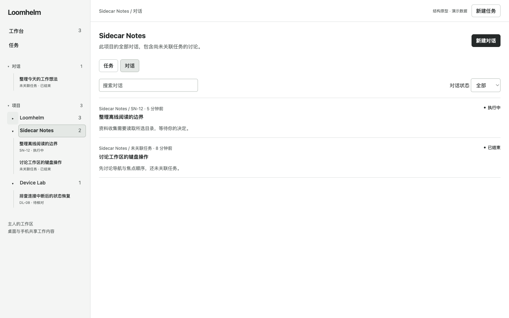

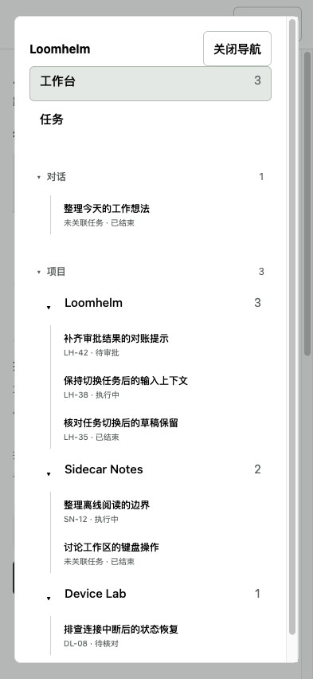

The owner also accepted these D, Glass / Layered, style specimens. They were captured from the login-free, synthetic-content `design/styles.html?style=glass&theme=light` and `theme=dark` fixtures at desktop 1440×1100 and mobile 393×852 CSS pixels, then normalized with trim-only cropping. These are the exact four images shown for review, retained without changing their bytes. They establish the selected material direction in both themes; they do not represent complete page designs or product behavior.

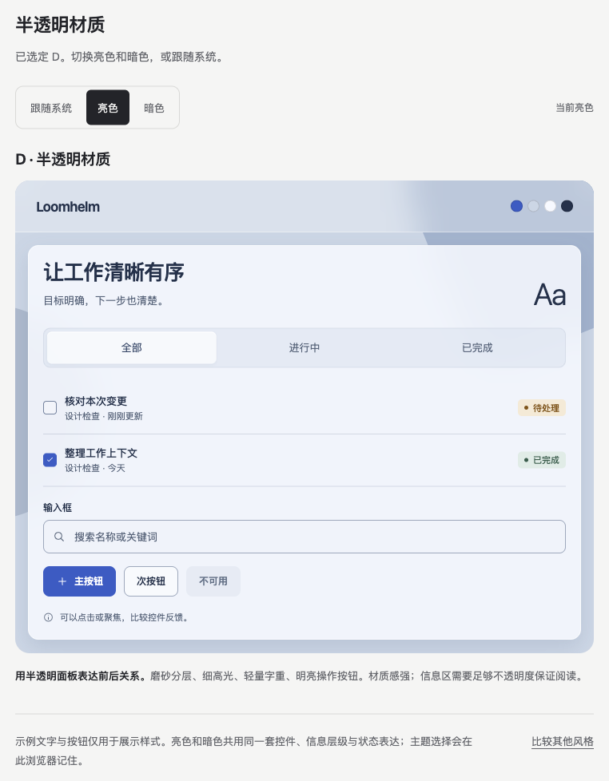

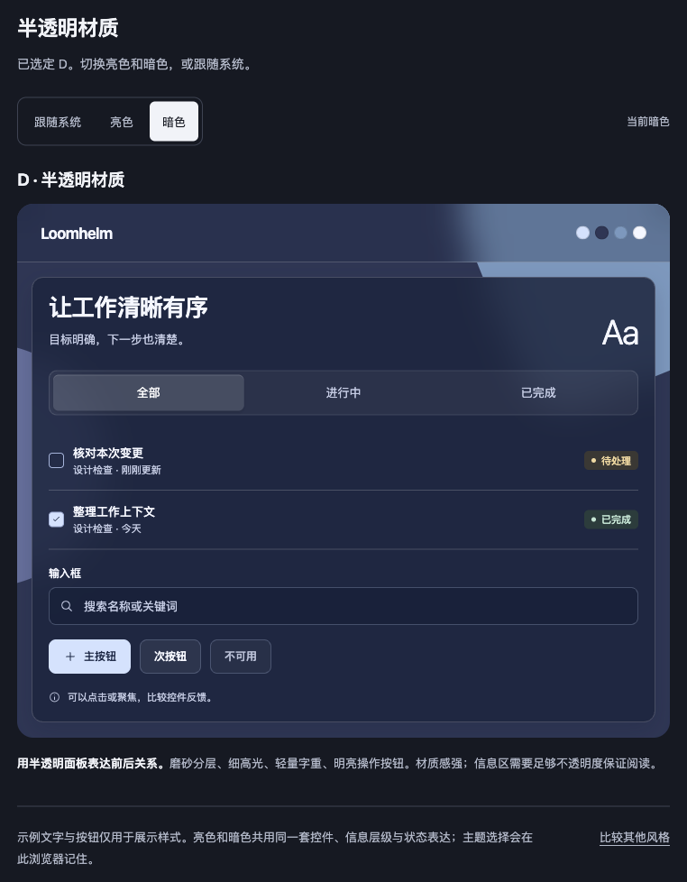

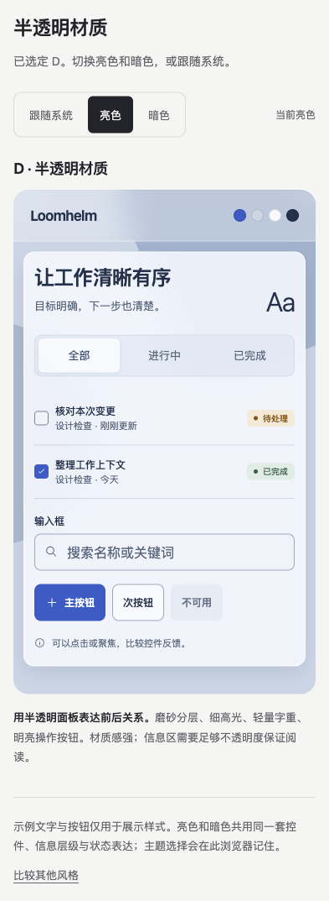

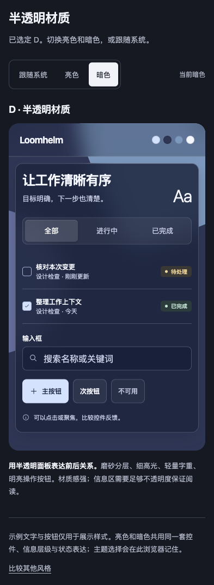

The owner accepted the following standalone UI language board as displayed, with all four exact normalized images retained. These images establish material roles, typography, semantic colors and authored component vocabulary at desktop 1440×1000 and mobile 393×852 CSS pixels. They are separate from the subsequent major-layout review.

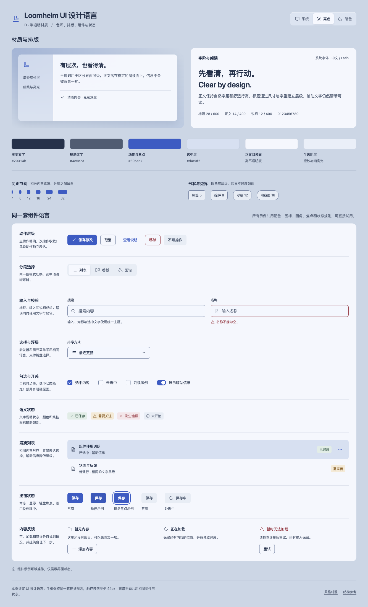

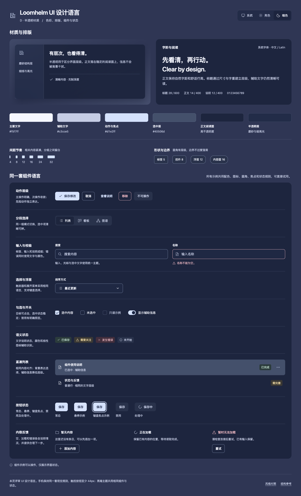

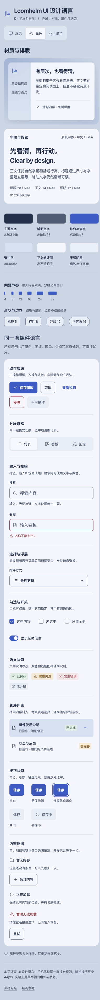

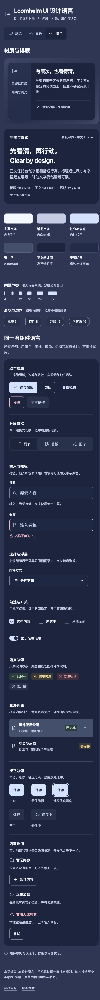

### Owner-Confirmed Major-layout Examples

The owner confirmed that only these two normalized major-layout examples may be retained from the current review; they are persisted canonical evidence and do not approve the complete D01 UI. The current-only comparison remains open because actual parent `079d3d85318c365056cd29a238aafdf732581421` has no readable baseline, heatmap or two-sided regression report.

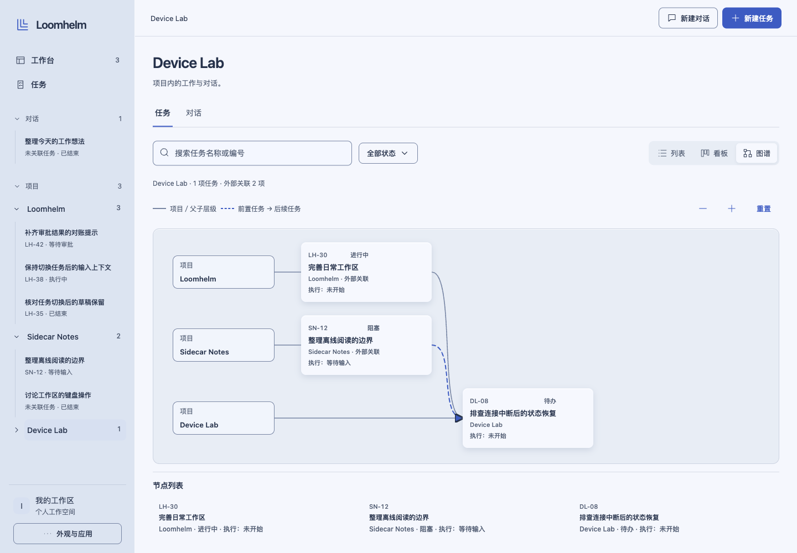

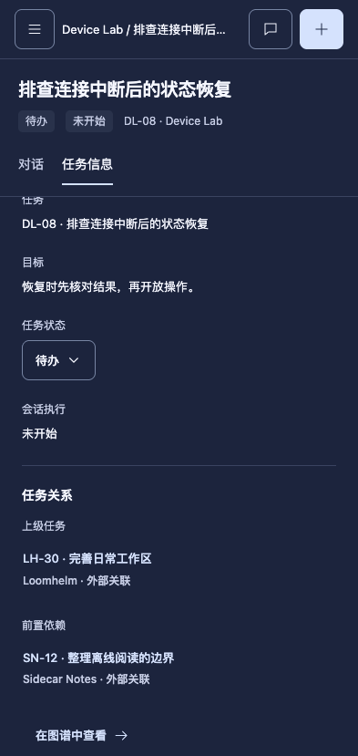

### Provisionally Retained Workbench and Conversation Layouts

The owner replied “就先这样吧” to this displayed four-image set. Retain these exact images as the current stage, with no claim of complete UI approval. They were captured from the login-free, mock-only `layouts.html` at source commit `5cbf46b7ce6e4aeb27f7ffd3c5677598aa7e78fb`, using `page=workbench` and `page=conversation&session=c38`, the shown themes and `canvas=1`. Desktop uses 1440×1000 and mobile uses 393×852 CSS px with DevTools emulation; capture scope is the full application/browser viewport. All four have document overflow 0, and the mobile approval buttons measure 44px high. This presentation-only capture does not rerun or supersede the historical functional checks. Trim-only normalization left every image unchanged. The exact destination paths are absent at parent `079d3d85318c365056cd29a238aafdf732581421`, so comparison is current-only without baseline, heatmap or two-sided report. Visual evidence status: Storybook覆盖=不适用（page-level demo）; 视觉证据目标源=ui_demo; 视觉证据=存在; 空白裁剪=无需裁剪; 聊天回图=已展示; 证据落盘=已落盘; 视觉比较=需确认（阶段性保留答复已收到，完整 UI 仍未定稿）. No rendered source, accepted style asset or design token changed during this archival step.

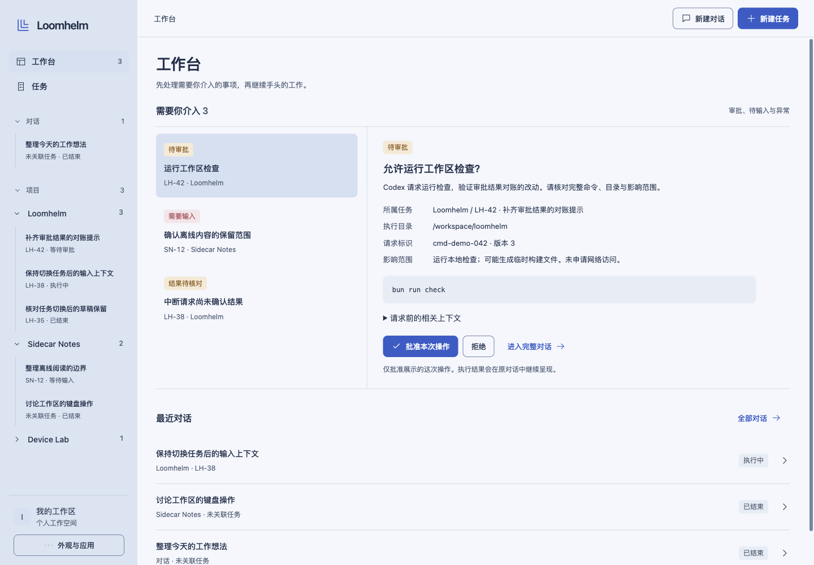

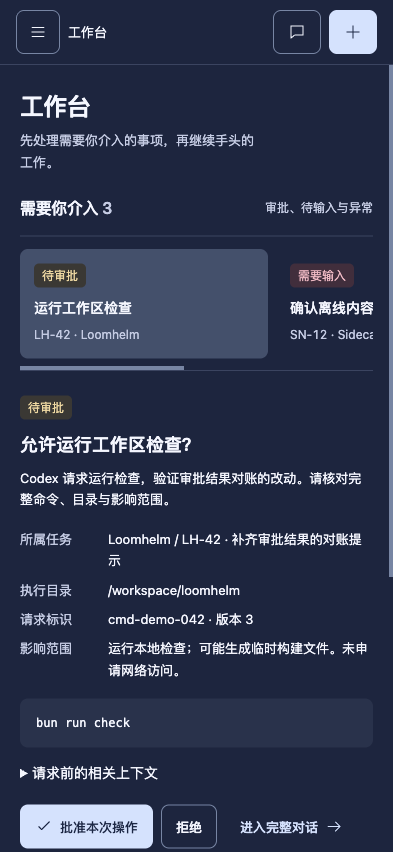

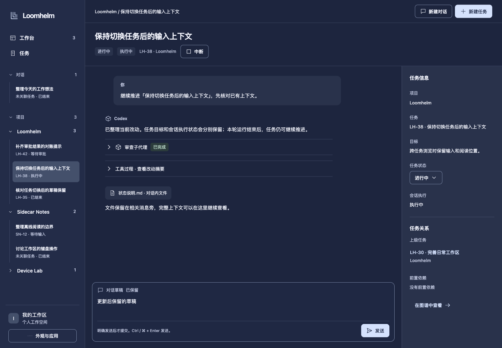

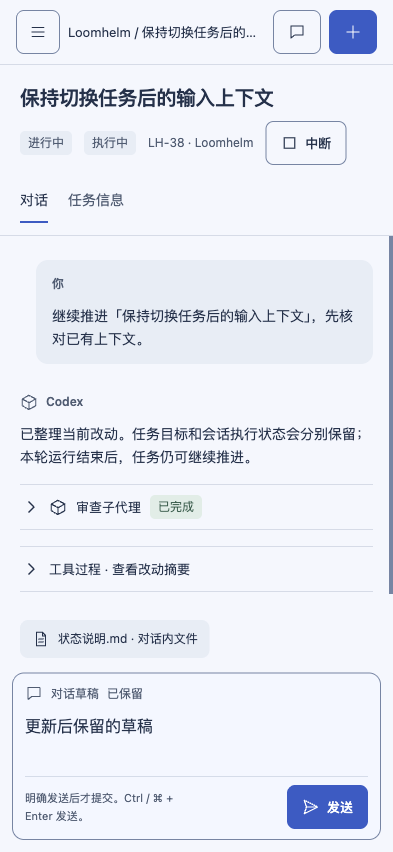

### Owner-Confirmed Task and Conversation Layouts

The owner accepted this exact four-image set with “没问题”. These are the displayed normalized bytes from the supplemental review at source `3d01ab21ab708466704746f3cc7390fbd1bcbe52`; desktop is 1440×1000 and mobile is 393×852 CSS px. The source is login-free, mock-only `ui_demo`, with DevTools viewport emulation and browser-viewport capture of the entire app. Trim-only left all four unchanged. All exact destination paths are absent at parent `079d3d85318c365056cd29a238aafdf732581421`; there is no readable baseline, heatmap or two-sided report. Visual evidence status: Storybook覆盖=不适用; 视觉证据目标源=ui_demo; 视觉证据=存在; 空白裁剪=无需裁剪; 聊天回图=已展示并获确认; 证据落盘=已落盘; 视觉比较=需确认（展示集答复已收到，实际 parent 无同路径基线）. This records acceptance of these examples only; complete UI approval and implementation authorization remain separate.

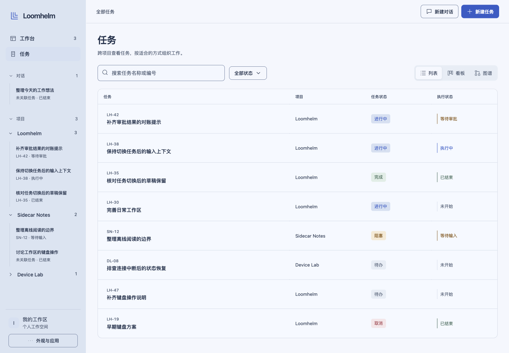

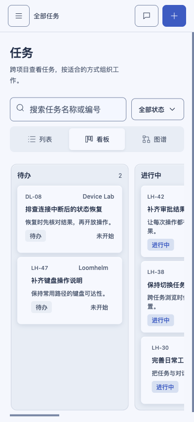

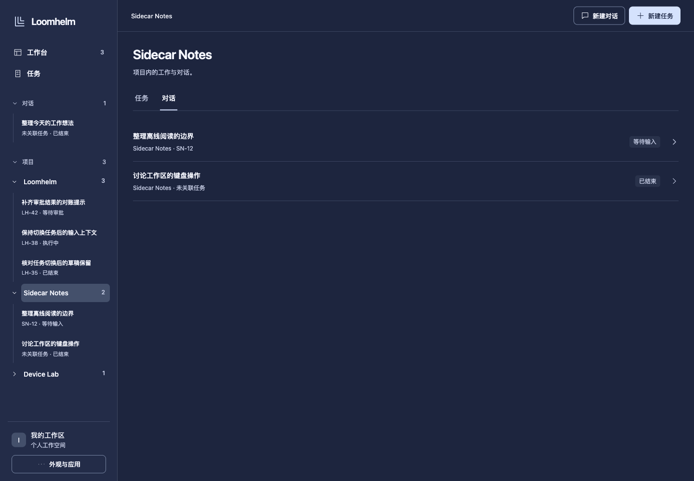

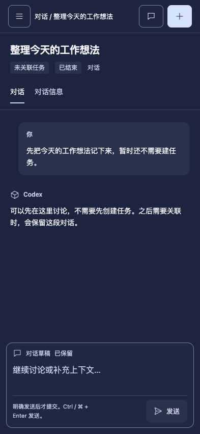
