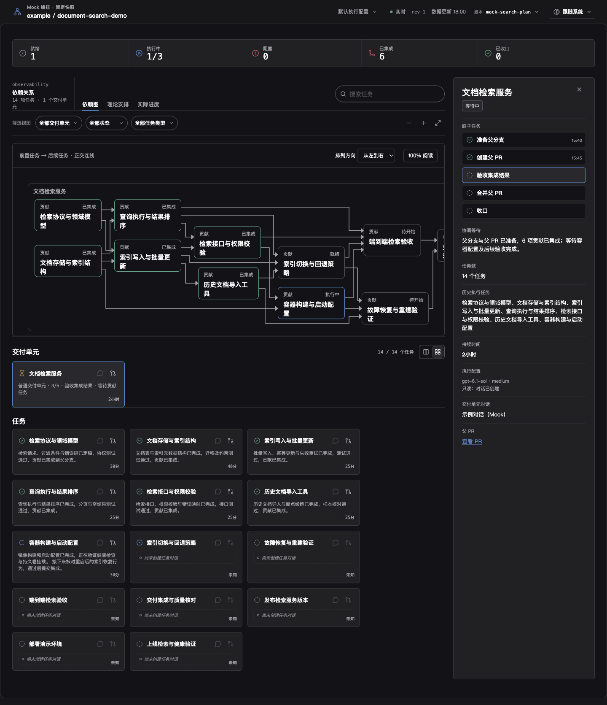

# 客户端 Skills 与工程执行支持

## Context and Scope

本主题约束客户端从固定 dot-codex 源版本迁入的 29 套 Skills、执行脚本、共享支持和本地任务网页。它与客户端独立核心并存，不替代 Go 客户端、服务端或 Web App，不代表 Connected mode 已实现。

## Terms and Interfaces

- Skill 是命名的指令与资源包，不是一次任务执行，也不授予超出调用者授权的权限。
- 迁入资源以项目根 `skills/` 为源包目录、`skills/bin/` 为共享执行支持目录；所有随包执行代码、合同资源、依赖声明与构建支持必须位于 `skills/` 内；仅安装该目录即可保留依赖闭包，生产产物必须携带必要资源。
- 外部宿主能力包括未迁入的 Skills、原生 Codex 工具及专项 CLI；缺失能力必须明确检测。

## Requirements

### REQ-SKILLS-001

客户端 MUST 完整提供已审查的 29 套源包及必要脚本、references、模板、网页资源、测试与共享依赖。资源 MUST 可追溯到固定来源提交和文件摘要，不得隐式依赖全局 dot-codex 执行代码，也不得复制 `~/.agents` 的 Skill 源包。资源 MUST 排除与客户端实际功能及其行为回归无关的提供方历史语言迁移审计资料；来源清单 MUST 明确记录排除范围，重复导入和增量打包不得重新带入这些资料。

### REQ-SKILLS-002

生产命令、计划校验与本地网页服务 MUST 仅使用固定 Bun 1.4.4 直接执行 TypeScript 源码，保持输入、退出码、副作用及恢复合同。生产入口 MUST NOT 依赖预生成的 JavaScript、自建 Node-API 模块或安装时 C 编译；类型检查不得发射生产 JavaScript，浏览器资源构建独立保留。

### REQ-SKILLS-003

FFI 路径缓冲区 MUST 在完整系统调用期间保持所有权。文件读写与互斥 MUST 保留目录描述符相对操作、拒绝符号链接、文件身份与权限验证、旧新进程锁互斥、原子不覆盖重命名及原有备份语义。不得以路径预检查或另一种不互斥的锁替代。

### REQ-SKILLS-004

客户端 MUST 直接兼容并合法接续现有 schema2/contract2 Multi-task Flow 运行，不要求导入或转换；保持 owner、revision、请求身份、历史和依赖关系。未知副作用 MUST 先对账；较旧格式保持原有只读及显式维护边界，不自动迁移或转移 owner。

### REQ-SKILLS-005

任务与本地网页 MUST 使用迁入的权威运行合同；可执行后继应通过真实派发接力，交付单元阻塞不得阻止无关可执行贡献。网页 MUST 保留任务图、进度、会话链接、实时更新、鉴权、loopback 和服务所有权验证。新 viewer MUST 使用 v2 源码资源清单并验证摘要；旧 v1 包仅允许诊断，不得在 rollback 或失败恢复时作为新启动入口。

### REQ-SKILLS-006

各工程交付路径 MUST 保持原授权、门禁和停靠点；dev-plan MUST 保持独立临时计划合同，不与运行协调器建立机器交接。外部依赖缺失 MUST 明确阻塞适用场景，不静默减免门禁。

### REQ-SKILLS-007

正式工作流与任务流 MUST 替换此前缩水实现及误导完成声明。不兼容旧命令 MUST 明确报错，不偷偷转换或删除旧状态。客户端独立核心、Codex 底层能力及 Go/Web 工程 MUST 保留。

### REQ-SKILLS-008

本地编排网页 MUST 默认横向紧凑展示依赖，保留完整任务标题、交付单元边界、里程碑与全部投影依赖，按布局引擎生成的正交路径渲染；状态更新不得无故重排相同结构，旧异步结果不得覆盖新布局。默认阅读不得以自动缩小整图牺牲文字可读性，用户可主动适配全图或切换纵向。任务视图只有一个交付单元时 MUST 默认网格，其他数量默认看板，显式 URL 布局选择优先并可恢复。独立的单交付单元示例 MUST 使用合成数据，任务前驱、时间、对话、PR、原子步骤和生命周期事实必须一致；预览对话输出不得读取真实会话，注入适配器仅允许隔离开发配置。

### REQ-SKILLS-009

Multi-task Flow MUST distinguish `proposal`, `initialized run`, `scheduled run` and `completed run` as separate lifecycle stages. A proposal MUST be visibly marked as unapproved and unschedulable; rendering a dependency graph, timeline or live dashboard MUST NOT imply that dispatch is authorized. Dispatch MUST require an explicit approval for the exact execution plan and authorized action set.

### REQ-SKILLS-010

Every task and delivery unit MUST carry a structured acceptance contract. The contract MUST identify the owner, completion state, observable criteria, required evidence kinds and required checks. An acceptance scope or digest MAY summarize the contract, but MUST NOT replace the contract when validating proposal completeness or presenting approval evidence.

### REQ-SKILLS-011

Every delivery unit MUST declare its complete closeout path before approval. The path MUST cover workspace readiness, integration branch and integration PR publication, merged-SHA CI, planned post-merge release/deployment/verification work when applicable, known follow-PR reconciliation and final closeout. A plan with implementation tasks but no applicable post-merge obligations MUST be rejected or explicitly record that those obligations are not applicable with evidence.

### REQ-SKILLS-012

Multi-task Flow dependency facts MUST use the contract in `docs/specs/multi-task-flow-unified-atomic-orchestration/SPEC.md`. `AtomicNode` and `AtomicEdge` are the only canonical dependency facts; Task and DeliveryUnit are peer projections. Milestone conditions MUST use explicit structured criteria and full AND evaluation. Legacy `integrated` is a read-only derived compatibility label for child-PR integration; it is not a canonical TaskStatus or an edge condition.

### REQ-SKILLS-013

Proposal validation MUST report all material completeness issues together, including missing acceptance criteria, missing closeout obligations, ambiguous dependency semantics, missing coordinator readiness requirements and low-confidence estimates that exceed the configured decomposition threshold. The dashboard MUST expose these diagnostics before owner approval.

### REQ-SKILLS-014

The first delivery unit MUST be bootstrap by default. A proposal MAY designate the first unit as regular only with an explicit exception reason and evidence recorded in the acceptance contract. Bootstrap delivery units MUST remain main-owned and may use the bound main conversation. Every regular delivery unit MUST bind the execution policy required by its delivery-unit scoped work before activation. A delivery conversation or Agent runtime observation is separate from canonical atomic business state; waiting and coordination MUST be derived from dependencies and milestones rather than represented as a coordination Task.

### REQ-SKILLS-015

The dashboard MUST present proposal status, approval status, scheduling eligibility and completeness status as separate fields. It MUST use explicit labels such as `Proposal only`, `Not approved` and `Not schedulable` when applicable, and MUST NOT derive readiness from the presence of nodes, estimates, a plan ID or a live viewer lease.

### REQ-SKILLS-016

Estimates with low confidence MUST either be decomposed into independently verifiable atoms or carry a documented reason for remaining coarse. A low-confidence estimate MUST be visible in the approval review and MUST NOT be presented as a precise execution commitment.

### REQ-SKILLS-017

Viewer upgrades MUST execute the staged release's own reader against every retained run before stopping the current service. When the newest reader cannot read a run but the current release can prove read safety, the upgrade MAY proceed only with an explicit per-run read-only fallback; if neither reader can prove safety, the upgrade MUST remain blocked.

### REQ-SKILLS-018

Viewer compatibility maintenance MUST keep historical format, fallback, migration and rejection tests in the repository. Mechanical migration MAY be automatic only when it is deterministic, idempotent, recoverable and fenced by backup, digest and revision; historical content cleanup and compatibility-code removal are separate owner-approved release decisions.

## Verification

### VER-SKILLS-009

- covers: `REQ-SKILLS-009`, `REQ-SKILLS-013`, `REQ-SKILLS-015`
- Method: Candidate proposal fixtures with and without approval, structured completeness diagnostics and dashboard projection checks.
- Pass condition: Unapproved proposals remain visibly unschedulable; all material issues are reported; no dispatch command accepts the proposal.

### VER-SKILLS-010

- covers: `REQ-SKILLS-010`, `REQ-SKILLS-011`, `REQ-SKILLS-012`, `REQ-SKILLS-014`, `REQ-SKILLS-016`
- Method: Schema, validator and runtime-gate tests covering acceptance contracts, bootstrap/regular ownership, lifecycle evidence, post-merge obligations, dependency conditions and low-confidence decomposition.
- Pass condition: Invalid plans fail before approval; valid plans retain explicit evidence requirements; runtime gates still reject missing coordinator, branch, PR, CI, verification or closeout facts.

### VER-SKILLS-011

- covers: `REQ-SKILLS-017`, `REQ-SKILLS-018`
- Method: Candidate reader subprocess checks, fallback read-only HTTP checks, migration interruption/replay tests and retained historical-format rejection tests.
- Pass condition: Target-reader failures use a proven fallback without writes; dual-reader failures block before service control; mechanical migration remains recoverable and no historical test is removed.

### VER-SKILLS-001

- covers: `REQ-SKILLS-001`
- Method: 固定来源资源清单、路径闭包和来源隔离产物测试。
- Pass condition: 29 套资源完整；已跟踪资源均有清单归属，实际 TS 导入闭包缺失必须失败；无全局执行代码回退或外部 Skill 源包混入。

### VER-SKILLS-002

- covers: `REQ-SKILLS-002`
- Method: Bun 纯源码隔离安装、正式入口与迁入原始测试。
- Pass condition: 无生成服务端 JavaScript 或 posix.node 时正式命令可运行，依赖缺失准确失败，既有输入输出合同不变。

### VER-SKILLS-003

- covers: `REQ-SKILLS-003`
- Method: POSIX 安全故障注入、调用边界 GC 压力与旧上游 Bun/当前 Bun 跨进程竞争。
- Pass condition: 同时至多一名合法持锁者，目标身份变化或越界失败关闭，不覆盖已存在目标。

### VER-SKILLS-004

- covers: `REQ-SKILLS-004`
- Method: 旧格式测试副本直接接续、交叉读写和重启对账。
- Pass condition: 不转换即可合法续跑，历史和身份保持，冲突及未知副作用被正确处理。

### VER-SKILLS-005

- covers: `REQ-SKILLS-005`
- Method: 受控原生 Codex 会话接力及本地网页实时观察。
- Pass condition: 前驱完成后产生后继实际派发收据，网页同步权威事实，服务鉴权和所有权保持。

### VER-SKILLS-006

- covers: `REQ-SKILLS-006`
- Method: 工程交付路径与独立计划通过、拒绝和依赖缺失测试。
- Pass condition: 原授权与停靠点不变，不以局部验证冒充完成或合并许可。

### VER-SKILLS-007

- covers: `REQ-SKILLS-007`
- Method: 接口和调用方检查、旧状态保留及既有工程回归。
- Pass condition: 正式入口使用迁入合同，旧命令不静默转换，Go/Web 与独立核心完整。

### VER-SKILLS-008

- covers: `REQ-SKILLS-008`
- Method: 依赖路由与边界测试、布局 URL 往返测试、合成快照一致性测试、隔离预览服务输出测试及受控示例视觉验收。
- Pass condition: 节点不重叠，依赖正交且准确连接卡片边界；横向标题可读；单交付单元默认网格且显式选择可恢复；示例原子进度、对话输出和前驱时间一致，正式配置拒绝合成会话适配器。

## Visual Evidence

## Related ADRs

- [Bun 直接运行客户端与 Skills](../../adr/0021-bun-source-runtime.md)
- [Multi-task Flow proposal quality gates and execution boundary](../../adr/0026-multi-task-flow-proposal-quality-gates.md)

## References

- [实现说明](IMPLEMENTATION.md)
- [兼容历史](HISTORY.md)

viewer 启动器先验证临时目录及祖先，再使用私有受控 Bun 配置；在任何包内 TS 或配置执行前，以启动器绑定的资源身份验证完整清单。FFI 路径拒绝嵌入 NUL，保持目录描述符边界。

viewer 的导入前检查同时拒绝清单外文件与包内可写权限异常，防止扩展名省略解析加载未验证模块；sticky-root 例外仅用于包外可信祖先。

Dev Plan 私有快照对每个源目录和文件检查 root/当前用户所有权及无 group/other 写权限，并对已打开描述符再次核验；嵌套模块不能绕过入口信任边界。所有 FFI 路径转换均拒绝 NUL，包括报告克隆路径。

客户端与 Skills 的自有维护脚本、生成工具和测试源文件统一为 TypeScript，由 Bun 直接运行；不因 Bun 可以执行 MJS 而保留自有 JS 入口。浏览器构建产物与第三方依赖中的 JavaScript 不属于该源码转换范围。

自有 TS 子进程及安装探测显式关闭 Bun 自动安装；依赖须先按声明准备，缺失时报告阻塞。安装报告独立列出本地依赖准备状态，不以祖先 checkout 的偶然依赖充当独立安装成功。

本机 viewer 保留调用者的 PATH、运行时环境变量与 Bun 配置，不进行预加载环境清理或强制配置隔离。launchd 定义保存安装或升级调用者的 PATH，使后台 gh 查询沿用相同工具环境；不硬编码工具安装目录。发布包资源完整性校验仍独立执行。
