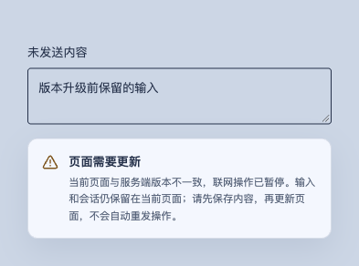

# 统一手动版本发布

## Context and Scope

本主题落实 Manual version release delivery，确保服务端、Go 客户端、TypeScript 客户端和 Web/PWA 以统一版本共同交付。它定义发布身份、门禁、完成与恢复边界；不授权生产发布、平台权限变更或旧执行能力删除。

## Terms and Interfaces

产品端与产品发布术语以 [术语表](../../../GLOSSARY.md) 为准。入口只接收一个人工 release target；恢复入口引用既有 identity，不重新选择版本。已确认的平台目标为服务端、Go 客户端与 TypeScript 客户端 Linux amd64；平台矩阵必须分别声明 Go 与 TypeScript 客户端，不以一个客户端的验证替代另一个；平台名称使用 canonical architecture 映射，linux/x64 与 linux/amd64 指向同一目标。

## Requirements

### REQ-MVR-001：统一产品发布单元

服务端（Server、Worker）、Go 客户端、TypeScript 客户端和 Web/PWA MUST 使用同一 canonical version 与最终 source SHA；组件即使没有代码变化也 MUST 纳入该次交付。Go 客户端现有源码使用 cmd/connector 与 internal/connector 路径；这些是实现标识，不构成独立名为 Connector 的产品端，也不表示应删除或迁移 Go 客户端。各产物保留独立 digest。

### REQ-MVR-002：单一人工 target 与可信 baseline

新发布 MUST 仅以 owner 提供的单一 release_target 接收 patch、minor、major 或完整 SemVer 正式版／预发布版本，由执行端 Version Policy 解析。正式 tag 映射为 vX.Y.Z。baseline MUST 来自全部必需产物已验证完成的可信正式发布记录；不得从 VERSION、PR label、合并顺序或运行编号推导。无合法 baseline 时 MUST 要求显式完整版本；不得默认 patch。正常新发布 MUST 遵守声明的单调性、预发布排序与冲突规则。

### REQ-MVR-003：持久身份与并发占用

不可逆发布副作用前 MUST 建立 durable reservation，绑定产品、canonical version、policy identity、source boundary、owner 与唯一 claim key；最终源码与产物固定后 MUST 绑定 merge SHA、各 digest 和 publication targets。原子条件更新 MUST 防止竞争占用；不同身份争抢相同版本 MUST 显式冲突。不得依靠短期 workflow artifact 或静默取消旧 run 保证唯一性。

版本是否可继续使用 MUST 根据实际变更是否超过原发版意图判断，不得仅因 main 前进而作废。版本尚未固定到 main，且未产生构建 claim 或发布产物时，MAY 在原 identity 内通过 owner 或获授权 agent 对实际 diff 的有证据核验，追加准备修订并继续同一版本；原 intent 和历史 MUST 保留，MUST NOT 静默换源码。意图外变更 MUST 拒绝接续并请求 owner 调整意图或版本。版本已固定到 main 时，MUST 仅绑定并发布该对应代码，即使 ledger 尚未写入 bound 或 main 后来已更换 VERSION。

### REQ-MVR-004：受保护源码与质量门禁

发布源码 MUST 经过受保护 PR、verified commit、适用 review 与 required checks，并验证 exact-head merge；工作流 MUST NOT 直接写 main。reservation、Release、Deploy 边界 MUST 重验权威源码、权限、policy、产物和目标身份；缺失证明 MUST fail closed。仓库质量声明与平台规则 MUST 对齐。MUST 识别项目现有的原生分支保护，不得把采用特定 Rulesets 或新增 App、私钥作为额外强制条件；发布自动化复用现有认证，版本准备仍经过普通 PR。

### REQ-MVR-005：不可变产物与共同完成

每种交付产物 MUST 在绑定的 release identity 下构建一次并固定 digest；所有必需产物构建、验证和冻结后才可对外宣布成功。GitHub Release 是统一下载入口，包含服务端交付包、Web、Go 客户端包、TypeScript 客户端包、校验和及统一 manifest；不新增 npm／GHCR 渠道。部分上传成功 MUST 保持整体未完成，tag 或 Release 页面存在不等于成功。

### REQ-MVR-006：原身份恢复与部署分离

发布、上传、部署、回执或通知失败后的恢复 MUST 复用原 canonical version、reservation、最终 source SHA 与已冻结 digest，仅补齐缺失步骤；不得重算下一版、重建替换既有产物、改写 tag 或更改 channel。Release 完成且可验证后 Deploy 才能继续；部署 MUST 消费对应冻结产物并独立记录结果。

### REQ-MVR-007：旧版本运行与安全升级

Go 客户端、TypeScript 客户端及缓存 Web MAY 暂时运行旧版本，但 MUST 准确报告自身构建版本。首批 MUST 保证同版本组合；跨版本组合仅在发布合同明确声明且验证兼容后 MAY 放行，未获证明的组合 MUST 拒绝连接并提示受控升级。TypeScript 客户端独立本地能力 MUST 不因联网版本不兼容而被禁用。统一发布不要求所有终端瞬时升级。更新 MUST 保留用户输入、会话与恢复能力，不得把旧程序伪报为新版本。

### REQ-MVR-008：客户端发布收敛与可审计失败

Go 客户端现有独立发布链 MUST 收敛到统一产品发布身份，保留其作为 Go 客户端的能力及交付产物；产品文档 MUST 正确区分 Go 客户端与 TypeScript 客户端。统一发版 MUST NOT 隐含任何客户端的删除、替换或能力迁移。发布记录 MUST 关联 policy、SHA、version、reservation、digest、run／attempt 与各阶段结果；失败通知 MUST 包含可定位身份与恢复入口，使用经项目确认的 transport，且不得泄露凭据与无关数据。

### REQ-MVR-009：必需平台

正式交付 MUST 包含服务端 Linux amd64、Go 客户端、TypeScript 客户端及 Web/PWA；客户端平台目标为 Linux amd64，验收矩阵 MUST 分别覆盖两种实现。TypeScript 客户端遵循 ADR 0021，仅支持 Bun 1.4.4 直接运行源码；包 MUST 包含源码、完整 Skills、依赖和 Bun FFI 所需资源，分别解包运行并验证版本及 SHA，不再要求 Node 22／24。所有必需平台 MUST 验证通过；编译成功不能替代运行与安装可用性验证。不得因某个平台失败而缩减该次产物清单或宣布整体成功。

### REQ-MVR-010：产物保留

正式发布产物、manifest、校验和 MUST 长期保留；未完成发布的冻结产物 MUST 保留至恢复完成或维护者显式终止。保留合同 MUST 不依赖 Actions artifact 的短期有效期。原产物丢失 MUST 阻断该身份恢复，不能通过重建冒充原产物。终止 MUST 留存可审计状态；版本未固定到 main 时 MAY 经明确意图核验恢复原身份使用原版本，不自动释放给不同意图；版本已固定到 main 时 MUST NOT 重新分配给不同代码。公开前 MUST 用原子更新持久化公开意图；此前允许取消，此后即使失败也只能恢复原身份完成，MUST NOT 再终止。

### REQ-MVR-011：GitHub Issue 失败通知

独立通知流程 MUST 使用 GitHub Issue，按 release identity 创建或更新故障记录，包含失败阶段、run 链接及恢复入口。流程 MUST 使用最小仓库权限、持久记录投递状态并在结果未知时先对账，避免盲目重复创建。通知失败 MUST 独立记录，不更改发布或部署事实；本合同不授权本次需求整理实际创建 Issue。

## Verification

### VER-MVR-001

- covers: `REQ-MVR-001`
- Method: 合同检查与故障场景验证。
- Pass condition: 检查全部产物版本、SHA 与 manifest；缺失组件或版本不一致 MUST 阻断完成。

### VER-MVR-002

- covers: `REQ-MVR-002`
- Method: 合同检查与故障场景验证。
- Pass condition: 覆盖 symbolic／explicit 解析、非法输入、无 baseline、前进排序及 collision；同一输入与 baseline 得到确定结果。

### VER-MVR-003

- covers: `REQ-MVR-003`
- Method: 合同检查与故障场景验证。
- Pass condition: 并发抢占、进程中断和重复 dispatch 后，唯一 claim 与绑定保持可验证；冲突不得创建 successor。

### VER-MVR-004

- covers: `REQ-MVR-004`
- Method: 合同检查与故障场景验证。
- Pass condition: 以过期 head、未验证提交、失败或缺失门禁、错误目标、权限缺失构造负例，全部拒绝发布。

### VER-MVR-005

- covers: `REQ-MVR-005`
- Method: 合同检查与故障场景验证。
- Pass condition: 缺一个产物、上传中断或 digest 错误均不得完成；完整下载并校验版本、SHA、来源与 digest 后才可完成。

### VER-MVR-006

- covers: `REQ-MVR-006`
- Method: 合同检查与故障场景验证。
- Pass condition: 覆盖上传部分成功、部署失败与重跑；恢复前后 identity 和 digest 相等，部署失败不回写为 Release 未发布或自动升版。

### VER-MVR-007

- covers: `REQ-MVR-007`
- Method: 合同检查与故障场景验证。
- Pass condition: 旧客户端、缓存页面与新服务端组合可识别真实版本；未声明或未验证的跨版本组合被拒绝并提示升级；已声明兼容组合有对应验证；TypeScript 本地能力可用，升级后可恢复原上下文。

### VER-MVR-008

- covers: `REQ-MVR-008`
- Method: 合同检查与故障场景验证。
- Pass condition: 检查 Go 与 TypeScript 两种客户端均出现在产物清单且共享版本和 source SHA，独立入口不能绕过统一身份；核对失败记录完整性及通知脱敏，不得以通知成功代替发布或部署成功。

### VER-MVR-009

- covers: `REQ-MVR-009`
- Method: 平台矩阵与真实包安装／运行验证。
- Pass condition: 三个必需目标及 Web 验证齐全；任一目标缺失或不可用均拒绝整体完成。

### VER-MVR-010

- covers: `REQ-MVR-010`
- Method: 保留配置检查、Actions artifact 过期与冻结产物缺失故障验证。
- Pass condition: Actions artifact 过期不影响长期产物可获取性；原产物缺失时恢复明确失败，显式终止留下审计且不重新分配原版本。

### VER-MVR-011

- covers: `REQ-MVR-011`
- Method: 故障通知模拟及结果未知／权限不足场景验证。
- Pass condition: 同一身份更新可关联故障记录，未知结果先对账；通知失败不覆盖发布结果，内容无凭据或无关数据。

## Related ADRs

- [不可变候选与蓝绿](../../adr/0002-immutable-candidates-and-blue-green.md)
- [现有认证与平台签名](../../adr/0023-native-release-authentication.md)
- [主干版本绑定前的发版意图核验](../../adr/0024-release-intent-before-main-binding.md)

## References

- [实现状态](IMPLEMENTATION.md)
- [合同历史](HISTORY.md)
- [决策说明](DECISIONS.md)

## Visual Evidence

- source_type: storybook_canvas
- target_program: mock-only
- capture_scope: element
- requested_viewport: 393x852
- viewport_strategy: storybook-viewport
- margin_policy: require_margin
- evidence_surface: component
- surface_selector: `[data-visual-evidence-surface]`
- target_selector: `[data-visual-evidence-target]`
- sensitive_exclusion: N/A
- story_id_or_title: PWA/PwaStatusBanner/ProductVersionMismatch
- state: 版本不兼容，保留未提交输入
- submission_gate: approved
- evidence_note: 展示联网操作暂停及受控升级提示；输入保留，不自动刷新或重发。Owner 已确认该 mock 截图并授权纳入当前 PR。
