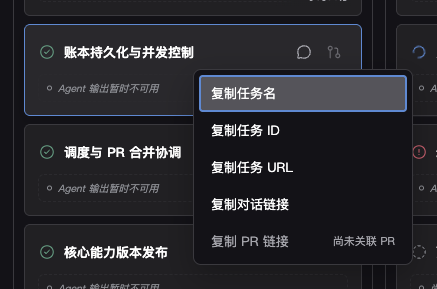

# Multi-task Flow 任务上下文菜单与直达链接

## Context and Scope

为任务提供一致的复制入口和可分享的页面直达链接。范围覆盖依赖图任务节点、任务卡片、理论安排和实际进度的任务行（名称、时间条与行内空白）；不包含交付单元和非任务里程碑。

## Terms and Interfaces

任务名是完整任务标题，不附加节点标签中的 ID 前缀；任务 ID 是账本中的原始稳定标识。任务 URL 是当前运行的最新视图入口，定位指定任务并打开详情，不携带凭据、历史计划、筛选或缩放状态。

## Requirements

### REQ-TASK-LINK-001

系统 MUST 在范围内的任务区域右键提供复制任务名、任务 ID、任务 URL、对话链接、PR 链接五项操作，复制纯文本。对话链接使用 `codex://threads/<thread-id>`；PR 使用完整网页 URL，多 PR 展开子菜单供选择；缺少对话或 PR 时置灰并解释原因。

### REQ-TASK-LINK-002

右键 MUST 不改变任务选择或触发跳转，保留既有左键行为；复制成功和失败 MUST 明确反馈。菜单 MUST 可关闭、支持键盘操作且不溢出视口。

### REQ-TASK-LINK-003

打开任务 URL MUST 获取运行最新状态，解除遮挡目标的筛选，定位并聚焦任务且打开任务详情。不存在的运行或任务 MUST 明确提示，不自动选择其他任务。

### REQ-TASK-LINK-004

任务 URL MUST 不携带凭据。未登录时 MUST 保留目标，完成既有登录流程后恢复定位；不得为任务链接绕过服务认证。

## Verification

### VER-TASK-LINK-001

- covers: `REQ-TASK-LINK-001`, `REQ-TASK-LINK-002`
- Method: DOM 交互测试与受控 demo 验证。
- Pass condition: 四类入口对应正确任务，复制值正确；多 PR、缺失资源、复制拒绝和键盘退出行为符合合同。

### VER-TASK-LINK-002

- covers: `REQ-TASK-LINK-003`, `REQ-TASK-LINK-004`
- Method: URL 恢复测试、认证恢复测试与受控 demo 验证。
- Pass condition: URL 只包含任务选择和详情状态，最新视图正确定位，目标丢失明确提示，登录后恢复安全的站内目标。

## Related ADRs

None

## Visual Evidence

主人已确认的任务卡片上下文菜单：

