# Multi-task Flow Agent 角色与交互设计

本文描述主 Agent（main Agent）、交付 Agent（Delivery Agent）和任务 Agent（Task Agent）的职责、身份边界，以及它们与 CLI、Codex、外部平台和账本之间的交互时序。本文是统一原子编排主题的交互设计配套文档，不新增角色、状态或命令；长期需求与验收见 [SPEC.md](./SPEC.md)，对象关系见 [DATA_MODEL.md](./DATA_MODEL.md)，状态与恢复规则见 [STATE_MACHINES.md](./STATE_MACHINES.md)，命令接口见 [CLI_CONTRACT.md](./CLI_CONTRACT.md)。实现映射、mock 测试覆盖和已知设计偏差统一记录于 [IMPLEMENTATION.md](./IMPLEMENTATION.md#agent-角色交互的实现与验证)。

## 角色边界

| 角色 | CLI actor | 身份绑定 | 主要责任 | 写入边界 |
| - | - | - | - | - |
| 主 Agent（main Agent） | `role: "main"` | `control.owner_thread_id` | 归纳计划、批准运行、维护全局依赖图、选择交付拓扑、派发和对账、处理跨单元异常、最终收口 | 全局计划、交付单元调度、通知意图/发送 attempt/receipt 对账和受保护操作；不能伪造其他 Agent 的任务事实 |
| 交付 Agent（Delivery Agent） | `role: "group"` | `groups[].agent_thread_id` | 管理一个 regular DeliveryUnit 的父分支、集成 PR、集成验收、发布/部署/验证义务和 closeout | 仅所属 DeliveryUnit 生命周期、交付单元原子、父 PR/合并事实和自身协调状态 |
| 任务 Agent（Task Agent） | `role: "task"` | `tasks[].thread_id` | 读取自身任务上下文，推进原子、工作区、任务分支、child PR、rebase、合并和 closeout | 仅自身 Task、原子、任务 PR 和证据；不能创建或派发其他任务，不能修改依赖图或交付单元所有权 |

Bootstrap DeliveryUnit 是唯一由主 Agent 持有的交付单元：其 `owner_kind` 为 `main`，不绑定独立交付对话。regular DeliveryUnit 必须先绑定交付 Agent；恰有一个 contribution Task 时使用 shared-delivery 拓扑，多个 contribution Task 时使用 multi-task integration 拓扑。verification、release 和 deployment Task 不参与 contribution 数量判断。

## CLI 与 Codex 对话边界

正式调用使用固定版本的 `bunx --bun @loomhelm/multi-task-flow@<exact-version> flow <command> --input -`。每次写操作都携带 `run_id`、`actor`、唯一 `request_id` 和 `expected_revision`；revision 冲突必须先读取账本，不能盲目重试。`show`/`view` 是只读入口，`show` 的 `task-context` 只向绑定的任务 Agent 投影自身任务、依赖、原子、验收、工作区和阻塞事实。

对话创建只有一条路径：先由主 Agent 使用 `dispatch-group-claim` 或 `dispatch-claim` 领取账本 operation，再调用 `conversation-create`。该命令通过 `codex exec --worktree --json` 创建独立工作区，核对真实 thread、初始化 turn、model/thinking、工作区归属、初始 HEAD 和清洁状态；完成后才绑定对话。超时、断线、证据不完整或已观察到 thread 时保持 `unknown`，只能进入 `creation-reconcile`，不能再次创建。

初始化 prompt 只建立角色待命状态。正式 handoff 通过账本 notification 产生；主 Agent 领取唯一发送 attempt，使用允许的原生消息工具投递，再以 provider receipt 对账。`sent` 只表示平台接受，`acknowledged` 必须由收件 Agent 产生；通知确认不等于派发批准。

## 完整工作流

### Proposal、init 与批准

主 Agent 在 proposal 阶段先建立 canonical AtomicNode/AtomicEdge、TaskScope、DeliveryUnitScope、原子前驱和验收条件。`init` 只接受尚未绑定且处于 `planned` 的交付单元和任务，不创建对话。计划批准后，`execution_plan_id` 才支配调度；dispatch claim、starting 和对话创建都不能单独把运行推进到 `implementation`，真正的阶段转换来自首个 `task_started` 事实。

### 交付单元准备与派发

主 Agent 按需求结果归纳 `delivery_unit_id`，不能从 PR 数量、Agent 数量或文件重叠推断边界。交付 Agent 负责 regular 单元的父分支、父 PR、集成基线和 closeout；Task Agent 路径在 starting 前通常必须等待已发布且可核验的父 PR。唯一例外是 active、workspace-ready、main-owned 的 bootstrap 单元允许其 main-owned contribution Task 在父 PR definitively absent 时启动；发布中、结果 unknown 或已有非空父 PR 时仍阻塞。

### Shared-delivery 拓扑

一个 DeliveryUnit 恰有一个 contribution Task 时，交付单元对话、工作区、分支和 PR 同时服务 DeliveryUnit 与 Task。交付 Agent 负责交付单元边界，任务事实仍通过 TaskScope 和原子图表达；不会额外创建 child PR。任务完成、父 PR 合并和 DeliveryUnit closeout 仍是不同的事实和门禁。

### Multi-task integration 拓扑

一个 DeliveryUnit 有多个 contribution Task 时，交付 Agent 拥有父分支和集成 PR，每个 Task Agent 拥有独立对话、工作区、分支和 child PR。Task Agent 先通过 `task-context` 读取自身边界，再按原子顺序推进 `prepare-branch → create-pr → merge-pr → closeout`。child PR 合并事实可以使后继任务 ready，但不等于当前任务已经完成；当前 Task 仍须完成 closeout。交付 Agent 在所有 child PR 和集成验收满足后推进父 PR 合并及单元级 post-merge 工作。

### 状态、通知与恢复

AtomicNode/AtomicEdge 是唯一编排事实。Task 和 DeliveryUnit 状态是从原子、里程碑、外部 PR/CI/release/deployment/verification facts 推导的读取投影；Agent idle、连接状态、最新输出和观察器断开属于 runtime observation，不能覆盖业务状态。

任务首次进入 `ready` 时账本生成可派发 notification；主 Agent 确认通知意图、发送 attempt 和 provider receipt，并重新评估依赖后才能调用 `dispatch-claim`；收件方（包括作为 owner 的 main Agent）通过自身绑定的对话产生 `notification-ack`。`waiting`、`blocked` 和 DeliveryUnit coordination state 表达依赖与门禁，不创建新的 coordination Task。创建、通知、发布、合并和部署出现 unknown 时保留 operation、claim、容量和原生身份，先 reconcile；不能用错误消息推断副作用未发生。

### Release、deployment、verification 与 closeout

release、deployment 和 verification 是显式原子，不能从 contribution Task 隐式推断。DeliveryUnit 合并能力必须由有效 merge receipt、`merge_sha`、PR identity 和未失效事实共同证明；provider PR 的 `closed` 或 DeliveryUnit 的 `closed` 单独不能满足 `requires: merged`。closeout reconciliation 只追加审计事件：证据仍有效则保持 `closed`，证据否定则转为 `blocked`，证据不足则保持原业务状态并阻塞后续门禁。

## 工作流时序图

以下时序图按 canonical 合同描述应有的交互顺序；CLI 是命令入口，Runtime / Ledger 是授权、原子图、operation、事实和事件的持久边界，Codex 与 Git/CI/发布平台是外部证据来源。Agent 之间的消息只交接身份、读取入口或异常，不能替代账本提交。箭头上标出的命令名是实际命令；“核验”“执行”“读取”等文字是 Agent 或 provider 的动作，不代表新增 CLI 命令。

图中的 `Task completed` 是 canonical 投影；旧 `Task.state = closed` 是兼容账本收口事实，两者不能混用。时序图描述设计要求，实际实现与验证覆盖见 [IMPLEMENTATION.md](./IMPLEMENTATION.md#agent-角色交互的实现与验证)。图中的“单元负责人”在 bootstrap 中是 main Agent，在 regular 中是绑定的 Delivery Agent。

| 图 | 工作流 | 关键责任与门禁 |
| - | - | - |
| S1 | proposal、init、批准 | 主 Agent 建模，主人批准，execution plan 才约束调度 |
| S2 | regular Delivery Agent 创建与父 PR 准备 | 主 Agent 创建，Delivery Agent 确认 handoff 并准备集成边界 |
| S3 | bootstrap main-owned 完成流 | 不创建 Delivery Agent，只有明确 bootstrap 例外可无父 PR 开工 |
| S4 | regular shared-delivery 完成流 | 一个 contribution 复用 Delivery 对话、工作区、分支和唯一 PR |
| S5 | multi-task integration 完成流 | Task Agent 独立交付 child PR，Delivery Agent 集成父 PR |
| S6 | native creation unknown 与 reconcile | 保留 claim 和身份，只对账同一次创建 |
| S7 | 通知发送、确认、重放与失败 | provider 接受与收件 Agent 确认分离 |
| S8 | 开工基线、原子执行与父分支推进 | 资源由主 Agent 注册，实际 owner 同步证据后执行 |
| S9 | 父 PR 合并、release、deployment、verification | 外部动作受批准及当前 SHA 证据约束 |
| S10 | Task、DeliveryUnit 与 Run 收口 | 合并、任务完成、单元关闭、运行完成分开记录 |
| S11 | closeout 对账与受保护恢复 | unknown 冻结后续门禁，invalid 才进入 blocked 恢复 |
| S12 | plan revision、task migration 与 cut | 保留旧事实，高影响修订批准前 hold 受影响范围 |
| S13 | actor、revision、request 幂等拒绝 | 校验失败不执行外部副作用，不推进业务状态 |

### S1：Proposal、init 与批准

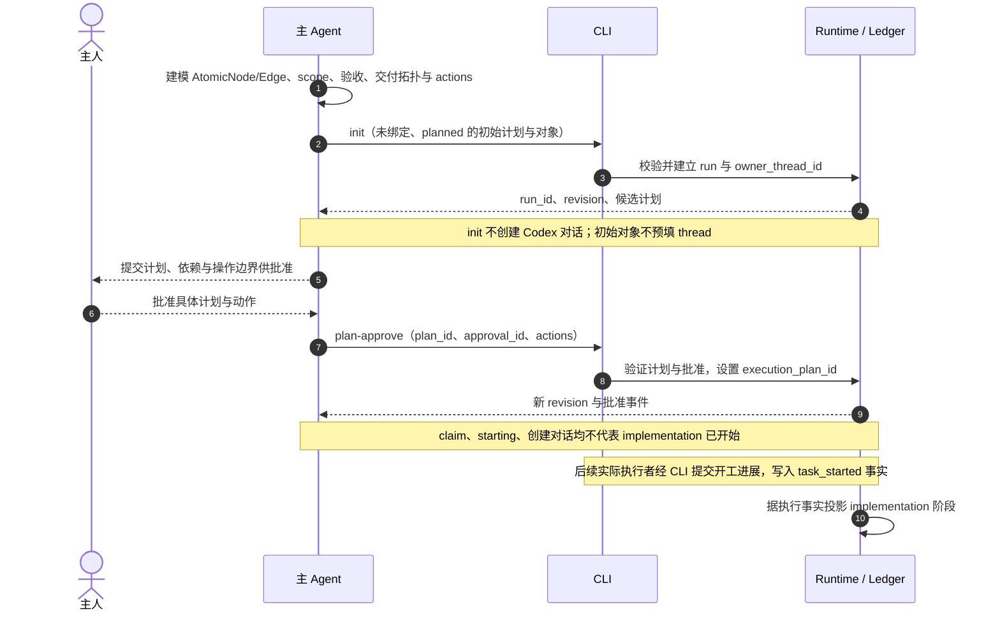

`plan-propose` 用于提交新的 canonical candidate，提案后内容不可原地改写；已有运行的修订见 S12。主人批准由主 Agent 通过 CLI 记账，不要求主人亲自调用 CLI。

### S2：Regular Delivery Agent 创建与父 PR 准备

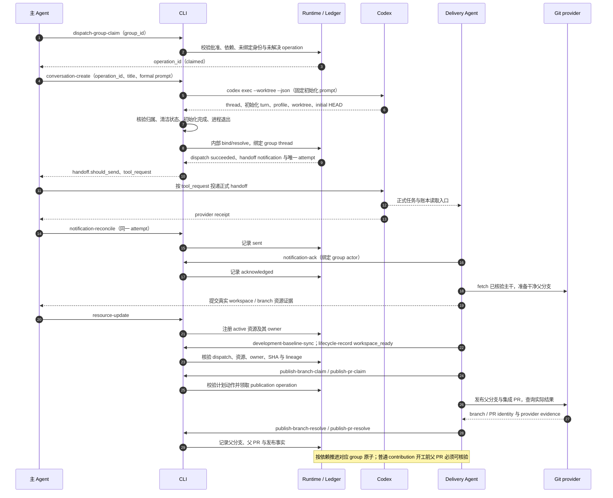

图中 publication 分别执行各自 claim、外部动作和 resolve，不能把两次外部副作用合成一个未对账操作。创建中断转 S6；正式通知的失败、重放和先后关系见 S7。

### S3：Bootstrap main-owned 完成流

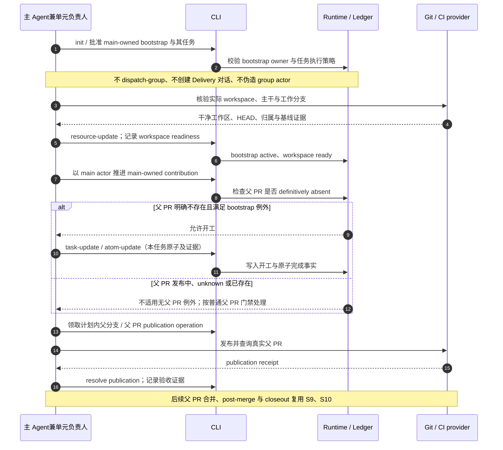

此图只展示明确批准的 main-owned bootstrap 路径，不把 regular 单元或任意任务转换为 main-owned。`group-update` 不能用来绕过 ownership、workspace 或恢复边界。该例外不是“所有 bootstrap 任务都可以忽略父 PR”。

### S4：Regular shared-delivery 完成流

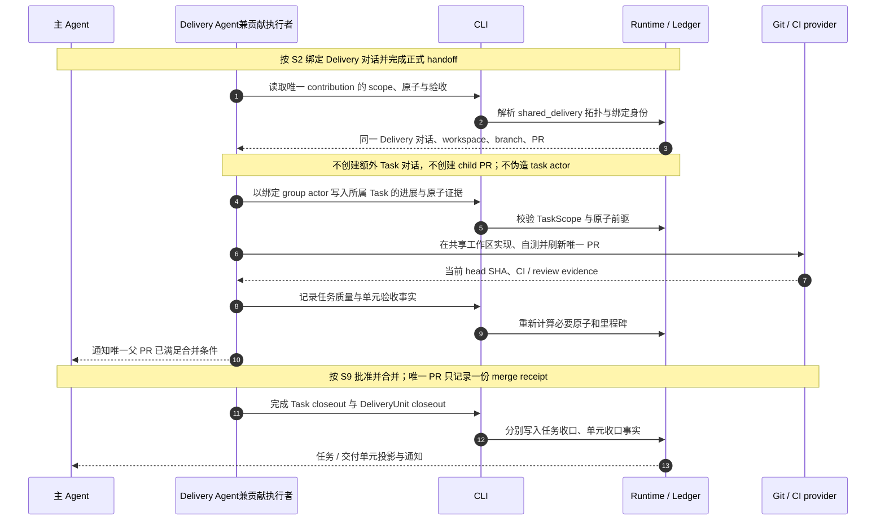

同一物理对话承担两层责任，不等于两种 scope 可以混写：Task 原子和 DeliveryUnit 预设原子仍分别有自己的 ID、依赖和结果。release、deployment、verification Task 是否另有执行者由已批准计划决定，不因 contribution 数量为一而被省略。

### S5：Multi-task integration 完成流

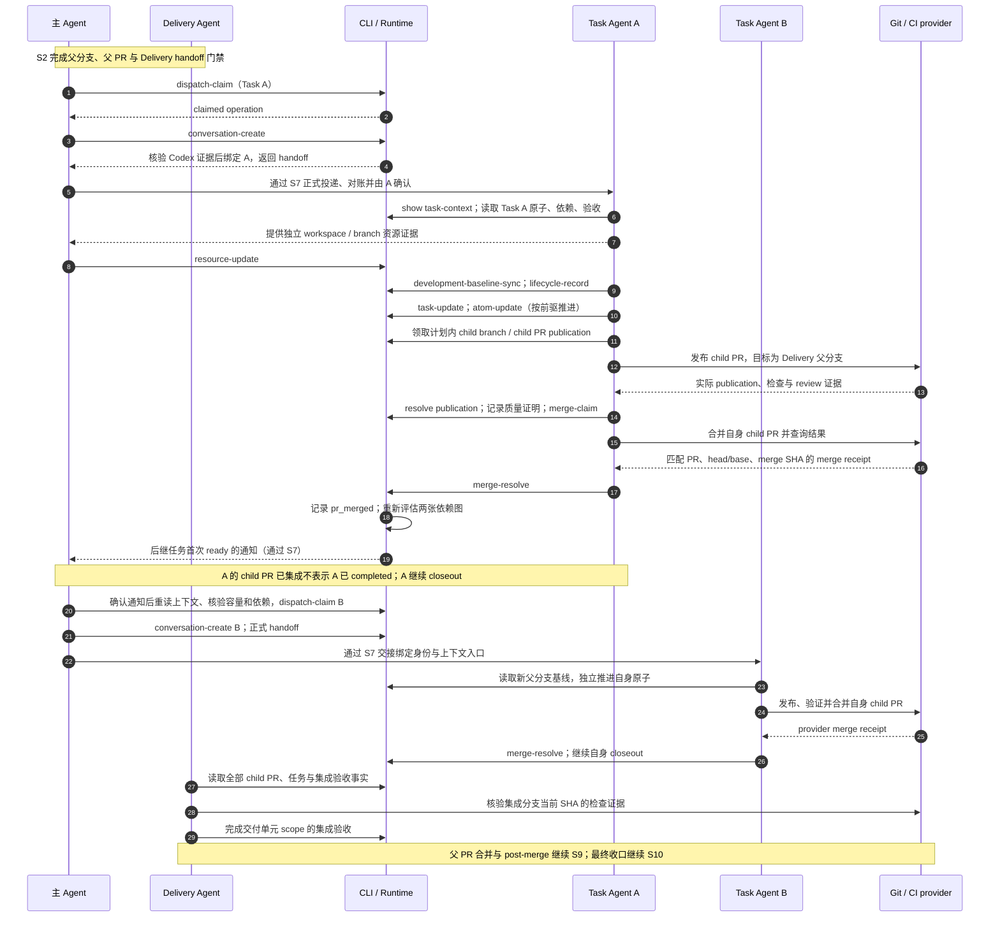

A → B 只表示计划明确声明的依赖；无依赖任务可在容量允许时并行。消息、任务列表顺序和文件重叠都不产生依赖边。child PR 合并由实现批准覆盖，父 PR 合并另需单元级 protected approval。

### S6：Native creation unknown 与 reconcile

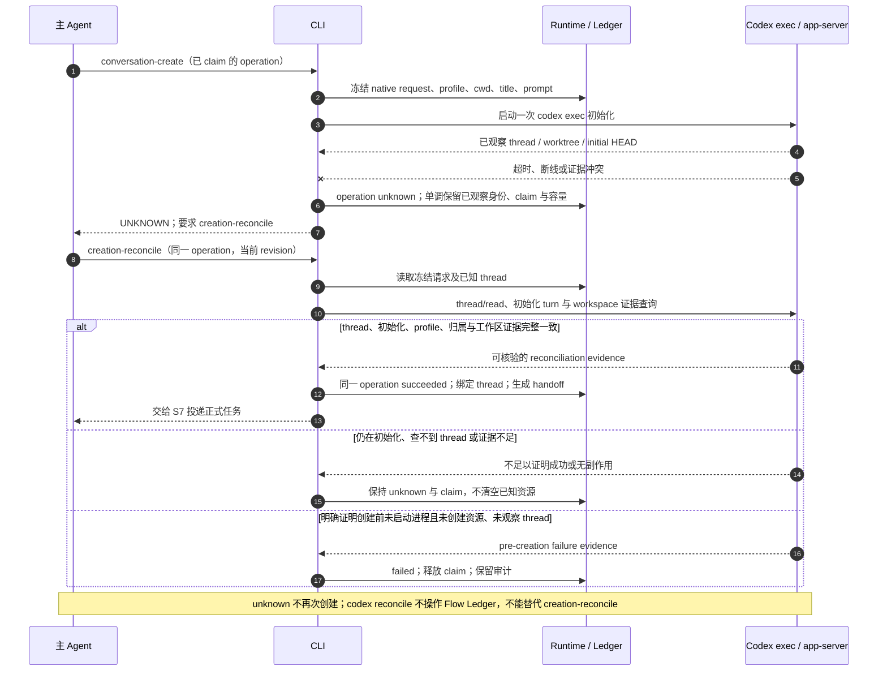

### S7：通知发送、确认、重放与失败

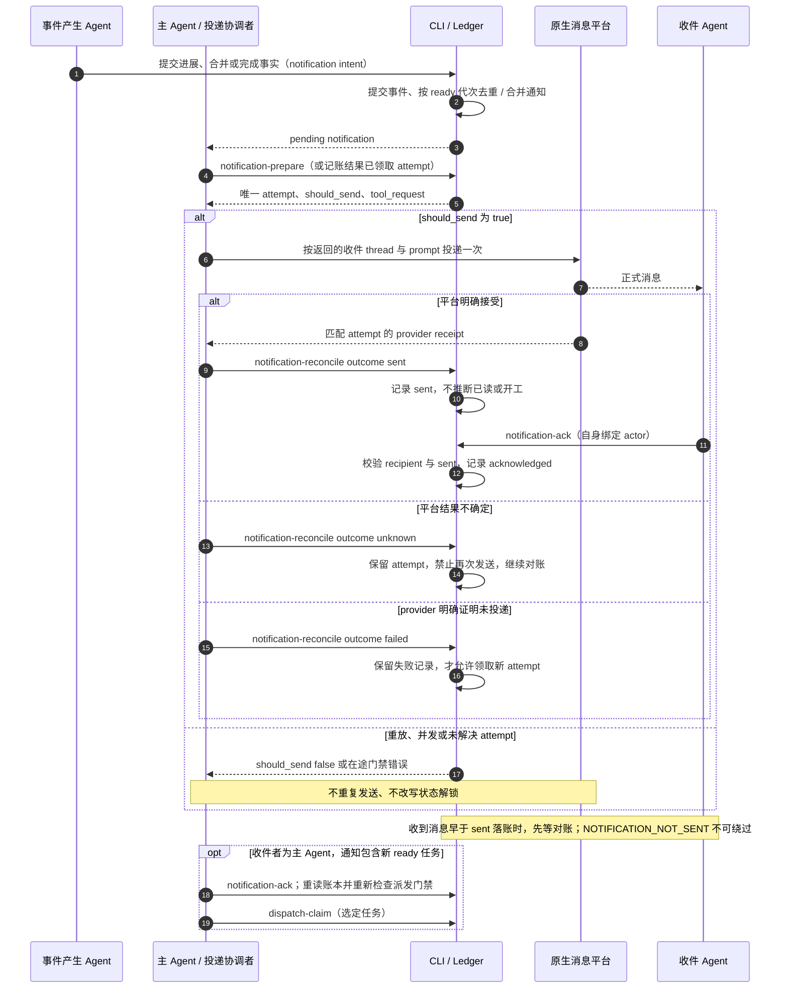

收件者既可能是 Delivery/Task Agent（formal handoff），也可能是 main Agent（进展、后继 ready、完成或升级）。main 只有在自身就是 recipient 时才能 ack。事件产生者负责提交账本事实和通知意图，投递协调者使用返回的 `tool_request` 完成发送及 provider 对账，收件者确认处理。持久交接边界是 intent → attempt → provider receipt → recipient ack，发送本身不改变业务状态，也不授予 Task Agent 任意跨线程发送权限。

### S8：开发基线、原子执行与父分支推进

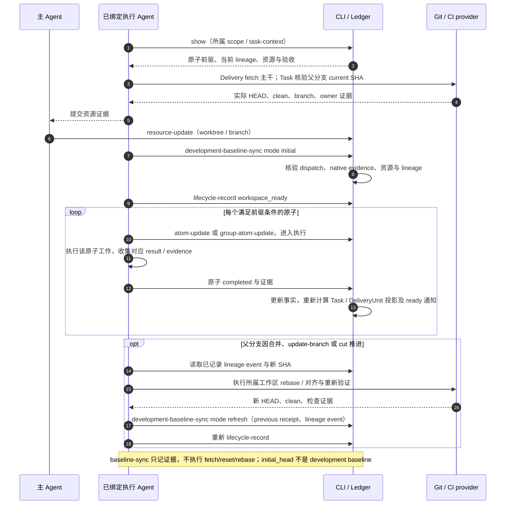

运行观察不参与以上状态推导：Agent idle、断线或最后输出不能把 Task 标成完成，也不能撤销已记录的 merge receipt。普通阻塞由负责 Agent 记账并留在原任务内处理；确认外部问题需改变任务或依赖时，提交证据给 main，按 S12 修订。

### S9：父 PR 合并、release、deployment 与 verification

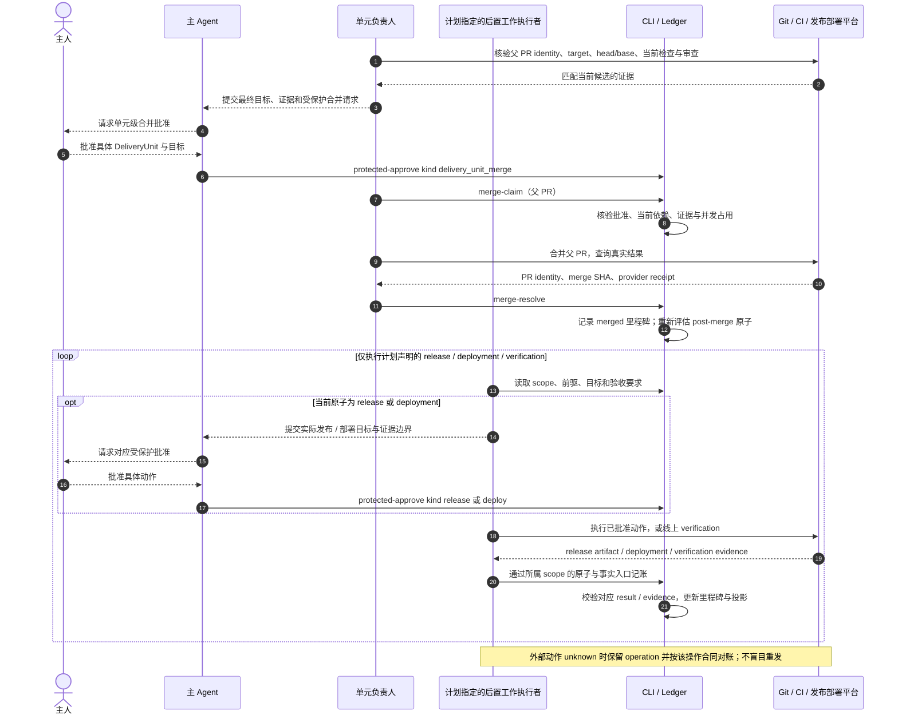

release、deployment、verification 只按已批准计划的原子和 scope 执行，不要求无条件全部存在，也不从贡献任务推断新任务、版本或发布安排。TaskScope 工作由相应 Task owner 执行，DeliveryUnitScope 工作由单元负责人执行。release/deploy 的批准不替代仓库发布 policy；provider PR 单纯 `closed`、消息“已合并”或旧 SHA 上的 CI 不能替代合并回执。

### S10：Task、DeliveryUnit 与 Run 的收口

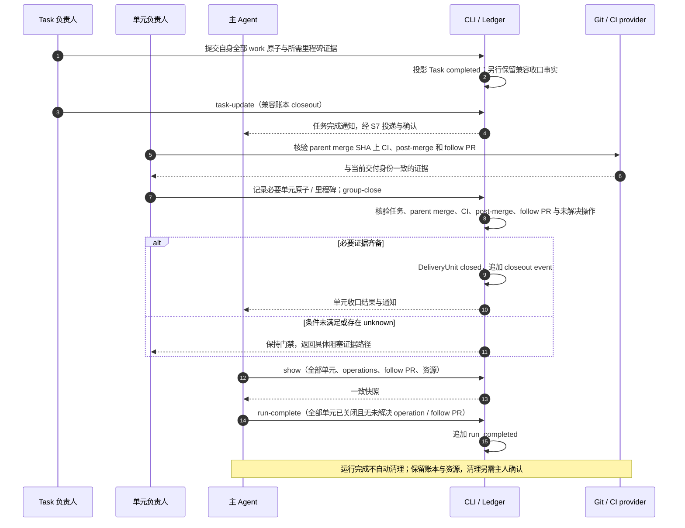

Task 的成功投影为 `completed`，旧 Task `closed` 可以表示其他管理性终止，不是证明成功的单独依据。

### S11：Closeout 对账与受保护恢复

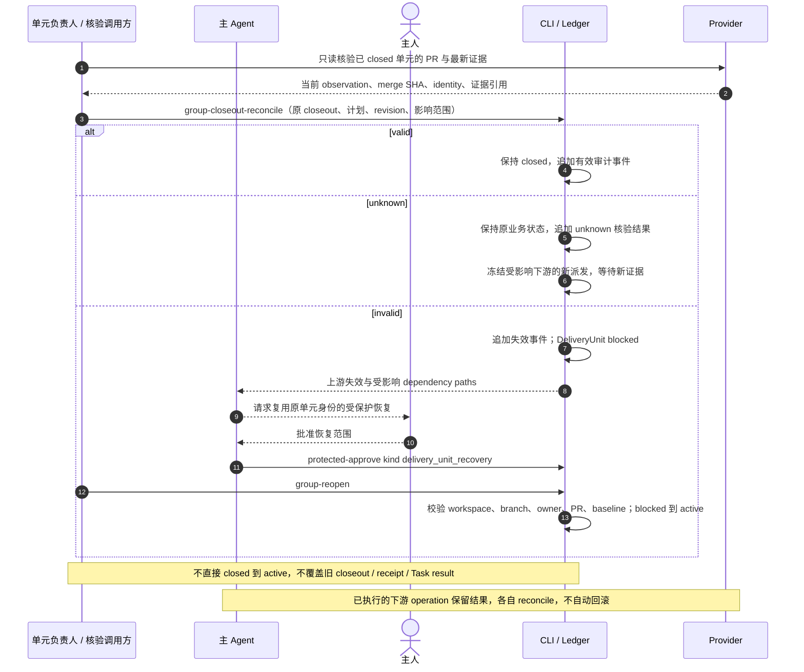

新增需求使用 S12 的 successor DeliveryUnit，不能借 `group-reopen` 改写原责任边界。

### S12：Plan revision、task migration 与动态 cut

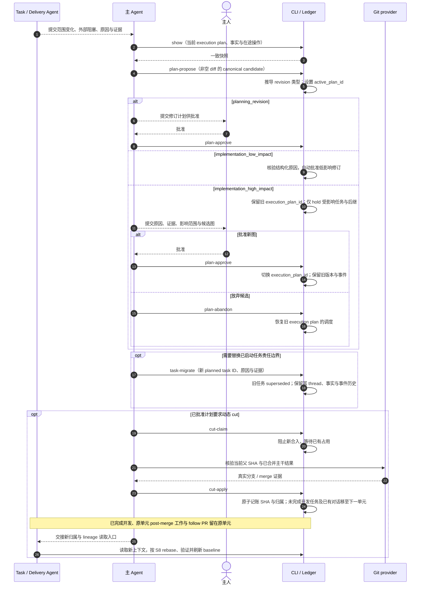

图中的 migration 与 cut 是经批准变更的条件分支，不是每次 plan revision 的自动副作用。closed 单元的新需求必须创建 successor DeliveryUnit；不修改原 closeout 历史。Task Agent 可以上报，但不能自行修订全局图、迁移其他任务或创建任务对话。

### S13：Actor、revision 与 request 幂等边界

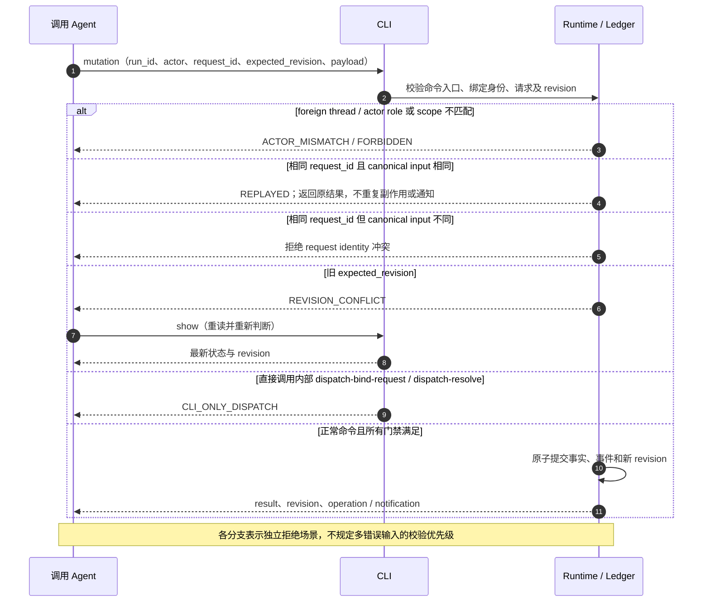

## 交互不变量

- 每个 Agent 只能使用与其绑定的 `thread_id` 和账本 actor role；复制 ID 不能产生第二个控制器。
- 主 Agent 是全局调度者，交付 Agent 是单一 DeliveryUnit 的所有者，任务 Agent 是单一 Task 的所有者；所有权不能通过普通更新或计划顺序改写。
- CLI 写入必须带 revision fence；相同 request 只能以相同 canonical input 幂等重放。
- 原生创建必须经过 `dispatch-claim → conversation-create → native evidence reconcile → formal handoff`；绕过路径是编排违规，不能静默接管结果。
- Task 完成、child PR 集成、DeliveryUnit 父 PR 合并、release/deployment/verification 和 closeout 是不同状态边界，不能互相替代。

## 参考

- [Task Agent ledger-driven progression](../../adr/0035-task-agent-ledger-driven-progression-and-dispatch-notifications.md)
- [Task execution and delivery boundaries](../../adr/0027-multi-task-flow-task-execution-and-delivery-boundaries.md)
- [Task Agent child PR ownership](../../adr/0025-task-agent-owned-child-pr-delivery.md)
