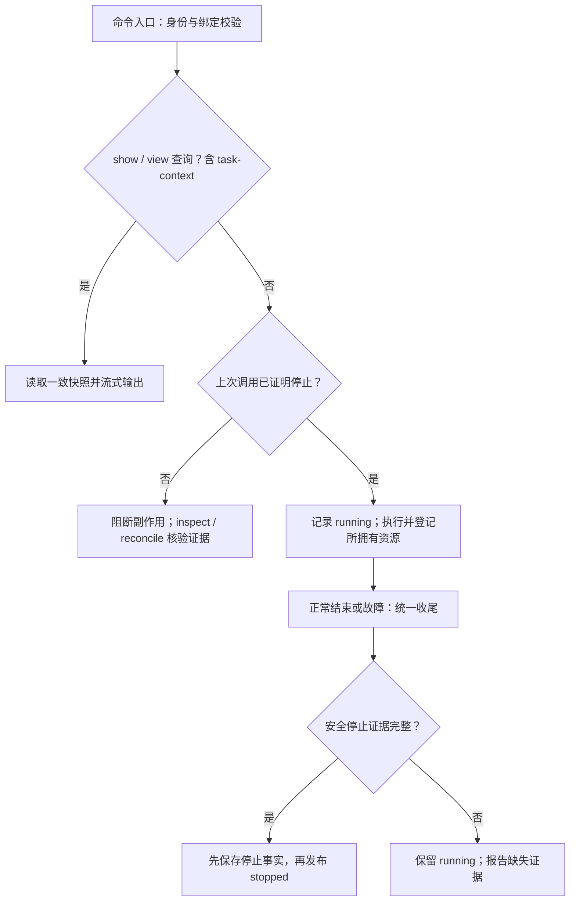

# 编排输出与调用停止对账

## 文档边界

本文是统一原子编排主题的配套设计，展开 [SPEC.md](SPEC.md) 中 REQ-INVOCATION-001 至 REQ-INVOCATION-006 的输出传输、查询隔离、停止与恢复合同。正常结果默认不限制累计输出字节，通过背压控制传输缓冲；未证实停止时允许严格限定的本地只读查询；副作用调用继续阻断，历史残留通过专用入口核验恢复。实现应复用现有模块，避免不必要的状态、锁和恢复分支。

具体实现覆盖和复现证据见 [IMPLEMENTATION.md](IMPLEMENTATION.md#编排输出与调用停止对账)，兼容背景见 [HISTORY.md](HISTORY.md#编排输出与调用停止对账)。本文不改变原子图业务模型、原生初始化恢复权限事务或前向升级合同，不包含实施步骤、发布操作或正式运行恢复授权。

## 行为边界

- 采用大输出预防、调用停止协议和受审计 invocation reconciliation 的组合。不得仅提高上限后宣称生命周期缺陷或历史阻塞已解决。
- 区分正常结构化结果、诊断日志、传输缓冲与账本容量。资源限制需要说明保护对象和实际资源影响，不用一个偏小的总字节上限同时约束所有对象。完整 JSON 不得静默截断或以部分结果冒充成功。
- 输出超限、下游关闭、超时和取消必须进入明确的停止协议。直接子进程 close、PID 消失、生命周期文件锁已释放或业务 operation 已结束，均不能单独证明所有原生副作用调用已停止。
- 只读行为由维护者审核的命令实现及能力边界确定，不能相信调用方自报 read_only。名称包含 reconcile 不代表没有写入或原生配置副作用。
- invocation journal 追加保存开始、停止请求、原生调用观察、安全停止证明和恢复对账；call.json 仅作当前状态投影。保留原始 running 事实，禁止删除或覆盖旧证据冒充正常退出。
- 安全停止必须覆盖该 invocation 拥有的子进程、原生 transport 和已登记在途调用；正常 finally 退出也需要验证这一条件，不能仅因 action 返回就宣布安全。业务执行结果、输出交付结果与调用静止是三个独立判据。
- CLI 返回后执行的桌面 tool_request 有独立 delivery attempt 和 provider receipt。CLI 的停止证明不能覆盖它，也不能把平台接受投递当作接收方工作已停止。
- 恢复保持 owner、operation、claim、容量和已有外部事实；不重复发送消息、重建对话、释放 claim、降级或改写权限来消除阻塞。

## 输出传输

Flow 正常结果使用有背压的流式传输，不设置默认累计输出字节上限；限制传输层在途缓冲，不继续将完整结果复制到父进程内存。消费者读取慢时暂停上游读取，恢复消费后继续。该选择不承诺无限账本容量，也不改变已有存储格式的容量边界。通用执行器原有捕获型调用保持独立语义，不能全局无差别取消保护。具体缓冲阈值由实现和背压测试确定，不能将 high-water mark 宣称为进程总内存硬上限。

不采用默认 64 MiB 或 256 MiB 的替代方案：合法结果增长后仍会撞到容量线，且无法解决父进程重复缓存完整结果的问题。现有 maxOutputBytes 不得继续作为 Flow 正常结果的隐式上限；配置文档必须明确它对捕获型调用的适用范围，不能静默改变用户显式配置的含义。若保留用户主动设置的输出预算，触发后必须走统一停止路径。

stdout 保持现有结果格式，诊断信息写 stderr；停止请求和停止证明走独立控制通道。连接中断可能留下不完整的已发送字节，此时必须报告交付失败，不能宣称得到完整 JSON。输出交付失败不等于业务失败，禁止因此自动重做业务操作。stderr 的转发同样遵守背压；如需捕获错误摘要，只保留有明确预算的尾部摘要，不累计缓存所有日志。

## 故障时的只读访问

将纯本地 show/view 及其中的 task-context 查询与具有副作用能力的调用分离。只读路径仍核验精确版本、绑定、actor、目录身份和一致快照，不创建或覆盖 invocation 标记；遇到未证实停止的调用时返回明确 quiescence 提示，不得把可读快照当作调度许可。输出不夹入破坏 JSON 合同的提示文本。该路径不得隐含续租、归档、通知、原生调用、迁移或业务写入，升级未完成或绑定不一致仍拒绝。

只读命令明确为 show、view（含 task-context）；task-context 是查询视图，不是独立命令。程序按命令及查询视图选择只读路径，复用同一个权限与快照读取入口；不新增调用方可控制的 read_only 开关。其他命令继续通过副作用门禁。取得一致快照后释放读取所需的排斥，再向消费者输出，避免慢消费者长时间阻塞维护。当前命令尾部的 renewViewerUsage 必须从纯查询路径移出。只读时不等待残留 invocation 的生命周期锁，具体一致性使用已有存储读取合同。

不采用“所有普通查询都阻断，仅另设诊断查询”的替代方案，以免故障期间无法读取任务上下文，也避免维护两套相近的查询实现。

## 模块职责与复杂度约束

| 模块 | 单一职责 | 实现边界 |
| - | - | - |
| TypeScript CLI 的 Flow 进程适配层 | 转发输出、传递停止请求、报告进程与交付结果 | 与现有捕获型 runProcess 分开使用；不判定远端业务是否停止，不解析业务 JSON 来决定成功 |
| 编排命令入口与查询路径 | 固定区分纯查询和副作用命令，取得结果快照 | 复用现有查询与权限校验；移出隐式续租，不复制一套查询引擎 |
| orchestration-lifecycle | 登记调用、统一收尾、保存停止证明与当前状态 | 正常返回、异常、取消、超时共用一个收尾函数；仅登记本调用实际拥有的资源 |
| invocation inspect/reconcile | 读取缺失证据，核验后登记历史停止结果 | 复用生命周期核验、现有锁顺序和原子写入；不执行原业务动作，不建立后台恢复服务 |

持久化的调用状态仍只有 running 和 stopped。running 表示尚未证明安全停止，既可能正在执行，也可能已经退出但证据不足；inspect 解释原因，不再增加 orphaned、recovering、partially-stopped 等可写状态。业务结果、输出交付结果和停止证据分别记录，不枚举它们的所有组合状态。

调用 journal 是停止事实的唯一依据，call.json 是可重建的兼容投影；二者不允许成为相互竞争的事实源。journal 只记录开始、停止请求、必要资源证据和最终停止结果，不建设通用事件平台。已有 operation、delivery attempt 和 provider receipt 通过身份引用，避免复制成第二套业务账本。已有原生调用适配器只补充登记和关闭能力，不重写 provider 协议或新增全局进程扫描器。

正常退出与恢复对账共用安全停止核验和 stopped 发布函数。历史旧 marker 的证据导入只在专用恢复入口处理，不把历史格式分支散布到普通命令。复用已有锁，不为每类证据增加新锁；持锁期间不等待人工补证，不执行新的原生副作用。每项新增机制必须对应本文的失败场景或验收条件，否则不纳入本次实现。

## 停止与恢复协议

开始记录至少绑定 invocation_id、command、canonical input digest、actor、run/binding identity、source package/version/build/source SHA、起始 revision、进程实例身份和时间；原生调用在副作用边界前追加 intent，随后追加 provider、request、thread/turn、delivery attempt 等观察。日志避免保存原始敏感 prompt 或凭据。停止记录分别描述本地进程退出、原生 transport 关闭、外部调用对账和结果交付，未知项保持未知。

普通调用在原生副作用前持有既有 lifecycle 排斥；输出故障先请求协作停止，等待已拥有资源关闭并持久化停止证明。无法关闭或监督者自身崩溃时保留未证实状态。强制终止即使作为受控资源保护动作发生，也不得据此自动发布安全停止回执。控制与证明通道独立于 stdout/stderr，不能因正常输出预算耗尽而丢失。

提供专用 invocation inspect 与 invocation reconcile：inspect 只读报告缺失项；reconcile 核验绑定 main、request_id、expected_revision、invocation_id、原 marker digest 和证据摘要。按仓库既有锁顺序取得此次写入必需的排斥，锁内重新核验目录与版本身份。相同 canonical input 幂等，不同输入或并发状态变化拒绝。先持久化不可变恢复结果，再发布 stopped 投影；任一写入点崩溃后按同一恢复身份续跑，不允许出现无审计的放行窗口。读取时发现 journal 与投影不一致必须核验或重建投影，不能只相信 stopped 投影而放行。

恢复入口必须解决版本自锁：由经过验证的修复版本提供显式、范围受限的历史源读取和停止对账能力，冻结并记录源/执行者身份；普通 flow 的 exact-version 门禁不放宽。恢复阶段不切换 run binding；停止对账与正式前向升级是独立入口。机械迁移按 SPEC 第 16 节保留结果不确定的旧调用，不要求先证明停止，也不得把迁移成功视为静止。当前身份新调用仍须满足精确停止门禁；不得要求先成功 upgrade 才能进行历史停止对账。

旧 running 缺少 command、input 或进程实例身份时，不自动补造。仅当可信外部执行记录能唯一关联到该 invocation 并证明其能力范围及停止事实时允许登记历史恢复证据；否则保持阻断。绑定主对话提供精确调用记录，执行宿主提供进程和控制通道事实，原生 provider 提供匹配的调用终结证据，维护者核验历史版本代码能力。owner 批准恢复动作本身不能代替停止事实。

连接初始化的严格能力证明、受支持历史来源、派生凭证、evidence refs 与发布后恢复步骤见 [INITIALIZE_RECOVERY.md](INITIALIZE_RECOVERY.md)。它保留未知 command/actor 与未确认的 RPC 结果，仅证明该连接不能继续业务；不能代替任意业务请求的 provider terminal。

## 验收入口

验收条件统一定义于 [SPEC.md](SPEC.md) 的 VER-INVOCATION-001 至 VER-INVOCATION-006；本文只展开实现必须满足的设计边界，不维护第二套验收清单。
