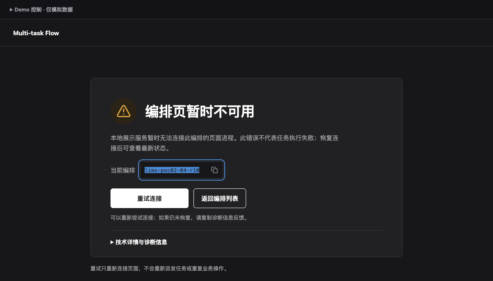
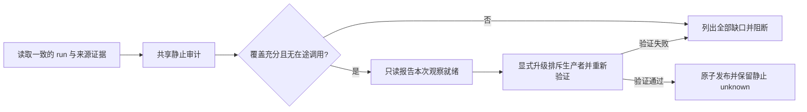

# Unified atomic orchestration

状态：已锁定的长期主题合同。

第 16 节规定历史副作用静止审计的实施合同，不表示已实现、已发布或已获得正式运行写入授权；当前证据缺口与覆盖状态见 IMPLEMENTATION.md。

本文是仓库内多任务编排的 canonical 领域、持久化、状态推导、迁移和网页展示合同。实现、测试和后续设计修订必须以本文为基线；`/tmp` 中的设计草稿不属于项目事实源。

## Context and Scope

本主题定义 Multi-task Flow 的统一原子编排合同，覆盖 AtomicNode、AtomicEdge、Task、DeliveryUnit、外部事实、状态推导、迁移和网页投影。它约束 `skills/multi-task-flow/` 的持久化、运行时门禁、验证器和 viewer，不替代仓库级工程交付流程或外部 provider 的事实来源。

## Requirements

### REQ-ATOMIC-001

AtomicNode 与 AtomicEdge MUST 是唯一的编排依赖事实；Task 与 DeliveryUnit MUST 作为平级派生投影读取同一张原子图，不得保存可独立修改的第二份成员或业务状态。

### REQ-ATOMIC-002

普通 contribution Task 和 Task Agent 路径 MUST 在 starting 前核验交付单元的集成 PR 与分支事实；只有 active、workspace-ready、main-owned 的 bootstrap unit 才能让 main-owned contribution task 在集成 PR 发布前启动，发布进行中、结果未知或已有非空父 PR 事实时 MUST 继续阻塞。

### REQ-ATOMIC-003

planned work、milestone、Task 状态和 DeliveryUnit 状态 MUST 通过统一 schema/domain 校验器及原子、里程碑和外部事实推导；空条件 planned milestone、非法 scope、循环依赖和不匹配的执行边界 MUST 被拒绝。

### REQ-ATOMIC-004

原子图、任务图和交付单元图 MUST 使用同一份 canonical 原子数据，聚合投影 MUST 保留回溯到原子节点、条件、证据和阻塞原因的路径；历史格式只能按兼容合同读取或经可恢复的显式迁移处理。

### REQ-VIEWER-ATOMIC-001

原子依赖图 MUST 展示 canonical `AtomicNode` 与 `AtomicEdge` 中所有已持久化的节点和边，即使图存在环、孤儿节点、缺失依赖或顺序冲突；viewer MUST 通过节点、边和详情警告标记异常区域，不得通过过滤异常事实制造一个看似合法的子图。

### REQ-VIEWER-ATOMIC-002

交付单元和任务详情中的原子任务列表 MUST 从同一份原子依赖图推导顺序；无环图使用以稳定节点 ID 作为并列 tie-breaker 的稳定拓扑排序，有环图使用强连通分量的稳定回退顺序，并 MUST 显示无法形成合法线性顺序的诊断。系统 MUST NOT 持久化独立的 `display_order` 作为第二个顺序事实。

### REQ-VIEWER-ATOMIC-003

原子任务状态 MUST 仅由状态图标表达；用户聚焦的节点使用聚焦样式；viewer MUST NOT 因节点是第一项或第一个 `planned` 节点而自动添加“当前待推进项”样式。

### REQ-VIEWER-RECOVERY-001

Gateway MUST 在 Worker 完全不可用时独立提供编排入口的 HTML 故障页，清楚区分页面连接失败与任务失败，提供手动重试、返回列表、复制诊断和可展开技术详情。重试 MUST 尊重实际剩余重启窗口并保留当前完整 URL，不得重新派发任务或重复业务副作用；非页面请求 MUST 保持 JSON 错误合同。

### REQ-SCHEDULE-001

计划在批准前 MUST 通过完整理论排期校验；任一可执行节点缺少可计算的正确定时、存在悬空依赖、循环依赖、未批准计划或其他导致开始/结束偏移不可确定的情况时，批准和 scheduled 状态转换 MUST 被拒绝。

### REQ-SCHEDULE-002

理论排期 MUST 使用纯相对小时坐标，时间原点固定为 `0h`；排期计算、持久化投影、URL 状态、图表轴、节点标签和详情 MUST NOT 展示日期、时间戳或时区语义。分钟可以作为内部计算精度，但用户可见值 MUST 格式化为小时。

### REQ-SCHEDULE-003

理论排期不完整时，viewer MUST 隐藏理论时间轴并显示逐项阻断原因，包括缺少 duration、悬空依赖、循环依赖和未批准状态；不得把未知时间渲染成零点、默认时长或看似有效的时间轴。

### REQ-ATOMIC-005

每个状态 MUST 归属于唯一对象边界：Run phase 归属于 Orchestration，work lifecycle 归属于 AtomicNode，TaskStatus 与 DeliveryUnitStatus 是从原子、里程碑和外部事实派生的读取投影，provider PR state 归属于外部事实，operation status 归属于一次副作用操作，runtime observation 归属于会话或资源；任何对象不得把其他对象的状态复制为第二份权威状态。

### REQ-ATOMIC-006

DeliveryUnit 的 `closed` 业务状态 MUST 保留已经验证的 `pr_merged` 能力，使其可以满足下游 `requires: merged` 依赖；该能力 MUST 由有效的 merge receipt、`merge_sha`、目标 PR identity 和未被后续冲突事实失效的证据共同决定，不能仅由 `group.state` 或 provider PR 的 `closed` 状态决定。

### REQ-ATOMIC-007

恢复 MUST 通过受审计的 reconcile 或 protected recovery 命令记录为追加事件，不得新增 `reconciling` 等临时业务状态或覆盖原始事实；有效 closeout 的 reconcile 保持 `closed`，无效 closeout 转为 `blocked`，范围变化通过显式计划修订和 successor DeliveryUnit 表达，只有受保护恢复才能使同一 DeliveryUnit 从 `blocked` 回到 `active`。

### REQ-ATOMIC-008

当上游 DeliveryUnit 的 merge 能力被新事实否定时，新的下游派发 MUST 被阻塞；已存在的下游 operation MUST 保持其原有 `unknown`、`succeeded` 或 `failed` 事实并单独对账，系统不得自动回滚外部副作用或删除历史证据。

## Verification

### VER-ATOMIC-001

- covers: `REQ-ATOMIC-001`, `REQ-ATOMIC-003`
- Method: AtomicNode/AtomicEdge schema、里程碑评估、scope 校验、状态投影和迁移测试。
- Pass condition: 非法图、空条件 planned milestone、错误 scope 或第二份状态来源被拒绝；合法投影从同一原子事实重建。

### VER-ATOMIC-002

- covers: `REQ-ATOMIC-002`
- Method: engine、atomic-orchestration schema 和 dispatch claim 测试覆盖 bootstrap main-owned、regular、Task Agent、父 PR 发布中、未知和关闭事实。
- Pass condition: 只有明确满足 bootstrap 例外的 main-owned contribution task 可以绕过父 PR；其他路径在缺少已发布且开放的父 PR 时保持阻塞。

### VER-ATOMIC-003

- covers: `REQ-ATOMIC-004`
- Method: viewer projection、原子依赖图、聚合依赖回溯、历史兼容和迁移测试。
- Pass condition: 三种图使用同一 canonical 数据，页面可定位具体原子和证据，历史数据不会被无语义推断地覆盖或清理。

### VER-VIEWER-ATOMIC-001

- covers: `REQ-VIEWER-ATOMIC-001`, `REQ-VIEWER-ATOMIC-002`, `REQ-VIEWER-ATOMIC-003`
- Method: viewer projection、原子图和详情内容测试，覆盖合法 DAG、并列节点、环、孤儿节点、缺失依赖、开始/结束节点、里程碑、选中节点和状态图标。
- Pass condition: 所有 canonical 节点与边始终可见；合法 DAG 的详情顺序与依赖一致；非法图显示完整事实和异常原因；不产生第二顺序字段；列表不再自动高亮第一个 planned 节点。

### VER-VIEWER-RECOVERY-001

- covers: `REQ-VIEWER-RECOVERY-001`
- Method: Gateway HTTP 故障注入、Worker pool 限流和页面交互测试，以及独立 `ui_demo` 的桌面和移动布局核验。
- Pass condition: Worker 不可用时 HTML 页面无需 Worker 资源即可显示，倒计时结束前不能重试，结束后不自动刷新；手动重试保留 URL，API 保持 JSON，Ledger 内容与业务 revision 不变。

### VER-SCHEDULE-001

- covers: `REQ-SCHEDULE-001`, `REQ-SCHEDULE-003`
- Method: 计划批准、scheduled 转换、排期校验器和 viewer 空状态测试，覆盖缺失 duration、悬空依赖、循环、未批准计划和合法完整计划。
- Pass condition: 所有非法计划在批准前失败并返回逐项原因；viewer 不创建理论时间轴；合法计划才显示完整排期。

### VER-SCHEDULE-002

- covers: `REQ-SCHEDULE-002`
- Method: 排期计算、序列化、URL 状态和 timeline formatter 测试，覆盖零点、并行节点、小数小时和跨内部日期边界的长排期。
- Pass condition: 用户可见坐标始终从 `0h` 开始并以小时显示，输出不包含日期、时区或 ISO 时间戳。

### VER-ATOMIC-004

- covers: `REQ-ATOMIC-005`, `REQ-ATOMIC-006`
- Method: schema/domain 状态归属、DeliveryUnit merge capability、closed bootstrap 上游派发、provider PR closed 与业务 closeout 区分测试。
- Pass condition: 每个状态只有一个权威对象；closed DeliveryUnit 在 merge evidence 有效时可以满足下游 merged 依赖，但自身仍不能继续普通派发；provider closed 且没有 merge evidence 的 PR 不得满足该依赖。

### VER-ATOMIC-005

- covers: `REQ-ATOMIC-007`, `REQ-ATOMIC-008`
- Method: closeout-reconcile、protected recovery、计划修订、下游影响阻塞、unknown operation reconciliation 和历史事件投影测试。
- Pass condition: 恢复只追加审计事件；有效 closeout 保持 closed；无效 closeout 进入 blocked；范围变化创建 successor；上游能力失效不会删除或自动回滚下游副作用。

## 1. 核心模型

AtomicNode 与 AtomicEdge 是唯一的编排真相。AtomicNode 统一承载可执行 work 原子和只表达条件的 milestone 原子；Task 与 DeliveryUnit 是从同一张原子图派生出的平级投影。

- work 原子表示需要责任边界、执行策略或外部系统推进的工作，活动类型包括 contribution、documentation、verification、release 和 deployment。
- milestone 原子表示一组显式条件的检查点，没有 Agent 执行、执行 owner 或 running 状态。
- Task 由 task scope 的 work 原子归纳得到，DeliveryUnit 由 delivery_unit_id 范围内的原子和外部事实归纳得到。
- Task 和 DeliveryUnit 不互相拥有，不保存对方的成员副本，也不保存独立的权威编排状态。
- Agent idle、对话连接、PR 查询和观察器断开等信息属于运行时观察层，不覆盖原子图推导出的业务状态。

## 2. 对象关系

```text
AtomicNode + AtomicEdge（唯一的原子依赖图）
├── work.scope.kind = "task"
│   └── TaskProjection 读取 task_id 范围内的成员
├── work.scope.kind = "delivery_unit"
│   └── DeliveryUnitProjection 读取 delivery_unit_id 范围内的成员
└── milestone.scope.kind = "task" | "delivery_unit"
    └── TaskProjection 或 DeliveryUnitProjection 读取里程碑

AtomicNode + AtomicEdge
├── 原样展示 / 筛选 ───────────────> 原子依赖图
├── 按 task_id 折叠 ───────────────> 任务依赖图
└── 按 delivery_unit_id 折叠 ──────> 交付单元依赖图

Task 与 DeliveryUnit 是平级对象；delivery_unit_id 只是共同的分类、整合和验收范围标记，不表示父子、会话从属或管理权转移。
```

状态机图、对象状态归属和异常恢复规则集中记录在 [STATE_MACHINES.md](./STATE_MACHINES.md)，便于单独审查；数据结构和 schema 定义集中记录在 [DATA_MODEL.md](./DATA_MODEL.md)。角色职责、身份绑定和端到端交互时序集中记录在 [AGENT_INTERACTIONS.md](./AGENT_INTERACTIONS.md)，命令接口集中记录在 [CLI_CONTRACT.md](./CLI_CONTRACT.md)；实现映射、测试覆盖与已知设计偏差见 [IMPLEMENTATION.md](./IMPLEMENTATION.md)。

## 3. 统一的原因

当前实现把任务内部原子和交付单元生命周期原子分成两套数据和两套更新命令，造成相同概念有两个状态来源、依赖图覆盖范围不一致、交付单元生命周期依赖数组顺序、网页无法追溯实际阻塞原子，以及 merge-claim、group-close 和任务状态检查使用不同集合的问题。

统一后，依赖、完成证据、阻塞原因和状态推导都围绕一张原子图进行，Task 和 DeliveryUnit 只保留身份、执行策略、外部资源事实和可重建投影所需的信息。

## 4. 协调模型与交付单元流程

交付单元数量是主 Agent（main Agent）在规划阶段基于需求结果和 contribution Task 归纳出的计划结果，不是主人预先填写的数量，也不是由 PR 数量、Agent 数量或文件边界反推。主 Agent 必须先判断每个 contribution Task 服务的需求结果，再把共同完成同一个可验收需求结果的任务归入同一个 `delivery_unit_id`；能够独立交付和独立验收的需求结果才使用不同的 `delivery_unit_id`。该判断保留在 Agent 上下文和已批准计划中，不新增 `DeliveryUnitProposal` 等中间账本对象。

归纳完成后，每个 contribution 或 documentation work 原子必须使用唯一的 `TaskScope`，其中的 `task_id` 标识任务，`delivery_unit_id` 标识其交付范围。`DeliveryUnitDefinition` 不保存 `task_ids` 副本；DeliveryUnitProjection 从原子 scope、里程碑和外部事实派生成员。计划校验必须拒绝缺少归属、重复归属以及执行策略与归纳结果不一致的计划，不能把“一项任务一个交付单元”作为隐式默认。

同一 `delivery_unit_id` 下 contribution Task 的数量决定执行拓扑：数量为一时，任务复用交付单元对话、工作区、分支和 PR；数量大于一时，每个任务保持独立对话、工作区、分支和 child PR，由交付单元负责集成。verification、release 和 deployment Task 不参与该数量判断。计划批准后若需求边界发生变化，必须通过计划修订重新归纳，不能在运行中静默创建或删除 child PR。

当前项目中的 `Task.kind = "coordination"` 和 `Group.coordination_execution` 是历史实现概念。新模型不再定义 coordination TaskKind，也不定义 `activity_type = "coordination"`；协调是由依赖边、里程碑条件、外部事实和运行时观察共同表达的编排行为。

文档、需求、设计和 ADR 等文档产物使用 documentation 原子类型；属于实现交付一部分的文档使用 contribution 原子。documentation 原子归入 contribution Task，不新增 documentation TaskKind。集成验收使用 verification 原子，发布使用 release 原子，部署使用 deployment 原子，代码实现使用 contribution 原子。

交付单元的标准生命周期按以下顺序编排，具体顺序由 AtomicEdge 表达：

1. 解析交付拓扑并准备工作区、交付单元分支和 PR 基线：记录外部操作及其 evidence，不创建 coordination 原子。只有一个 contribution Task 时选择共享交付拓扑；存在多个 contribution Task 时选择多任务集成拓扑。
2. 创建并发布交付单元 PR：使用 delivery_unit scope 的 milestone，显式要求 provider receipt。共享交付拓扑下，该 PR 同时是唯一 contribution Task 的交付 PR。
3. 执行该 `delivery_unit_id` 下的 contribution Task 原子。共享交付拓扑使用同一个交付单元对话、工作区、分支和 PR；多任务集成拓扑才为各 contribution Task 创建独立 child PR。普通 contribution 任务进入 starting 前，交付单元必须已经提供 `pr` 和 `parent_branch`，但活跃且 workspace readiness 已完成的 main-owned bootstrap unit 可以让其 main-owned contribution task 在集成 PR 创建前启动；regular unit 和 Task Agent 路径仍必须满足父 PR 门禁。启动输入不要求提交 hash；交付单元等待状态由依赖投影得到，不创建“等待任务”。
4. 共享交付拓扑直接完成交付单元级验收；多任务集成拓扑先集成 child PR，再使用 delivery_unit scope 的 verification work 原子核对当前交付单元分支 SHA 和检查证据。
5. 合并交付单元 PR：使用 delivery_unit scope 的 milestone，显式要求前置原子完成和合并事实。
6. 按计划执行 release、deployment 和线上 verification 原子；根据责任边界使用 Task scope 或 delivery_unit scope。
7. 收口和资源清理：使用 delivery_unit scope 的 milestone，显式要求必要节点、外部资源和通知条件满足。

交付单元的准备父分支、创建父 PR、合并父 PR 和收口是交付单元预设 work 原子；它们不得与 Task 原子混用。集成验收不是预设原子；如果计划需要集成检查，应由 Agent 创建实际 work 或 milestone，并声明其 scope 和条件。旧账本中的 coordination task 和 coordination session 只读兼容，不自动猜测业务语义；迁移必须通过显式计划修订，将其转换为 contribution、documentation、verification、release、deployment 或适当的 milestone。

Canonical schema、Task/DeliveryUnit 投影、外部事实和执行策略见 [DATA_MODEL.md](./DATA_MODEL.md)。

状态派生、状态优先级和非正常恢复见 [STATE_MACHINES.md](./STATE_MACHINES.md)。

## 5. 编排流程

```text
创建原子 work 与 milestone 定义
  -> 创建 AtomicEdge 并校验无环
  -> 为 planned 原子绑定唯一 scope
  -> 生成或绑定 TaskDefinition 与 DeliveryUnitDefinition
  -> 校验活动类型、scope、TaskKind 和执行策略
  -> 批准 canonical 原子图
  -> 运行时记录 work 事件、外部事实和 evidence
  -> 统一评估 milestone
  -> 派生 Task 与 DeliveryUnit 状态
  -> 网页展示原子图和两个聚合投影
```

计划阶段允许原子处于 design，此时可以先定义目的、输出、验收条件和候选依赖，但不能调度。进入 planned 后，work 和 milestone 都必须具有明确且唯一的 scope；不存在同时属于多个 Task 或多个 DeliveryUnit 的原子。

## 6. 校验合同

所有规则必须进入单一的 Zod/domain schema 和领域校验器，不能依赖网页或调度器各自补充隐式判断。

- 所有节点和边 ID 唯一，边引用存在节点。
- 原子图必须无环；里程碑条件不能形成无法满足的循环。
- planned work 原子恰好拥有一个 scope；contribution/documentation 只能是 TaskScope，verification/release/deployment 才允许 DeliveryUnitScope。
- 每个 Task 至少包含一个 task scope 的 work 原子；所有成员原子属于同一 DeliveryUnit。
- milestone 可以是 TaskScope 或 DeliveryUnitScope；TaskScope 必须同时携带 task_id 和 delivery_unit_id。
- planned milestone 至少有一个入边条件或显式验收条件；两者都为空时拒绝计划。
- milestone 不得有 execution owner、requirements path、conversation binding 或 running 状态。
- TaskKind 必须与成员 work 原子的归纳结果一致；不同 TaskKind 的活动不能混入同一个 Task。
- contribution Task 必须有 `pr: TaskPrBinding` 字段；running 时可以是 `unbound`，blocked 时也可以是 `unbound`，从 running 之后进入的任何非 blocked 阶段必须是 `open` 或 `merged`。
- TaskPrBinding 必须能够表达 `unbound`、`open`、`merged` 和 `closed`；DeliveryUnitExternalFacts 必须能够表达 `unpublished`、`published`、`merged` 和 `closed`。两者的 `closed` 都必须保留关闭时间和关闭原因，并只能作为外部失败/阻塞事实，不能被当作成功完成。
- contribution Task 切换到 starting 时，所属 DeliveryUnit 的外部事实通常必须是 `published`，并提供 `pr` 与 `parent_branch`；活跃且已完成 workspace readiness 的 main-owned bootstrap unit 是唯一例外，可以在集成 PR 创建前启动其 main-owned contribution task。若父 PR 发布操作仍在进行、结果未知或已有非空的父 PR 事实，则不能使用该例外；engine、atomic validator 和 viewer 必须对父 PR 使用相同的 provider/repository/id/state 证据判定，engine 不得在缺少明确 absent receipt 时放行 bootstrap，且 viewer 的计划级 readiness 必须聚合 DeliveryUnit 的 active、workspace 和父 PR 门禁；starting 输入不要求提交 hash，提交 hash 只能作为后续 provider receipt 或合并事实记录。
- contribution work 原子进入 starting 时必须满足同一 DeliveryUnit 的 `published` PR 前置条件，除非它属于上述 main-owned bootstrap 例外；starting 是原子生命周期的一部分，不能只在 TaskProjection 或 Agent runtime observation 中临时伪造。
- 活动类型、完成条件、result/evidence 和外部目标必须兼容。
- TaskScope 和 DeliveryUnitScope 必须分别解析到对应的 execution_policy；不得出现 null 组合。
- 外部事实必须绑定正确目标、SHA、PR、环境和来源身份。
- 状态必须绑定唯一对象边界；Run、AtomicNode、Task、DeliveryUnit、provider PR、operation 和 runtime resource 的状态不得互相复制为第二份权威状态。
- `requires: merged` 的依赖必须使用统一的 merge capability 判定；DeliveryUnit 为 `merged` 或 `closed` 且具有有效 merge receipt 时满足，provider PR 单独为 `closed` 或 DeliveryUnit 单独为 `closed` 时不满足。
- DeliveryUnit closeout 只能由受审计的 closeout operation 完成；有效 reconcile 保持 `closed`，无效 reconcile 只能进入 `blocked`，同一单元恢复执行必须经过 protected recovery 和完整重新验证。
- 收口后发现的新范围必须通过 plan revision 和 successor DeliveryUnit 表达；不得通过覆盖历史 closeout、复活旧 Task identity 或新增未批准 atom 改写原责任边界。
- 上游 merge capability 失效时，新下游派发必须阻塞，既有下游 operation 必须保留原始结果并单独 reconcile，不得自动回滚外部副作用。
- 发布、部署和线上验证必须是显式原子，不能从普通 contribution 节点隐式推断。
- 普通实现任务内部可以保留单元测试、静态检查和代码自测，不得因此自动生成 verification Task。
- 孤立节点、悬空任务、无归属里程碑和空条件 planned milestone 拒绝执行。
- 计划修订以 AtomicNode 和 AtomicEdge 为 canonical diff；Task、DeliveryUnit 和网页投影由修订后图重新生成。
- 动态切割只能迁移尚未开始的原子节点；已开始节点保留身份、事件和证据。

## 7. 网页展示

网页提供原子依赖图、任务依赖图和交付单元依赖图，三者使用同一份 AtomicNode + AtomicEdge 数据。

原子依赖图展示所有 work 和 milestone 节点，支持按 DeliveryUnit、Task、activity_type 和 kind 筛选，显示入边条件、显式验收条件、完成证据、评估状态和阻塞原因，并能从节点打开对应 Task 或 DeliveryUnit 详情。

任务依赖图和交付单元依赖图是两个平行投影：

```text
AtomicNode + AtomicEdge
├── 按 task_id 汇总和折叠 ─────────> Task 依赖图
└── 按 delivery_unit_id 汇总和折叠 > DeliveryUnit 依赖图
```

聚合边必须保留“聚合边 -> 原子路径 -> 具体节点 -> 条件 -> 证据/阻塞原因”的回溯入口。等待合并必须能明确指向交付单元集成 PR 合并 milestone，并列出前置 work、PR published、CI passed 等显式条件。

页面必须分别展示 Run phase、TaskStatus、DeliveryUnitStatus、provider PR state、operation status 和 runtime observation。页面不得把 operation 的 `unknown`、provider PR 的 `closed` 或 Agent 的 idle/disconnected 显示为 Task 或 DeliveryUnit 的成功完成。

当 DeliveryUnit 为 `closed` 且 merge capability 有效时，页面应同时显示“本单元已收口”和“可满足下游 merged 依赖”；该单元自身的 dispatch readiness 仍应为 blocked。closeout reconcile 的原始事件、核验依据、失效原因、受影响依赖和 protected recovery 记录必须可从 DeliveryUnit 详情回溯。

## 8. 历史兼容与迁移

第一阶段新增统一 `atomic_nodes` 和 `atomic_edges` canonical 存储，旧字段只读兼容，禁止新写入继续创建 `Task.atoms` 或 `Group.atoms`。

第二阶段把 `Task.atoms` 映射为 work 节点，把 `Group.atoms` 映射为具体的 verification、release、deployment 或 milestone；旧数组顺序只有在语义明确时才转换为依赖边。无法机械判断语义的旧组级原子必须标记为需要计划修订，不能自动创建新的协调原子。

第三阶段统一使用 atomic-node-update，删除 group-atom-update 的独立语义，删除 Task 和 DeliveryUnit 状态的直接写入路径；外部合并、发布、部署和验证操作只写事实、事件和原子完成证据。

第四阶段保留聚合图为兼容默认视图，新增原子依赖图作为审查入口；旧 viewer 只读兼容旧字段，不再生成新的双份原子数据。旧 `Group` 名称和 `group_id` 字段只保留在兼容层，新 canonical 模型使用 DeliveryUnit 和 delivery_unit_id。

旧账本中的 `parent_pr` 只在确认它表示 DeliveryUnit 的集成 PR 时，读取为 canonical `DeliveryUnitExternalFacts.pr`；旧执行策略值 `parent_pr` 只读映射为 `delivery_unit_pr`。新 canonical 字段和策略不再使用 `parent_pr` 这个名称，也不把交付单元表达成 Task 的父对象。

新增 closeout reconcile、protected recovery 或 recovery audit event 时，必须声明 contract version、viewer compatibility 和 persistent-state impact。旧 viewer 读取新事件时不得丢失原 closeout、merge receipt 或 blocked reason；无法安全读取时必须进入只读兼容或 fail closed，不得把新恢复事件解释为普通成功状态。

## Related ADRs

- [Multi-task Flow task execution and delivery boundaries](../../adr/0027-multi-task-flow-task-execution-and-delivery-boundaries.md)
- [First delivery unit is bootstrap by default](../../adr/0031-first-delivery-unit-bootstrap-by-default.md)
- [Multi-task Flow creation reconciliation and standalone Codex reconcile](../../adr/0034-multi-task-flow-creation-reconciliation.md)
- [Multi-task Flow CLI contract ownership](../../adr/0036-multi-task-flow-cli-contract-ownership.md)
- [编排版本绑定与前向升级](../../adr/0039-orchestration-version-binding-and-forward-upgrade.md)
- [初始化恢复的权限事务与原生写锁](../../adr/0040-initialization-recovery-permission-transaction.md)
- [历史静止证明随升级事务保存](../../adr/0041-historical-side-effect-quiescence-audit.md)

## 9. 可行性与风险

可行性高，但这不是局部重命名，会影响 schema、计划校验、初始化和动态切割、运行时事件、merge-claim、group-close、view projection、dashboard 图和历史迁移。

最大风险是把 milestone 误当成可执行任务，或为了兼容旧生命周期字段继续保留第二套权威状态。milestone 必须是条件节点；Task 和 DeliveryUnit 必须是派生投影；外部事实和证据必须是状态评估的输入。

不建议一次性重写历史账本。应先实现新 schema、只读迁移和三种视图验证，再对可机械转换的历史数据执行受控迁移；无法机械判断的历史语义必须等待显式计划修订。

本设计锁定以下边界：AtomicNode + AtomicEdge 是唯一编排真相；Task 与 DeliveryUnit 是平级投影；里程碑以所有入边条件和所有显式验收条件的全量 AND 规则达成；空条件 planned milestone 无效；Task 和 DeliveryUnit 的业务状态由原子、里程碑和外部事实推导；Agent 运行观察单独记录；coordination 不再作为新任务类型或原子活动类型。

## 14. Native creation reconciliation

### REQ-DISPATCH-001

Contract 3 的 Flow dispatch operation 在 `conversation-create` 超时、进程终止、连接中断、已观察 thread 或资源可能已创建时 MUST 保留 `unknown`、native request identity、claim、容量和已知 creation observations，并 MUST 通过显式的 `flow creation-reconcile` 入口恢复；不得自动重复创建、手工写入成功结果或使用普通 `codex reconcile` 替代。

### REQ-DISPATCH-002

创建对账 MUST 从同一 Flow Ledger operation 派生 native request identity，并使用当前 `expected_revision`、唯一 `request_id` 和绑定 main actor 执行原子写入；对账不得创建新的 native request，不得修改已冻结的创建参数。

### REQ-DISPATCH-003

对账只有在 Codex thread 身份、model/thinking、初始化 handshake、独立 worktree owner、initial HEAD 和清洁状态均有匹配外部证据时，才能把 operation 解析为 `succeeded`；证据不足、thread 仍在初始化或任何身份冲突 MUST 保持 `unknown`。

### REQ-DISPATCH-004

仅当外部证据明确证明创建进程未启动、没有资源创建且没有观察到 thread identity 时，operation 才能解析为 `failed` 并释放 claim；查询不到 thread、缺少退出码或普通错误文本不能单独证明失败。

### REQ-DISPATCH-005

创建对账成功后 MUST 复用 dispatch resolution 和 notification idempotency 合同，绑定目标 thread、记录 reconciliation evidence 并最多生成一次 handoff notification；重放相同 request identity MUST 不得重复创建 thread 或发送通知。

### VER-DISPATCH-001

- covers: `REQ-DISPATCH-001`, `REQ-DISPATCH-002`, `REQ-DISPATCH-003`, `REQ-DISPATCH-004`, `REQ-DISPATCH-005`
- Method: runtime command、Codex app-server query、worktree evidence、engine mutation、revision fencing 和 notification tests。
- Pass condition: unknown operation 可由已知 thread 的完整证据安全恢复；证据不足继续 unknown；明确 pre-creation failure 才能 failed；任何重放不会产生第二个 thread、第二个 operation 或第二条 handoff notification。

创建对账是 Flow Ledger 的恢复动作，不是普通 Codex dispatch 的别名。`codex reconcile` 继续服务独立的 Codex dispatch journal；Flow runtime 必须通过 `flow creation-reconcile` 查询并更新正式运行账本。没有已知 thread identity 时，系统不得按标题、cwd、时间或相似度猜测资源；只有额外的、可验证的 native request 查询证据才能解除该限制。

### REQ-INITIALIZATION-RECOVERY-001

`initialization-recover` MUST 仅恢复绑定 main 所拥有的 unknown codex-exec dispatch，保留创建 native request、thread、worktree 和完整执行配置。原始精确角色握手 MUST 为 interrupted 且没有工作 items；允许没有助手回复。failed、active、未知或额外业务 turn MUST 拒绝。

### REQ-INITIALIZATION-RECOVERY-002

恢复 MUST 在原生副作用前持久化唯一、不自动过期的 attempt；恢复 writer MUST 取得原生独占锁后复核完整历史再发送固定握手。超时、崩溃或冲突后的重入 MUST 仅对账已注册 attempt，不新建会话或重发。成功 MUST 复读并绑定 original interrupted turn 与 registered completed recovery turn，保留摘要、配置、owner、HEAD、清洁状态和一次性 handoff 证据。最终历史核验与 dispatch 成功写入 MUST 保持同一原生 writer 锁；已登记 attempt 的对账同样 MUST 在锁内核验且不发送新 turn，释放后才准备 handoff。具体边界遵循 ADR 0040。

### REQ-INITIALIZATION-RECOVERY-003

恢复 MUST 在中性 resume 取得原生写锁后、首次权限 override 前保存完整原权限快照，禁止以全局默认值替代。固定握手使用只读权限；正式 dispatch 成功 MUST 先在同一锁内恢复原权限并通过原生 effective-settings 通知核验，成功 evidence MUST 绑定快照摘要。恢复失败保持 unknown，不准备 handoff；崩溃后重入只恢复和对账，不能重发握手或覆盖与原始及握手权限均不相同的配置。历史 attempt 缺少快照以及无法无损保存的命名 profile MUST fail closed，不能自动推断或迁移；保留历史账本读取能力。`show task-context` MUST 为已绑定 Task 返回上下文及实际 readiness，拒绝未绑定身份且不改写账本。

## Visual Evidence

Gateway 故障页编排 ID 的指针与键盘焦点效果；隔离 `ui_demo`，由 owner 确认。




## 15. 编排版本绑定与前向升级

### REQ-UPGRADE-001

普通 flow 命令（含只读命令）MUST 核验调用 CLI 与编排绑定的包版本、build ID、source SHA 和合同集合；任一不匹配 MUST 拒绝并给出显式升级入口，不得隐式迁移。专用只读兼容检查和 upgrade dry-run MAY 读取历史信息，但 MUST 不产生业务写入或绑定切换。

### REQ-UPGRADE-002

升级 MUST 仅由显式 orchestration upgrade 触发，并由目标版本 CLI 自动完成必要的机械数据迁移及绑定切换；目标身份 MUST 与执行 CLI 的已验证 artifact 一致。升级入口可读取不匹配的源绑定，但 MUST 不把这一例外扩展为普通命令权限。迁移 MUST 不推断业务语义或改写 owner、对话、工作区及外部事实。

### REQ-UPGRADE-003

编排升级 MUST 仅前向推进，CLI MUST 拒绝降级及编排 rollback，不提供反向迁移。备份 MUST 用于独立灾难恢复，不能作为普通降级入口。Gateway 回滚和其他编排的绑定 MUST 不因单个编排升级而改变。

### REQ-UPGRADE-004

升级 MUST 持久化源身份、首次解析并冻结的不可变目标身份和进度；中断后 MUST 仅由显式 upgrade 续跑同一次升级，不重新跟随标签、不自动回滚或切换目标。账本与版本绑定不一致或升级未完成时，普通命令 MUST 拒绝操作，专用诊断 MUST 能报告状态。锁与恢复记录 MUST 防止 CLI/Worker 进入混合版本可写状态，daemon 通知 MUST 不作为升级正确性的必要条件。

### REQ-UPGRADE-005

升级 MUST 阻止该编排新写入，并等待已执行的 CLI/Worker 写事务与原生副作用调用安全退出；只读连接 MUST 不无限阻塞升级。可证明已静止的 unknown operation、claim 及容量 MUST 原样保留并迁移，不要求任务或结果不确定的操作全部终结。无法证明副作用停止时 MUST 阻断，不得通过强杀并伪造终态推进升级。

### REQ-UPGRADE-006

历史编排缺少可信绑定时，普通命令 MUST 拒绝。只有该编排的可验证历史证据唯一确定源身份时，显式升级入口才 MAY 机械补齐；证据不足 MUST 报告缺失并等待可验证来源，不得按当前 Gateway、全局安装或 latest 猜测。新 CLI MUST 保留支持范围内的历史诊断和前向迁移路径，旧 CLI/Worker MUST 无法写入升级后的编排。

### VER-UPGRADE-001

- covers: `REQ-UPGRADE-001`, `REQ-UPGRADE-002`, `REQ-UPGRADE-003`, `REQ-UPGRADE-004`, `REQ-UPGRADE-005`, `REQ-UPGRADE-006`
- Method: 隔离历史 ledger 与绑定 fixture、已验证 artifact 身份 fixture、CLI/Worker 并发写入、原生副作用调用观察、升级各落盘边界的崩溃注入及重入测试。
- Pass condition: 普通命令跨版本或同版本不同 build 均拒绝；专用诊断及 dry-run 不改变业务数据或绑定；目标 CLI 完成迁移和绑定一致切换；中断只续跑冻结目标、不降级；在途副作用未退出时阻断，静止 unknown/claim/容量不丢失；缺失绑定有唯一证据才补齐；旧 writer 不能绕过门禁；Gateway 和其他编排不受影响。

## 16. 历史副作用静止审计

### 范围与术语

本节规定历史 run 的副作用静止证明与前向升级，覆盖 notification、dispatch 及其 recovery、archive/unarchive 和相关旧生产者。业务结果与编排静止是独立事实；领域术语以 [项目术语表](../../../GLOSSARY.md#编排升级) 为准；本节的静止证据覆盖指可信证据对应的精确调用、attempt 或受排斥 writer 范围，一个范围的退出不能证明范围外调用停止。c4 握手恢复、业务继续执行、新建替代 run、通用 provider 插件、新守护进程、数据库、后台轮询及更早 schema 的新增迁移链不在本节范围。



### REQ-QUIESCENCE-001

系统 MUST 分别表达业务结果与副作用静止。静止证据充分时，unknown operation、notification、resource 及既有 claim、容量 MUST 可原样保留并满足升级静止门禁；结果成功但调用仍在途 MUST 阻断。系统 MUST NOT 因静止证明而自动确认 READY、任务完成、投递成功、归档成功、释放 claim 或恢复调度。

### REQ-QUIESCENCE-002

系统 MUST 提供专用只读入口 `orchestration quiescence-check --run-id <run-id>`，允许目标版本读取支持范围内的 contract-3/4 历史 run；MUST 输出源与调用者完整身份、观察 revision、业务数据摘要、逐项证据覆盖、全部已识别 blockers、缺失来源及已有处理入口。证据项 MUST 绑定 run、对象类型/ID、attempt/native request（存在时）、provider、来源及稳定引用、采集时间、验证器版本和原因；MUST 区分缺失身份、证据不可访问、冲突、在途调用及过期观察。普通 flow 的严格版本绑定和未知历史格式的拒绝路径 MUST 保留。

### REQ-QUIESCENCE-003

审计、upgrade dry-run 和正式 upgrade MUST 共用静止判定。compatibility-check MUST 保持兼容性语义，不把 compatible 等同于可升级；dry-run MUST 分别报告 `migration_supported` 与 `quiescence_ready`，静止阻塞时返回 `RUN_QUIESCENCE_UNPROVEN` 并在 details 提供完整报告。命令 schema 和发布说明 MUST 明示 dry-run 成功条件的变化，不能继续在静止检查前返回成功。

### REQ-QUIESCENCE-004

审计与 dry-run MUST NOT 修改 ledger、binding、upgrade、runtime receipt、run 目录或相关执行资源，包括为了读取而新建锁文件。读取 MUST 校验前后目录身份、revision 与内容一致性，不稳定快照 MUST NOT 返回可升级。provider 读取 MUST 不启动 turn、thread/resume、writer 或新会话；审计 MUST NOT 自动发送、恢复、对账或修正账本。

### REQ-QUIESCENCE-005

通知证据 MUST 将精确 prepare intent/attempt 与真实平台调用及返回结果或可信终止证据关联，并核验 provider、recipient、prompt digest 和覆盖范围。intent、任意 evidence_ref、相似文本、时间接近、查询不到消息或 CLI stopped MUST NOT 替代独立桌面调用证据。已有精确结果回执 MAY 经 notification-reconcile 对账；仅有调用终止证据时 MUST 保留业务 unknown。

### REQ-QUIESCENCE-006

dispatch 静止证明 MUST 覆盖绑定的 native request、实际 thread 和持久 recovery attempt。持久 claim 后、turn identity 落盘前崩溃的状态 MUST 单独验证；缺失 recovery_turn_id 时 MUST NOT 按时间猜测空回合身份，或仅凭 interrupted turn 推断结果未知的提交已停止。可信执行边界证据可覆盖该提交时 MAY 保留 unknown 升级；无法覆盖时 MUST 阻断。初始化恢复不可重发合同 MUST 保持，不得补造 READY、重发握手、清除 attempt 或创建替代 thread。

### REQ-QUIESCENCE-007

archive/unarchive MUST 按精确 thread、操作方向和已知调用身份核验证据。provider 正向结果可走既有结果对账；仅有可信生命周期终止证据时 MUST 保留 unknown。负向查询 MUST NOT 证明失败或终止，unknown 路径 MUST NOT 再次发起 archive/unarchive；一个方向的证据 MUST NOT 覆盖相反方向。

### REQ-QUIESCENCE-008

所有来源 MUST 可独立验证真实性及精确覆盖，不能仅校验调用者输入字段匹配。现有 receipt MUST 验证来源、身份与范围，不能只检查文件存在、state 字符串或 PID 不存在；最新一次 stopped receipt MUST NOT 覆盖其他历史或独立桌面调用。首版 MUST 限于已验证的现有 Codex/桌面来源；无精确关联能力时 MUST 返回具体证据缺口，不假定某个 receipt API 存在，不接受人工 stopped 声明或 force。

### REQ-QUIESCENCE-009

正式升级 MUST 在提交边界排斥相关新写入并重新验证源目录身份、ledger/binding 摘要、attempt 集合、provider 状态和 writer 覆盖。旧 CLI、Worker、桌面调用方、后台归档等生产者的实际排斥机制 MUST 被验证；仅持有新版 lifecycle 锁或人工声明无人操作 MUST NOT 证明旧生产者已冻结。revision、attempt、身份或证据变化时 MUST 重新审计或拒绝；无法排斥生产者或排除在途请求时 MUST 阻断，不强杀后宣称安全。只读报告或其摘要 MUST NOT 作为提交授权。

### REQ-QUIESCENCE-010

系统 MUST 复用既有显式升级、原子发布、冻结目标和前向续跑，MUST NOT 新增独立 legacy-reconcile 状态机或伪造历史 runtime/call.json。被接受升级中的审计摘要 MUST 追溯源 revision/digest、源绑定、对象/attempt 集合、验证器和证据引用；原始私有提示、凭据和完整会话 MUST NOT 进入公开文档或包。目标 ledger contract MUST 为 5，schema_version 保持 2；读取支持 contract 3/4/5，显式迁移支持 3/4 到 5 及 contract 5 的前向版本切换，更早格式只保留诊断和明确拒绝。公开 API、frontend 和 viewer 的结构未变化时保持原合同。持久化 schema、reader/writer、快照及旧 writer 拒绝 contract 5 的路径 MUST 经兼容验证，不得暗改严格 schema。恢复材料 MUST 保留，不反向迁移或自动清理。

### REQ-QUIESCENCE-011

当前问题 MUST 以同一 `lims-poc02-04-r10` 的实际安全升级验收，允许采用承载本方案的后续正式精确版本。证据可行性 MUST 覆盖当前全部通知、dispatch/recovery、资源及生产者；实际升级前 MUST 重新盘点，不硬编码历史数量。证据不足时 MUST 报告精确缺口并阻断，此结果 MUST NOT 视为问题已解决。正式升级须另获运行写入授权，不得以方案批准、离线快照或单测结果替代。

### VER-QUIESCENCE-001

- covers: `REQ-QUIESCENCE-002`, `REQ-QUIESCENCE-003`
- Method: 精确 npm 0.3.0 基线与隔离历史 fixture 的公开 CLI 对照。
- Pass condition: 基线可复现通知首关及历史无 stop receipt 的后续关；候选一次列出全部对象及 producer 缺口，三种调用面不发生门禁漂移；fixture 不接触正式 root。

### VER-QUIESCENCE-002

- covers: `REQ-QUIESCENCE-001`
- Method: 业务结果与静止状态的组合矩阵及前后业务事实差异。
- Pass condition: unknown 且静止证明充分可通过，结果成功但调用在途拒绝；unknown、claim、容量及业务图不被静止审计改写。

### VER-QUIESCENCE-003

- covers: `REQ-QUIESCENCE-005`, `REQ-QUIESCENCE-008`
- Method: 精确通知证据、字段冲突、伪造引用及缺失 provider 记录的反例。
- Pass condition: provider、attempt、recipient、prompt digest 或来源任一不匹配均拒绝；intent、相似文本、负向查询及 CLI receipt 不得放行桌面调用。

### VER-QUIESCENCE-004

- covers: `REQ-QUIESCENCE-006`, `REQ-QUIESCENCE-008`
- Method: recovery claim 后、turn identity 落盘前的崩溃注入，以及空 interrupted、额外未知回合和历史不完整 fixture。
- Pass condition: 结果未知的提交未被精确覆盖时保持阻断，不猜 turn、不 resend、不清 attempt、不补 READY；覆盖充分时只确认静止，不伪造握手成功。

### VER-QUIESCENCE-005

- covers: `REQ-QUIESCENCE-007`
- Method: archive/unarchive 正向、负向、方向冲突及调用未知 fixture，记录 provider 调用集合。
- Pass condition: 仅匹配方向的可信证据可通过；负向查询仍 unknown；unknown 处理不发送新归档或反归档请求。

### VER-QUIESCENCE-006

- covers: `REQ-QUIESCENCE-002`, `REQ-QUIESCENCE-004`
- Method: 审计与 dry-run 前后文件、目录、绑定、receipt、执行资源对比，以及 provider 方法审计和快照竞争注入。
- Pass condition: 无持久或执行资源变化，不创建锁文件，不启动 turn/resume/writer；不稳定读取不返回 ready。

### VER-QUIESCENCE-007

- covers: `REQ-QUIESCENCE-008`, `REQ-QUIESCENCE-009`
- Method: 审计后新增 attempt、旧 writer、后台归档、目录交换、provider 状态变化和 receipt 范围冲突并发测试。
- Pass condition: 覆盖过窄或排斥失败均拒绝；状态变化触发重新审计或拒绝；旧报告和任意 stopped 文件不能绕过门禁。

### VER-QUIESCENCE-008

- covers: `REQ-QUIESCENCE-009`, `REQ-QUIESCENCE-010`
- Method: 升级各发布阶段崩溃注入与重入，核对快照、冻结身份及审计摘要。
- Pass condition: 只向冻结目标前向续跑；无混合版本可写窗口；源材料保留；摘要可追溯且无私有原文泄漏。

### VER-QUIESCENCE-009

- covers: `REQ-QUIESCENCE-002`, `REQ-QUIESCENCE-010`
- Method: contract 3 到候选目标迁移、历史诊断及拒绝、目标 reader/writer 和旧 CLI/Worker 兼容矩阵。
- Pass condition: 普通 flow 绑定不放宽；旧 writer 不能写目标；历史格式/拒绝路径保留；目标持久合同与 artifact 一致，无隐式 schema 扩展。

### VER-QUIESCENCE-010

- covers: `REQ-QUIESCENCE-011`
- Method: 授权范围内的当前 run 只读证据盘点和受控私有快照演练。
- Pass condition: 当前每项 attempt、recovery、资源及 producer 均有可验证证明路径；无法取得证据时明确未通过。离线或脱敏 fixture 不冒充正式在线 provider 状态或放行凭证。

### VER-QUIESCENCE-011

- covers: `REQ-QUIESCENCE-001`, `REQ-QUIESCENCE-010`, `REQ-QUIESCENCE-011`
- Method: 独立运行写入授权后，使用已发布的精确 version/build/source/contracts 完成同一正式 run 升级，保存受控证据清单及前后差异。
- Pass condition: upgrade completed，ledger、binding、runtime identity 与目标一致，目标 CLI 可读；业务图、owner、thread/worktree、unknown、claim 和容量按批准的结果对账差异保留；无重复创建、消息发送、恢复回合或归档请求；其他 run、Gateway/daemon 和全局安装不变。只有此项及证据覆盖通过才能宣布当前升级问题解决。
