# Unified atomic orchestration state machines

本文专门用于审查统一原子编排中的对象状态、正常流程、异常恢复和范围修订。长期规则以同目录的 [SPEC.md](./SPEC.md) 为准，数据结构以 [DATA-MODEL.md](./DATA-MODEL.md) 为准。图中的状态名保留 canonical 英文；标题、转移条件、事件说明和恢复规则使用中文。

## 1. 状态归属

状态机必须按对象拆分。Orchestration、AtomicNode、Task、DeliveryUnit、Provider PR、Operation 和 runtime observation 各自拥有独立状态边界；跨对象关系使用原子、里程碑、外部事实、operation receipt 和门禁表达，不把多个对象的状态拼成一个全局枚举。

## 2. 状态机图

状态机图必须按对象拆分；跨对象关系使用事实、事件、里程碑和门禁表达，不把多个对象的状态拼成一个全局状态枚举。下面先给出正常流程，再给出异常恢复流程；每张图的标题说明状态归属。

### 2.1 正常流程状态机

Orchestration 阶段：

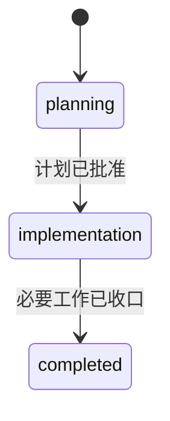

AtomicNode 的工作生命周期：

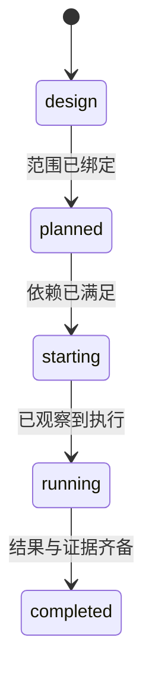

TaskStatus 的派生状态：

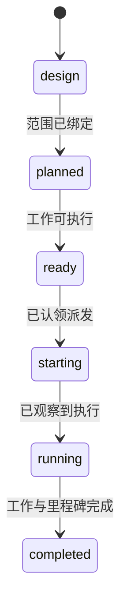

DeliveryUnitStatus 的派生状态：

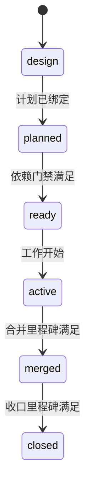

Provider PR 外部事实：

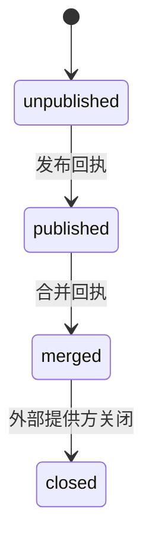

Operation 状态：

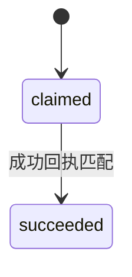

这些图中的 `ready` 是 Task 或 DeliveryUnit 的派生可执行状态，不是额外的持久化权威字段；`merged` 和 `closed` 也必须分别由对应的合并/收口里程碑与证据支持。网页上的任务图和交付单元图仍然只是 AtomicNode + AtomicEdge 的投影，不能反向成为新的依赖来源。

### 2.2 非正常流程状态机

AtomicNode 的阻塞与恢复：

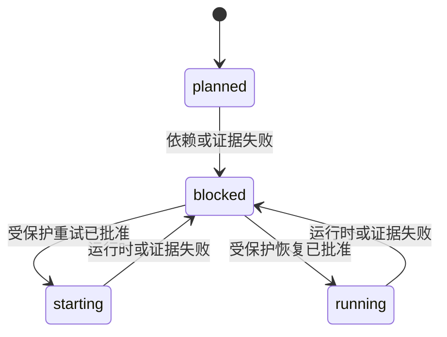

TaskStatus 的异常投影：

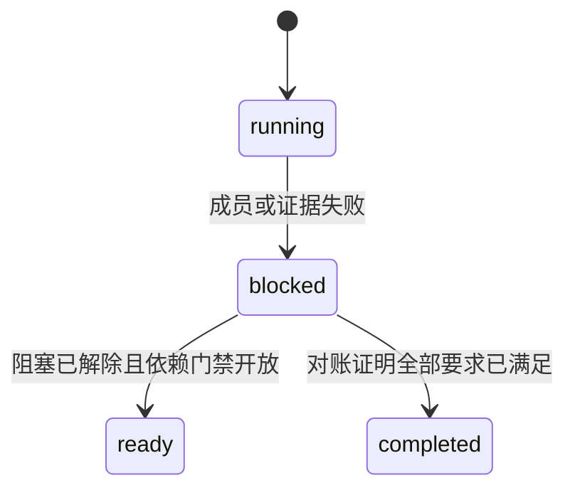

DeliveryUnit 的收口核验与修订：

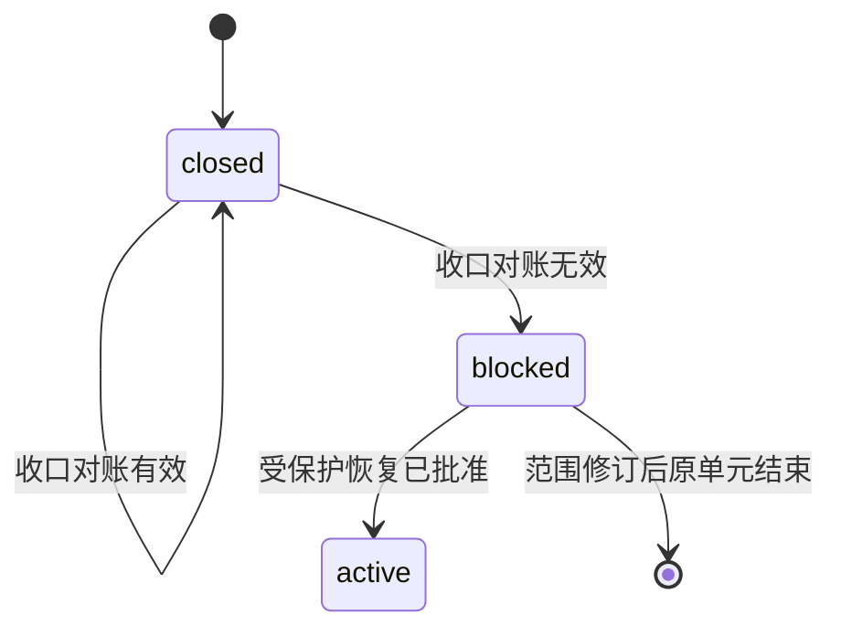

最后一条边表示原 DeliveryUnit 保留收口和阻塞审计后结束其原责任边界；计划修订另行创建处于 `planned` 的后继 DeliveryUnit，不表示覆盖原单元的收口。原单元只能从 `blocked` 经过受保护恢复回到 `active`，不得直接从 `closed` 回到 `active`。`closeout-reconcile`、`protected recovery`、`recovery_pending`、`reconciling`、`quarantined` 和 `reopened` 都是命令、事件、审计标签或 UI 提示，不是新增业务状态。

Provider PR 的异常事实：

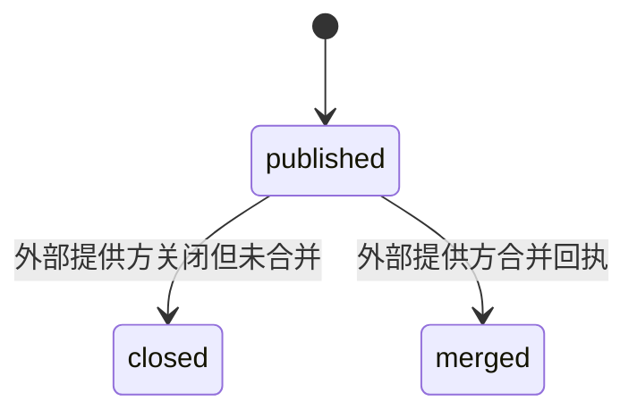

Operation 的异常事实：

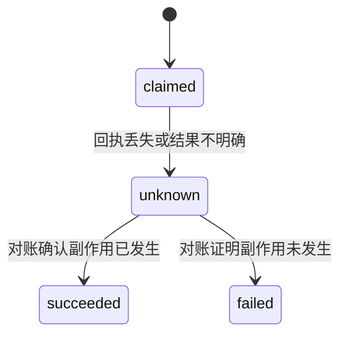

provider PR 的 `closed` 没有合并回执时不得满足 `requires: merged`；`unknown` 只属于一次 operation，不能被误写成 Task 或 DeliveryUnit 的业务状态。若已成功执行的下游 operation 所依赖的上游合并能力后续失效，新的下游派发进入阻塞门禁，既有 operation 保留 `succeeded`、`failed` 或 `unknown` 并单独对账。

聚合边必须保留“聚合边 -> 原子路径 -> 具体节点 -> 条件 -> 证据/阻塞原因”的回溯入口。

## 3. 状态推导与恢复

### 3.1 Work 原子

原子 state 必须包含 design。design 只允许存在于设计阶段，此时 scope 缺省；从 design 转为 planned 时必须一次性确定唯一 scope，之后不得回到 design。

work 原子保留唯一的执行状态：

```text
planned -> starting -> running -> completed
planned -> blocked
starting -> blocked
running -> blocked
blocked -> starting
blocked -> running
```

ready 不作为独立字段持久化；它是依赖满足、执行策略和资源可用性计算出的瞬时可执行条件。原子完成必须带有与活动类型匹配的 result/evidence：contribution 对应实现和质量结果，documentation 对应文档产物，verification 对应线上验证，release 对应发布证据，deployment 对应目标环境证据。

### 3.2 Task

Task 不保存独立的权威 state。TaskStatus 中可以包含 design、planned、ready、starting、running、blocked 和 completed；这些值都由 task scope 的 work 原子、里程碑和外部事实计算，不再额外保存 `ready` 布尔字段。Agent idle、waiting、disconnected 等 runtime observation 只作为独立叠加信息，不参与业务状态判定。

TaskStatus 按 `design → blocked → completed → running → starting → ready → planned` 的顺序取第一个满足条件的结果，以保证状态互斥；其中 `blocked` 优先于 ready/starting/running，`completed` 只有在不存在阻塞且所有必要条件满足时才成立。

- design：范围内仍存在 design 原子或任务尚未完成 scope 绑定。
- planned：没有 design 原子、阻塞节点、starting/running 节点或可执行成员。
- ready：至少一个成员 work 原子满足依赖并可执行，且没有 starting/running 节点。
- starting：至少一个成员 work 原子处于 starting 且没有 running 节点；对于 contribution Task，普通路径只有在所属 DeliveryUnit 已有 `pr` 和 `parent_branch` 后才能进入该状态，活跃且 workspace readiness 已完成的 main-owned bootstrap unit 的 main-owned contribution task 除外。
- running：至少一个成员 work 原子处于 running。
- blocked：成员节点存在明确阻塞、拓扑错误、证据错误，或多任务拓扑中的贡献任务 child PR 已进入 `closed` 且尚未建立替代 PR。
- completed：所有成员 work 原子完成，且该 Task 所需里程碑全部 satisfied。

`integrated` 是旧账本中的业务标签，表示多任务拓扑中贡献 Task 自己的 child PR 已经合并到 DeliveryUnit 的集成分支；共享交付拓扑不需要该中间标签，因为唯一 PR 同时就是 DeliveryUnit 和 contribution Task 的交付。它不表示存在 follow-up PR，也不表示 Task 的全部工作已经完成。follow-up PR 是独立的外部资源，可以在 child PR 集成后继续存在，并由自己的发布/合并事实或里程碑决定是否阻塞 DeliveryUnit 的后续步骤。新模型不把 `integrated` 作为 canonical TaskStatus，而是用 `pr_merged` 外部事实或对应 milestone 的 satisfied 结果表达；网页如需保留旧术语，只能显示为派生标签。

这三个词的边界必须固定：`integrated` 表示“child PR 已进入 DeliveryUnit 集成分支”，是过程标签；`completed` 表示“该 Task 的全部 work 原子完成，且所需 milestone 全部 satisfied”，是成功的 canonical TaskStatus；`closed` 在旧 Task 账本中表示记录被关闭或收口，可能发生在 `integrated` 或 `completed` 之后，也可能用于 abandoned、superseded 等不成功的终止，因此不能当作成功状态。新模型不把旧 Task 的 `closed` 写入 TaskStatus；成功收口使用 DeliveryUnit 的 closeout milestone，管理性关闭使用独立的 disposition/closure 事实。Task 的 `closed` 与 `TaskPrBinding.state = "closed"` 也不是一回事，后者只表示 provider 关闭了 PR。

### 3.3 DeliveryUnit

DeliveryUnitStatus 由同一 delivery_unit_id 范围内的全部成员节点、交付单元级里程碑和外部事实推导；Agent runtime observation 不参与业务状态判定。

DeliveryUnitStatus 按 `design → blocked → closed → merged → active → ready → planned` 的顺序取第一个满足条件的结果，以保证状态互斥；`closed` 和 `merged` 只有对应的交付单元里程碑 satisfied 后才成立。

- design：范围内仍存在 design 原子或交付单元尚未完成计划绑定。
- planned：没有可执行、starting 或 running 的 work 原子。
- ready：至少一个成员 work 原子满足依赖并可执行，且没有 starting/running 原子。
- active：至少一个 work 原子处于 starting 或 running。
- blocked：存在明确阻塞节点、未满足且已失败的必要里程碑、拓扑错误，或 DeliveryUnit 的集成 PR 已进入 `closed` 且尚未建立替代 PR。
- merged：交付单元集成 PR 合并里程碑 satisfied。
- closed：收口里程碑 satisfied 且所有必要节点完成。

交付单元集成 PR、CI、发布和部署事实由外部操作和 provider evidence 记录，只作为原子完成或里程碑满足的输入，不再同步成另一份 DeliveryUnit.lifecycle 状态。

### 3.4 Agent 运行观察

Agent 空闲、对话连接、最新输出和观察器断开等信息属于独立 runtime_observation。页面可以同时显示“任务已完成 · Agent 空闲”或“任务执行中 · 对话断开”，但运行观察不能覆盖原子图推导出的 Task 或 DeliveryUnit 状态。

### 3.5 非正常恢复与修订

非正常恢复不引入新的 DeliveryUnit、Task 或 Run 业务状态。`recovery_pending`、`reconciling`、`quarantined` 和 `reopened` 只能作为命令结果、事件名称、审计标签或网页操作提示；它们不得进入 DeliveryUnitStatus、TaskStatus 或 AtomicNode lifecycle。

`closeout-reconcile` 是只读 provider observation 与账本事实的受审计核验入口。它 MUST 携带原 closeout event/request、当前 revision、plan/execution plan identity、目标 DeliveryUnit、PR identity、merge_sha、最新相关事实、evidence references、reason 和影响范围。核验结果分为三类：事实仍支持 closeout 时保持 `closed` 并追加成功事件；事实否定 closeout 时追加失效事件并转为 `blocked`；事实不足或外部副作用未知时保持原业务状态并阻塞受影响的后续门禁，直到新的证据完成对账。

`group-reopen` 只表示受保护的 `blocked -> active` 状态转移，不得直接执行 `closed -> active`，也不得绕过计划、workspace、branch、owner、PR 和基线门禁。它只适用于必须复用原 DeliveryUnit 身份的恢复；收口后出现新需求、新任务或新交付范围时，必须通过 implementation plan revision 创建 successor DeliveryUnit，原 DeliveryUnit 的 closeout 历史保持不变。

恢复命令 MUST 使用标准 `request_id`、`expected_revision`、绑定 actor 和稳定的 reconciliation/recovery identity。相同输入重放返回原结果；相同 identity 的不同输入失败；revision 冲突要求先读取新账本再重新判断。恢复不得删除、覆盖或伪造旧 provider fact、merge receipt、closeout event、Task result 或 operation receipt。

如果被恢复的 DeliveryUnit 已经成为其他任务或交付单元的依赖源，失效的 merge capability MUST 阻止新的下游派发，并在 projection 中列出受影响的 dependency path。已经成功执行的下游 operation 不得自动回滚；其 `succeeded`、`failed` 或 `unknown` 结果必须通过各自 operation 的 reconcile contract 处理。

## 4. 审查要点

- 正常流程先审查每个对象自己的状态机，再审查对象之间通过事实、里程碑和门禁形成的依赖关系。
- 异常流程不得新增 `reconciling`、`reopened` 或其他临时业务状态；恢复动作必须落为追加事件，并重新计算受影响投影。
- `closed` DeliveryUnit 的下游能力与其自身继续派发的 readiness 必须分别显示和判断。
- 范围变化必须产生计划修订和 successor DeliveryUnit；原对象的 closeout、事实、结果和副作用记录必须保留。
