# Unified atomic orchestration state machines

本文专门用于审查统一原子编排中的对象状态、正常流程、异常恢复和范围修订。长期规则以同目录的 [SPEC.md](./SPEC.md) 为准，数据结构以 [DATA_MODEL.md](./DATA_MODEL.md) 为准。图中的状态名保留 canonical 英文；标题、转移条件、事件说明和恢复规则使用中文。

## 1. 状态归属

状态机必须按对象拆分。Orchestration、AtomicNode、Task、DeliveryUnit、Provider PR、Operation 和 runtime observation 各自拥有独立状态边界；跨对象关系使用原子、里程碑、外部事实、operation receipt 和门禁表达，不把多个对象的状态拼成一个全局枚举。

## 2. 状态机图

状态机图必须按对象拆分；跨对象关系使用事实、事件、里程碑和门禁表达，不把多个对象的状态拼成一个全局状态枚举。下面先给出正常流程，再给出异常恢复流程；每张图的标题说明状态归属。

### 2.1 正常流程状态机

Orchestration 阶段：

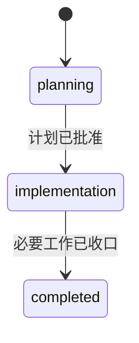

AtomicNode 的工作生命周期：

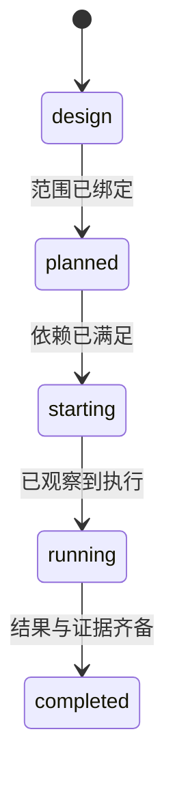

TaskStatus 的派生状态：

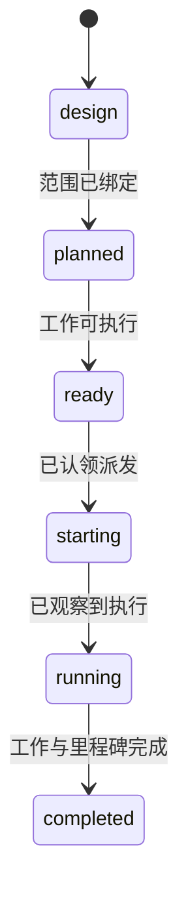

DeliveryUnitStatus 的派生状态：

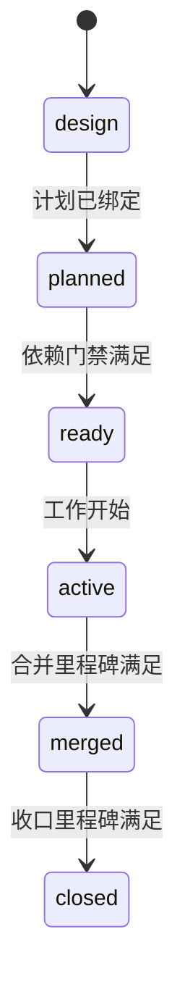

Provider PR 外部事实：

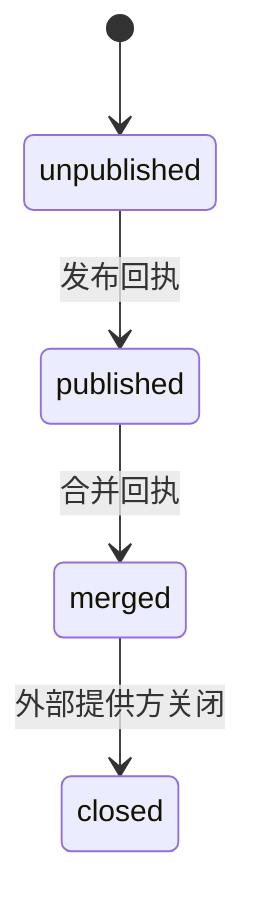

Operation 状态：

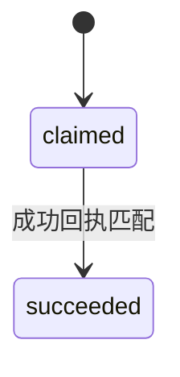

这些图中的 `ready` 是 Task 或 DeliveryUnit 的派生可执行状态，不是额外的持久化权威字段；`merged` 和 `closed` 也必须分别由对应的合并/收口里程碑与证据支持。网页上的任务图和交付单元图仍然只是 AtomicNode + AtomicEdge 的投影，不能反向成为新的依赖来源。

### 2.2 非正常流程状态机

AtomicNode 的阻塞与恢复：

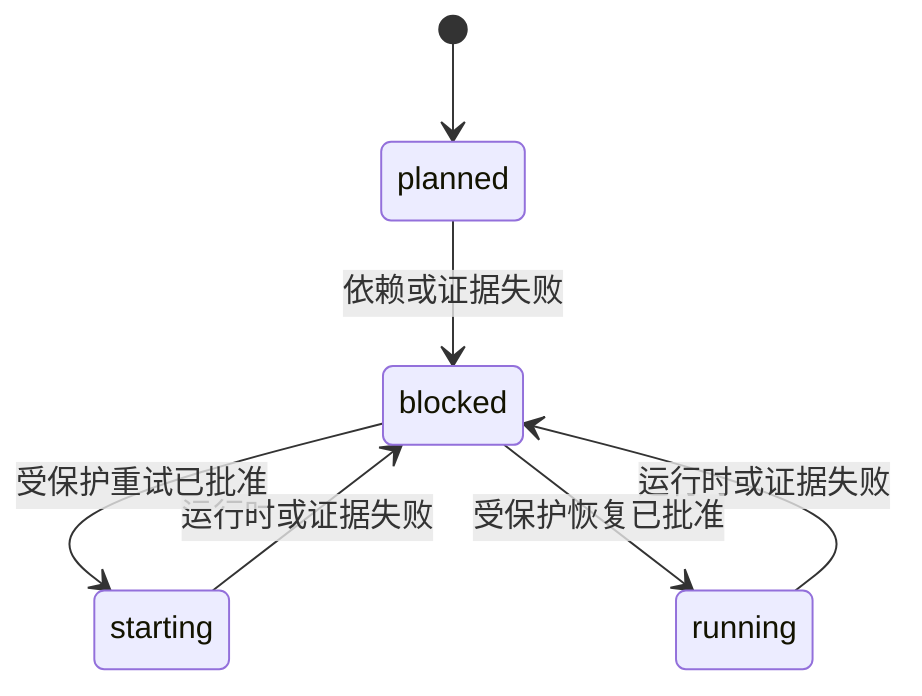

TaskStatus 的异常投影：

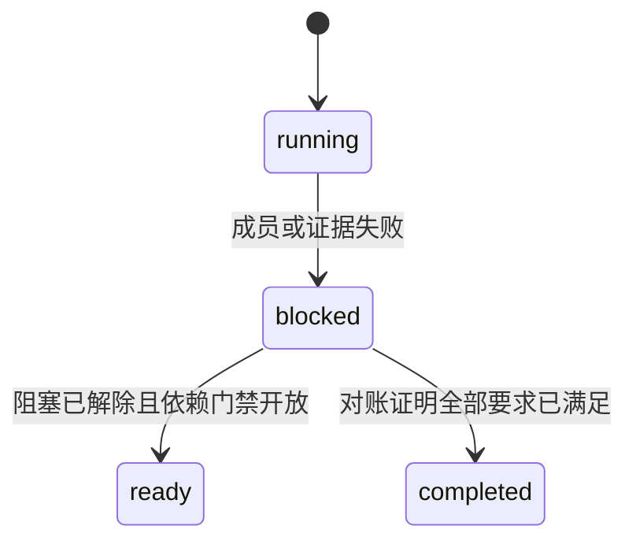

DeliveryUnit 的收口核验与修订：

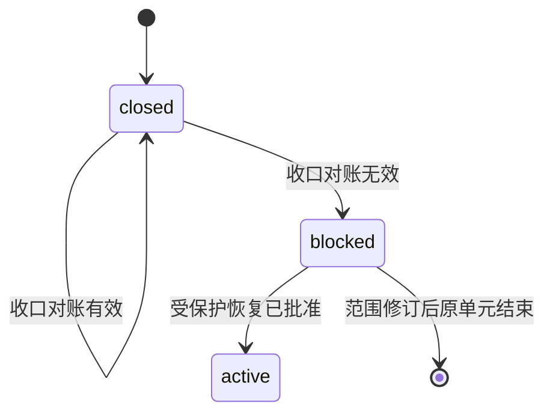

最后一条边表示原 DeliveryUnit 保留收口和阻塞审计后结束其原责任边界；计划修订另行创建处于 `planned` 的后继 DeliveryUnit，不表示覆盖原单元的收口。原单元只能从 `blocked` 经过受保护恢复回到 `active`，不得直接从 `closed` 回到 `active`。`closeout-reconcile`、`protected recovery`、`recovery_pending`、`reconciling`、`quarantined` 和 `reopened` 都是命令、事件、审计标签或 UI 提示，不是新增业务状态。

Provider PR 的异常事实：

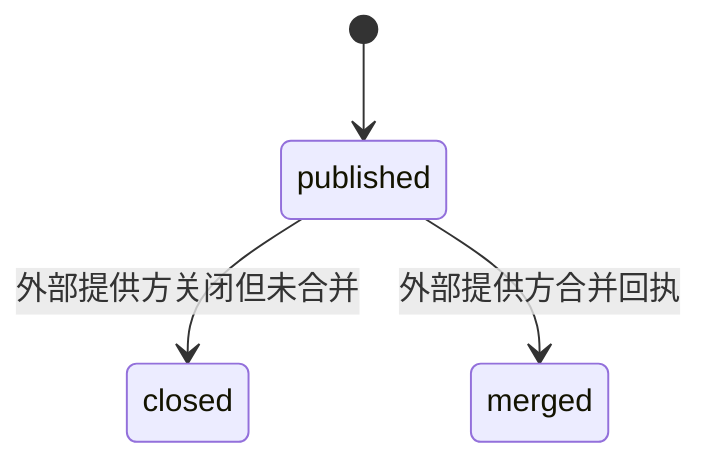

Operation 的异常事实：

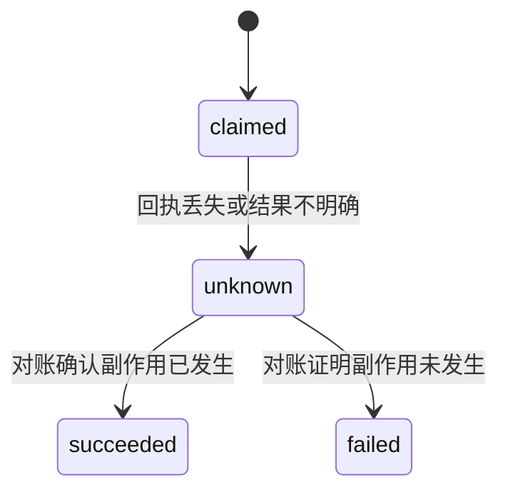

provider PR 的 `closed` 没有合并回执时不得满足 `requires: merged`；`unknown` 只属于一次 operation，不能被误写成 Task 或 DeliveryUnit 的业务状态。若已成功执行的下游 operation 所依赖的上游合并能力后续失效，新的下游派发进入阻塞门禁，既有 operation 保留 `succeeded`、`failed` 或 `unknown` 并单独对账。

聚合边必须保留“聚合边 -> 原子路径 -> 具体节点 -> 条件 -> 证据/阻塞原因”的回溯入口。

## 3. 状态推导与恢复

### 3.1 Work 原子

原子 state 必须包含 design。design 只允许存在于设计阶段，此时 scope 缺省；从 design 转为 planned 时必须一次性确定唯一 scope，之后不得回到 design。

work 原子保留唯一的执行状态：

```text
planned -> starting -> running -> completed
planned -> blocked
starting -> blocked
running -> blocked
blocked -> starting
blocked -> running
```

ready 不作为独立字段持久化；它是依赖满足、执行策略和资源可用性计算出的瞬时可执行条件。原子完成必须带有与活动类型匹配的 result/evidence：contribution 对应实现和质量结果，documentation 对应文档产物，verification 对应线上验证，release 对应发布证据，deployment 对应目标环境证据。

### 3.2 Task

Task 不保存独立的权威 state。TaskStatus 中可以包含 design、planned、ready、starting、running、blocked 和 completed；这些值都由 task scope 的 work 原子、里程碑和外部事实计算，不再额外保存 `ready` 布尔字段。Agent idle、waiting、disconnected 等 runtime observation 只作为独立叠加信息，不参与业务状态判定。

TaskStatus 按 `design → blocked → completed → running → starting → ready → planned` 的顺序取第一个满足条件的结果，以保证状态互斥；其中 `blocked` 优先于 ready/starting/running，`completed` 只有在不存在阻塞且所有必要条件满足时才成立。

- design：范围内仍存在 design 原子或任务尚未完成 scope 绑定。
- planned：没有 design 原子、阻塞节点、starting/running 节点或可执行成员。
- ready：至少一个成员 work 原子满足依赖并可执行，且没有 starting/running 节点。
- starting：至少一个成员 work 原子处于 starting 且没有 running 节点；对于 contribution Task，普通路径只有在所属 DeliveryUnit 已有 `pr` 和 `parent_branch` 后才能进入该状态，活跃且 workspace readiness 已完成的 main-owned bootstrap unit 的 main-owned contribution task 除外。
- running：至少一个成员 work 原子处于 running。
- blocked：成员节点存在明确阻塞、拓扑错误、证据错误，或多任务拓扑中的贡献任务 child PR 已进入 `closed` 且尚未建立替代 PR。
- completed：所有成员 work 原子完成，且该 Task 所需里程碑全部 satisfied。

`integrated` 是旧账本中的业务标签，表示多任务拓扑中贡献 Task 自己的 child PR 已经合并到 DeliveryUnit 的集成分支；共享交付拓扑不需要该中间标签，因为唯一 PR 同时就是 DeliveryUnit 和 contribution Task 的交付。它不表示存在 follow-up PR，也不表示 Task 的全部工作已经完成。follow-up PR 是独立的外部资源，可以在 child PR 集成后继续存在，并由自己的发布/合并事实或里程碑决定是否阻塞 DeliveryUnit 的后续步骤。新模型不把 `integrated` 作为 canonical TaskStatus，而是用 `pr_merged` 外部事实或对应 milestone 的 satisfied 结果表达；网页如需保留旧术语，只能显示为派生标签。

这三个词的边界必须固定：`integrated` 表示“child PR 已进入 DeliveryUnit 集成分支”，是过程标签；`completed` 表示“该 Task 的全部 work 原子完成，且所需 milestone 全部 satisfied”，是成功的 canonical TaskStatus；`closed` 在旧 Task 账本中表示记录被关闭或收口，可能发生在 `integrated` 或 `completed` 之后，也可能用于 abandoned、superseded 等不成功的终止，因此不能当作成功状态。新模型不把旧 Task 的 `closed` 写入 TaskStatus；成功收口使用 DeliveryUnit 的 closeout milestone，管理性关闭使用独立的 disposition/closure 事实。Task 的 `closed` 与 `TaskPrBinding.state = "closed"` 也不是一回事，后者只表示 provider 关闭了 PR。

### 3.3 DeliveryUnit

DeliveryUnitStatus 由同一 delivery_unit_id 范围内的全部成员节点、交付单元级里程碑和外部事实推导；Agent runtime observation 不参与业务状态判定。

DeliveryUnitStatus 按 `design → blocked → closed → merged → active → ready → planned` 的顺序取第一个满足条件的结果，以保证状态互斥；`closed` 和 `merged` 只有对应的交付单元里程碑 satisfied 后才成立。

- design：范围内仍存在 design 原子或交付单元尚未完成计划绑定。
- planned：没有可执行、starting 或 running 的 work 原子。
- ready：至少一个成员 work 原子满足依赖并可执行，且没有 starting/running 原子。
- active：至少一个 work 原子处于 starting 或 running。
- blocked：存在明确阻塞节点、未满足且已失败的必要里程碑、拓扑错误，或 DeliveryUnit 的集成 PR 已进入 `closed` 且尚未建立替代 PR。
- merged：交付单元集成 PR 合并里程碑 satisfied。
- closed：收口里程碑 satisfied 且所有必要节点完成。

交付单元集成 PR、CI、发布和部署事实由外部操作和 provider evidence 记录，只作为原子完成或里程碑满足的输入，不再同步成另一份 DeliveryUnit.lifecycle 状态。

### 3.4 Agent 运行观察

Agent 空闲、对话连接、最新输出和观察器断开等信息属于独立 runtime_observation。页面可以同时显示“任务已完成 · Agent 空闲”或“任务执行中 · 对话断开”，但运行观察不能覆盖原子图推导出的 Task 或 DeliveryUnit 状态。

### 3.5 非正常恢复与修订

非正常恢复不引入新的 DeliveryUnit、Task 或 Run 业务状态。`recovery_pending`、`reconciling`、`quarantined` 和 `reopened` 只能作为命令结果、事件名称、审计标签或网页操作提示；它们不得进入 DeliveryUnitStatus、TaskStatus 或 AtomicNode lifecycle。

`closeout-reconcile` 是只读 provider observation 与账本事实的受审计核验入口。它 MUST 携带原 closeout event/request、当前 revision、plan/execution plan identity、目标 DeliveryUnit、PR identity、merge_sha、最新相关事实、evidence references、reason 和影响范围。核验结果分为三类：事实仍支持 closeout 时保持 `closed` 并追加成功事件；事实否定 closeout 时追加失效事件并转为 `blocked`；事实不足或外部副作用未知时保持原业务状态并阻塞受影响的后续门禁，直到新的证据完成对账。

`group-reopen` 只表示受保护的 `blocked -> active` 状态转移，不得直接执行 `closed -> active`，也不得绕过计划、workspace、branch、owner、PR 和基线门禁。它只适用于必须复用原 DeliveryUnit 身份的恢复；收口后出现新需求、新任务或新交付范围时，必须通过 implementation plan revision 创建 successor DeliveryUnit，原 DeliveryUnit 的 closeout 历史保持不变。

恢复命令 MUST 使用标准 `request_id`、`expected_revision`、绑定 actor 和稳定的 reconciliation/recovery identity。相同输入重放返回原结果；相同 identity 的不同输入失败；revision 冲突要求先读取新账本再重新判断。恢复不得删除、覆盖或伪造旧 provider fact、merge receipt、closeout event、Task result 或 operation receipt。

如果被恢复的 DeliveryUnit 已经成为其他任务或交付单元的依赖源，失效的 merge capability MUST 阻止新的下游派发，并在 projection 中列出受影响的 dependency path。已经成功执行的下游 operation 不得自动回滚；其 `succeeded`、`failed` 或 `unknown` 结果必须通过各自 operation 的 reconcile contract 处理。

## 4. 审查要点

- 正常流程先审查每个对象自己的状态机，再审查对象之间通过事实、里程碑和门禁形成的依赖关系。
- 异常流程不得新增 `reconciling`、`reopened` 或其他临时业务状态；恢复动作必须落为追加事件，并重新计算受影响投影。
- `closed` DeliveryUnit 的下游能力与其自身继续派发的 readiness 必须分别显示和判断。
- 范围变化必须产生计划修订和 successor DeliveryUnit；原对象的 closeout、事实、结果和副作用记录必须保留。

## 5. 详情面板的三状态组合投影

详情名称右侧只显示一个状态图标。它组合业务/执行状态 S、运行就绪 R 和调度门禁 D，悬浮或键盘聚焦时以两行显示三项原始信息。第一行是任务或交付单元状态，第二行是运行就绪与调度状态。它是只读展示状态机，不改变第 1 节的对象边界，不持久化，不作为派发许可，也不替代 `is_ready`、依赖检查或操作审批。

### 5.1 状态一：业务/执行状态

Canonical TaskStatus 与 DeliveryUnitStatus 的正常、异常状态机见第 2 节和第 3 节。详情读取的兼容 Viewer 尚包含旧账本标签；下图描述其输入与观察叠加，不能反向作为 canonical 业务迁移规则。

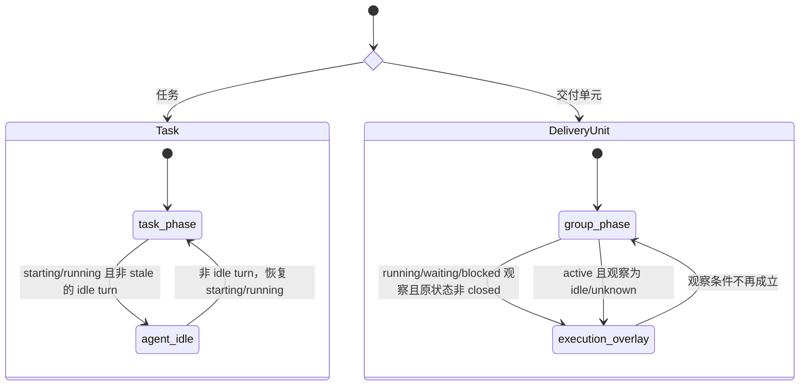

`task_phase` 的输入集合是 `planned | ready | starting | running | agent_idle | waiting | blocked | integrated | completed | closed`；`group_phase` 是 `planned | active | merged | closed | blocked`。`groupExecutionVisualState` 保留 raw group state，额外计算展示状态；closed 不允许观察覆盖。已存在的观察不能证明业务状态已迁移：例如 raw active、观察 blocked、R ready、D ready 是合法组合。约束必须检查 raw state，不能检查显示文字或观察后的状态。Task 的 idle 叠加遵循 `runtimeTaskState`，不覆盖 waiting、blocked、终态或非 active disposition。

### 5.2 状态二：运行就绪 R

`groupRuntimeReadiness` 根据同一账本快照重新计算。Task 没有独立的同名字段，详情取所属交付单元的 R，提示文字必须写“所属单元运行就绪”。下图的边表示事实变化后的重新计算，不是写入业务状态的命令。

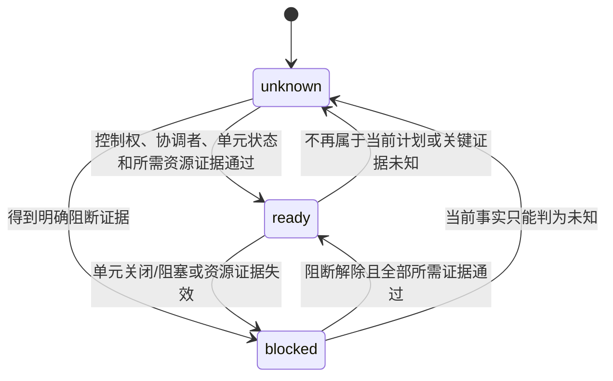

判定顺序是：非当前计划相关单元为 unknown；closed 为 blocked；需要运行证据但控制权未确认时为 unknown；协调者未创建为 blocked、未知为 unknown；planned 或 blocked 单元为 blocked；最后检查 workspace、worktree、branch、发布回执和适用的基线证据。资源 blocker 的明确失败与未知由 `blockersReadiness` 合并。顺序本身影响可达组合：不相关的 closed 单元可以是 unknown；已合并但尚未 closed 的单元目前仍可能是 ready，不能擅自改成 blocked。

### 5.3 状态三：调度门禁 D

D 是 `view.ts` 的 policy/交付门禁投影，不是 Task 的最终可执行状态。交付单元完整输出只有 ready、blocked；Task 还允许旧执行策略未配置时的 unknown。

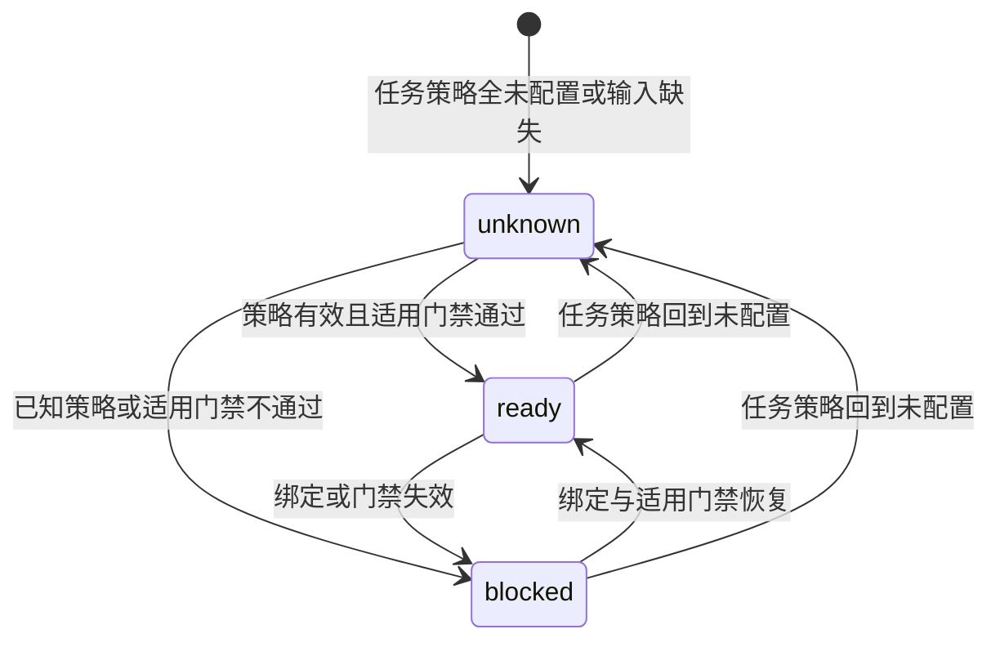

交付单元 D ready 要求 raw state 为 active、workspace lifecycle 通过且对应原子 completed、父 PR 门禁通过或满足 bootstrap 例外，并且 regular 单元已绑定 Agent。Task 则先检查三项执行策略是否全 null，再检查策略问题；贡献任务额外检查交付门禁，最后检查 bootstrap 或 Agent 绑定。D 不检查 Task 自身是否 completed，因此 completed + D ready 并不矛盾。R 还检查独立的资源证据和控制权，所以 D ready 既不蕴含 R ready，R ready 也不蕴含 D ready。

### 5.4 组合、剪枝与状态转换

先构造笛卡尔积 `P = S × R × D`，再按对象类型应用源码已证明的不变量，得到允许集合 A。组装与转换使用同一个账本/view 快照；不能把三次异步读取拼接，也不能为了动画依次修改三项而经过非法中间态。若来源状态机在事件 e 后得到 S′、R′、D′，组合机直接转移为 `q′ = (S′, R′, D′)`；q′ 不属于 A 时转到 unknown fallback。观察叠加另存为 V，完整 key 是 `[kind, S, V, R, D]`，禁止用一个概览类别替代这个 key。

交付单元的原始积有 `5 × 3 × 3 = 45` 个三元组。当前完整生产者输出满足以下关系，保留 15 个候选，排除 30 个；这是按可见字段约束得到的保守允许集合，不声称每一对候选之间都有直接迁移边。

| Raw S | 允许的 R | 允许的 D | 三元组数 |
| - | - | - | - |
| active | ready / blocked / unknown | ready / blocked | 6 |
| merged | ready / blocked / unknown | blocked | 3 |
| planned | blocked / unknown | blocked | 2 |
| blocked | blocked / unknown | blocked | 2 |
| closed | blocked / unknown | blocked | 2 |

证明来源：`deliveryGateDiagnostics` 对任意非 active 单元添加 `DELIVERY_UNIT_NOT_ACTIVE`，因此其 D 不可能 ready；`groupRuntimeReadiness` 在资源检查之前阻断 planned、blocked、closed，因此这些 S 的 R 不可能 ready；`view.ts` 的 group dispatch 分支只产生 ready 或 blocked。group D unknown 表示缺失/旧投影/尚未支持的数据，并非当前完整生产者的合法正常输出；UI 仍接受输入并走 unknown fallback，不能崩溃。

不能额外剪掉 active + R blocked + D ready（调度门禁通过后 worktree 证据缺失）、active + R unknown + D ready（控制权未知）、active + R ready + D blocked（父 PR 门禁未通过），以及 merged + R ready + D blocked（当前 runtime 检查不把 merged 当作 closed）。这些是真实规则允许的情况，不应使用直觉上的 `D ready ⇒ R ready` 抹掉。

Task 的兼容输入积为 `10 × 3 × 3 = 90`。目前这三个可见字段不足以证明进一步的通用互斥关系，故保守保留；不能把 group 的剪枝规则套到 Task。R 属于 owner，D 属于 Task policy，S 属于 Task 的业务/执行观察，三者作用域不同。这里保留 90 个候选不等于声称某个固定任务在某个固定计划中能遍历全部候选；若将来引入 kind、policy、owner phase 等额外约束，必须先用生产者证据证明并扩充测试，再收窄允许集合。

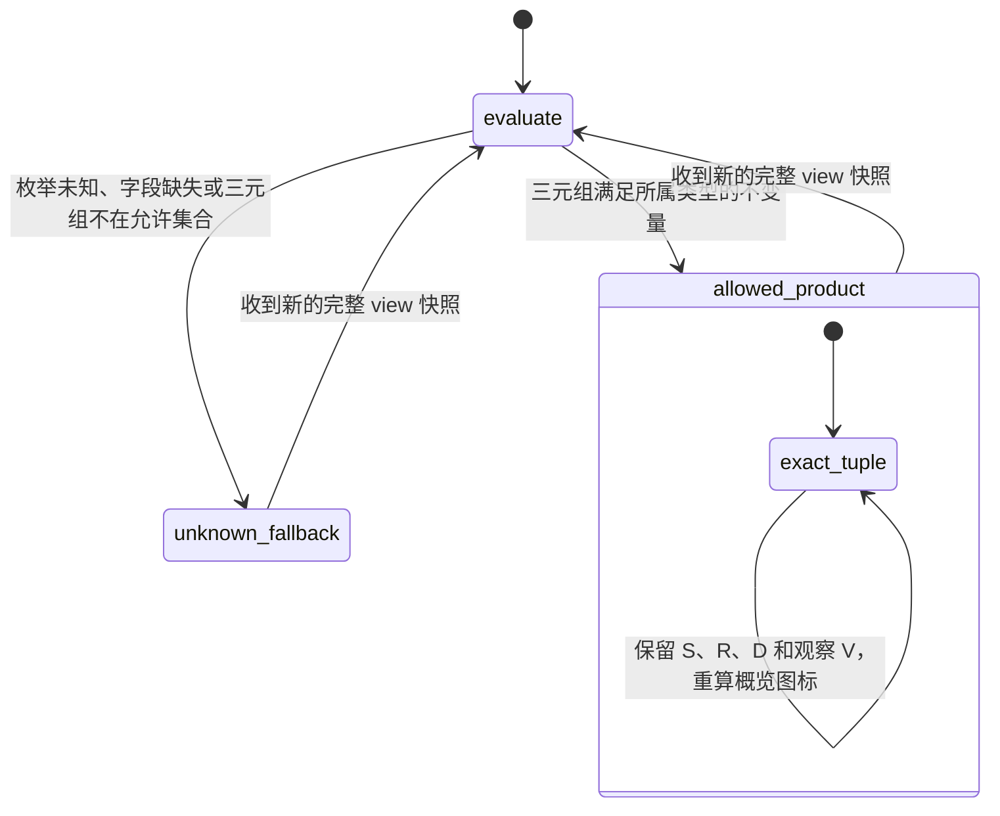

### 5.5 单图标与未知兜底

一个图标显示概览，精确状态由完整 tuple key 与两行 tooltip 保留。多个合法 tuple 可以共享图形，但它们仍是不同的组合状态；这不是已经证明行为等价的最小化状态机，不能声称单个形状无损编码全部 105 个候选。概览按下表从上到下匹配，第一项命中即停止。

| 条件 | 唯一图标 | 概览 |
| - | - | - |
| 非法 tuple、未知枚举、字段缺失，或任一就绪字段/执行观察为 unknown | circle-help | 状态待确认 |
| 已知的 integrated / completed / closed / merged | circle-check | 已结束，具体含义以原状态为准 |
| 执行观察 blocked 或 R blocked | circle-alert | 运行阻塞 |
| starting / running / active | loader-circle | 执行中，尊重 reduced motion |
| waiting / agent_idle / idle | hourglass | 等待中 |
| D blocked | circle-dashed | 调度门禁未通过 |
| 其余已知、合法且门禁通过 | circle-dot | 就绪 |

终态优先于其后正常的关闭门禁，避免 closed + R blocked + D blocked 被误画成执行故障；unknown 与非法组合则始终优先兜底。兜底为中性色问号，不显示成功或可运行，不静默改写原值，不清空详情；tooltip 保留原值并说明组合不一致或未识别原因。异常说明附在第一行，仍保持两行状态说明。键盘聚焦、屏幕阅读器和悬浮获得同样的信息。

### 5.6 回归边界

`tests/detail-status.test.ts` 穷举 45 个 group tuple 的 15/30 边界、90 个 Task 候选、不同 tuple 的 key 唯一性、观察覆盖边界和未来枚举/缺失字段兜底；同时通过真正的 `buildView` 检查 regular/bootstrap、五种 group phase、Agent 绑定和控制权变化，断言生产者不会输出被剪掉的组合。`tests/ui/detail-status.test.ts` 验证只有一个图标、tooltip 两行、键盘打开、非法组合使用问号且原值可读。生产者不变量改变时必须连同本表、组合投影和测试一起评审，不能只放宽 UI 校验以隐藏矛盾。

## 6. 执行归属、对话策略与 Agent chip

`execution_owner` 与 `conversation_policy` 是任务编排配置，不是 Agent 忙闲或任务执行进度。以下图表示配置快照的分类及重新投影；箭头表示收到新配置后重新校验，不授权任意修改配置，也不替代计划审批、修订和冻结规则。原始枚举与合法性以 `lib/schema-policies.ts` 的 `taskExecutionPolicyIssues` 和声明 schema 为准。

### 6.1 执行归属状态机

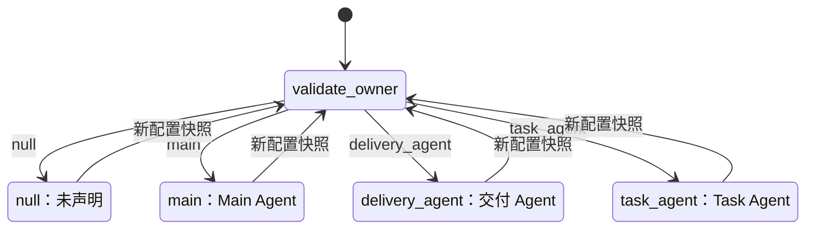

### 6.2 对话策略状态机

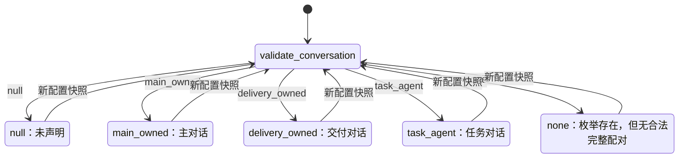

### 6.3 合成、剪枝与界面状态机

枚举笛卡尔积共 `4 × 5 = 20` 对。下表保留三组正常配对及一组未声明草稿，排除其余 16 对。`none` 虽然是对话策略枚举，但当前三个非空执行归属都要求各自固定策略，因此不能形成合法完整配对。

| execution_owner / conversation_policy | null | main_owned | delivery_owned | task_agent | none |
| - | - | - | - | - | - |
| null | 未声明草稿 | 不完整 | 不完整 | 不完整 | 不完整 |
| main | 不完整 | Main Agent | 冲突 | 冲突 | 冲突 |
| delivery_agent | 不完整 | 冲突 | 交付 Agent | 冲突 | 冲突 |
| task_agent | 不完整 | 冲突 | 冲突 | Task Agent | 冲突 |

这只是两个字段的投影，不等于完整任务策略已经有效：草稿还要求 `delivery_policy = null`，完整声明还要求交付策略非空并满足其独立约束。例如 `task_agent` 不得拥有 `parent_pr`，`main` 与 `delivery_agent` 不得拥有 `child_pr`。交付方式继续单独显示，不参与归属 chip 的命名；计划拓扑校验继续由领域层负责。

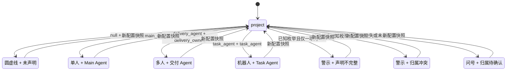

界面使用一个“图标 + 文本”归属 chip，悬浮或键盘聚焦显示 `execution_owner`、`conversation_policy` 两个字段的原始值；异常状态另附原因。`null`、缺失字段 `undefined` 和未知字符串明确区分，不通过猜测自动纠正。独立交付 chip 同样使用图标加文本，并在 tooltip 保留原始 `delivery_policy`；`parent_pr` / `child_pr` 显示父 PR / 子 PR，`shared_delivery_unit` 显示共享交付，`evidence` 显示验收证据，`none` 显示无交付产物。

`web/execution-policy-model.ts` 实现纯投影，`web/execution-policy-chip.ts` 实现可聚焦 chip。`tests/execution-policy.test.ts` 穷举 20 对并与领域校验器核对四组保留状态，同时覆盖缺失与未来枚举；`tests/ui/execution-policy-chip.test.ts` 验证单图标、文本、两个原始字段及异常说明。修改领域对应关系时必须同步更新本表、投影和测试。

## Interrupted initialization

unknown CLI dispatch → exact interrupted handshake preflight → durable recovery attempt → native exclusive writer → locked history preflight → fixed READY turn → registered native turn observation → full original/recovery chain verification → dispatch succeeded + one handoff intent。任一步骤未知或失败时保留 unknown 与所有已登记身份；intent 不过期，重入只对账。无登记 recovery、failed/active 或额外业务 turn 均不得绕过此路径绑定成功。
