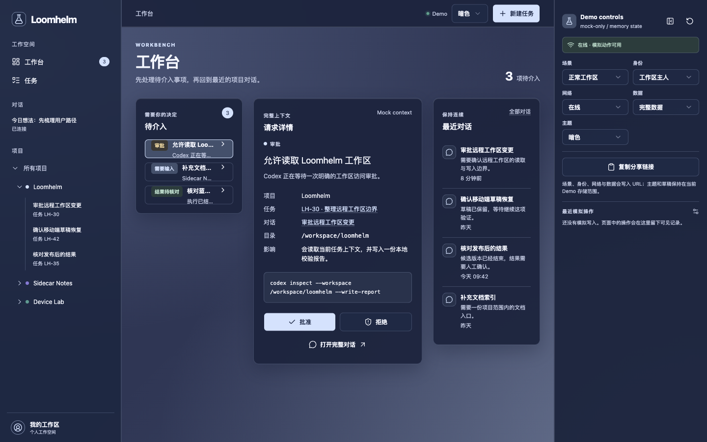
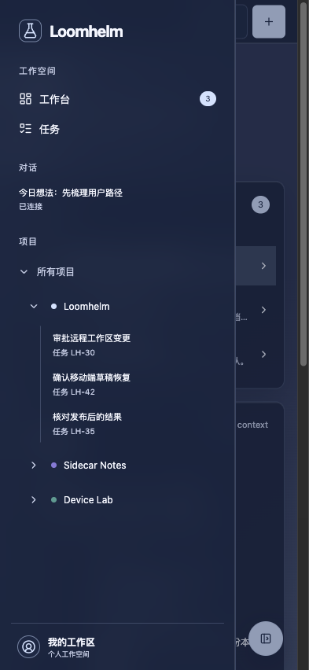
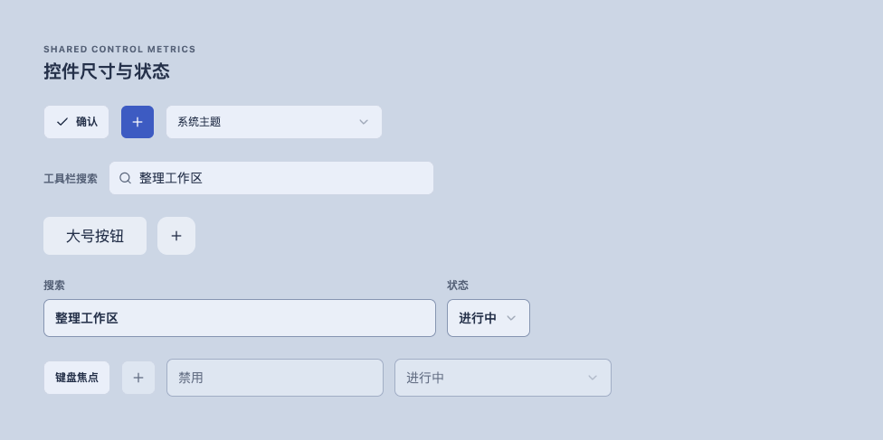
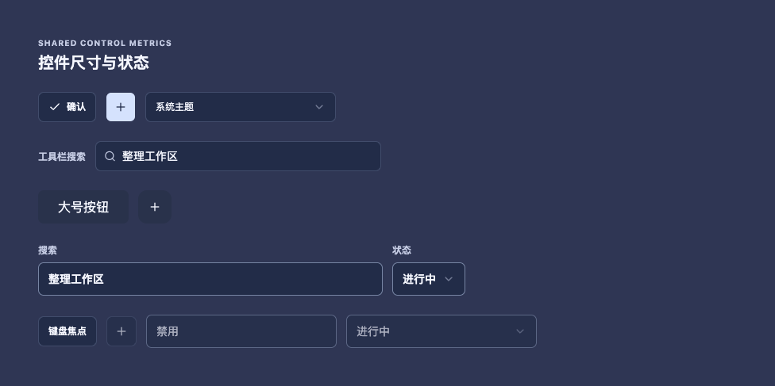
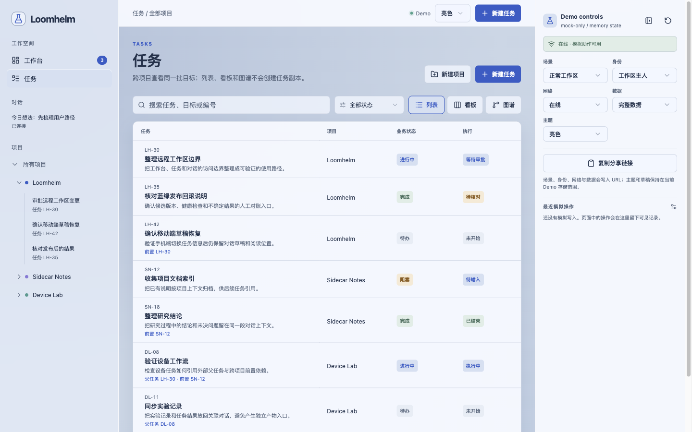
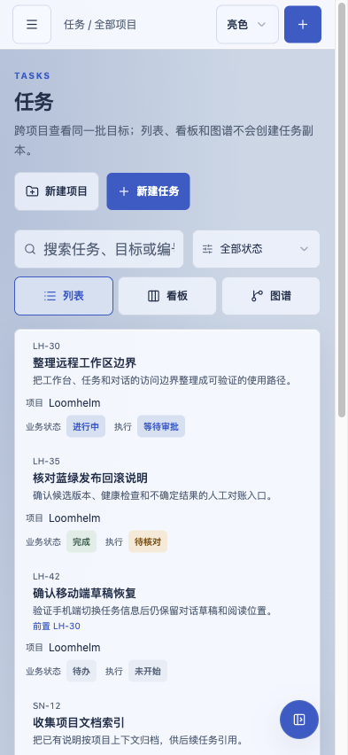

# Loomhelm core implementation coverage

## Current Status

The repository contains the Go lifecycle/persistence foundations, versioned public protocol/codegen, branch-preview blue-green runtime, Bun/React/PWA foundation, the approved product UI framework and login-free Demo, and the P01 identity/project/task services. Server and Worker require PostgreSQL and apply application and River migrations before completing startup. Server mounts the identity and business handlers under `/api/v1`, discovers a configured OIDC issuer before becoming ready, and applies cookie-session and standard-library same-origin protection to application requests. An unconfigured issuer disables browser login without permitting anonymous business access. Connector remains database-independent. Server still requires its drain token and checks persistence for readiness independently of liveness; Worker readiness remains tied to its durable generation lease and queue runner. Real product Web integration, Host/Connector/Run application assembly, MCP, PWA installation/update acceptance and a deployed product entrypoint remain separate incomplete gates.

## Implementation Coverage

| Requirements | Implementation | Verification |
| - | - | - |
| F01 slice of REQ-LH-007 | Server/Worker/Connector lifecycle skeleton, Server health/version/drain endpoints, loopback-plus-Bearer drain authorization, process-local Worker generation control and signal exits | Go unit, race and shuffled tests; `go vet`; native and `linux/amd64` cross-builds |
| F02 foundation supporting REQ-LH-006 | Bun workspaces, React/Vite/TypeScript, Router/Query providers, client/content/protocol package boundaries, neutral routes, Storybook and PWA build/registration wiring | Frozen dependency install, typecheck, Vite/PWA and Storybook builds in a session VM; observed route navigation, manifest/SW responses, narrow-screen overflow and component semantics |
| F03 infrastructure supporting REQ-LH-007 | pgx pool, embedded Goose schema, domain-local sqlc output, River short-job adapter and application composition; serialized migration window, bounded startup/drain and worktree bootstrap | Session VM Go test/vet, adapter race, sqlc/tidy drift and image build; real PostgreSQL/jobs, concurrent empty-database startup with a one-connection pool, outage/recovery, process drain and exact persisted rows across database restart; linked-worktree setup, failure aggregation, local-state preservation and Compose isolation |
| RD02 deployment/runtime slice of REQ-LH-007 | Immutable branch-preview manifest/state controller, Caddy blue-green slots, readiness-gated promotion, loopback-authenticated Server/Worker drain, retained Web assets, monotonic PostgreSQL Worker leases, database outage recovery and compatibility-gated switchback | Preview controller unit tests, shell/Python syntax checks, VM Compose rehearsal with real PostgreSQL and built Server/Worker images, Caddy proxy checks, old-asset fallback, generation fencing, drain, switchback, lease release/reacquisition and Worker readiness recovery |
| F05 contract foundation supporting REQ-LH-002 through REQ-LH-005, REQ-LH-008, REQ-LH-009 and REQ-LH-011 | Versioned REST/MCP operation contract, generated Go/TypeScript protocol types and codecs, typed REST client, HostGateway/CodexAdapter/RunController/ArtifactStore interfaces, command ACK and event cursor semantics, and explicit R01 new/active-session paths | Contract regeneration no-drift check, Go compile/tests, TypeScript compile, sanitized R02 fixture envelope encode/decode round trips and explicit no-fallback path tests |
| F04 quality-gate foundation supporting F01, F02, F03, F05, RD01 and RD02 | Unified quality checks, pinned dprint/Markdown and React Doctor hooks, generated-state drift checks, real database/job checks, canonical bootstrap validation and development/preview Compose validation | Required Candidate CI checks for quality declaration, bootstrap, React Doctor, Go/Web/database/generated verification and candidate build; informational reproducibility check remains separate |
| Project/task slice of REQ-LH-001, REQ-LH-002 and REQ-LH-010 | OIDC/scs identity and credentials, project/member permissions, persisted task CRUD, cross-project relationship graphs, deletion protection and migrations through 00006 | P01 real PostgreSQL ordinary/race tests and current-candidate per-test execution evidence, including all 15 required scenarios; Server/Web integration remains distinct |
| Browser application assembly supporting REQ-LH-001, REQ-LH-002 and REQ-LH-006 | Actual `/api/v1` OIDC, browser session/logout, credential, project/member and task handlers; no-store responses, cookie-only browser bootstrap, default same-origin protection and lifecycle-aware admission | Own-session VM real signed-token issuer and PostgreSQL login/CRUD/permission/CSRF/restart exercise, ordinary and race application/platform suites, database/domain suites and vet; a configured runtime does not establish a deployed Web product |
| Remaining slices of REQ-LH-003 through REQ-LH-006, REQ-LH-008 through REQ-LH-012 | The approved UI framework and Demo exist; Host/Connector/Run integration, real product Web/API/MCP workflows and PWA installation/update behavior remain incomplete | Foundation and Demo evidence do not establish full product acceptance |

## Development and Validation

The confirmed project permission contract assigns project/member administration to the project creator and read-only or operator access to other human accounts. P01 implements and verifies the project/task/member action matrix, revocation and scope-preserving credential issuance against real PostgreSQL. Operator execution and approval actions still depend on the later Run service; Agent credentials remain bounded by current user permissions and their project scope, including when deriving another credential.

The canonical credential catalog defines creation, metadata listing and revocation in the generated Go/TypeScript protocol and REST client, with matching MCP tool declarations. ADR 0006 limits inventory listing and revocation to unrestricted user principals and retains strictly bounded credential creation by project-scoped bearers. P01 implements these boundaries and verifies account isolation, bounded issuance, revocation and explicit public collection/scope shapes against real PostgreSQL. The creation-only token response remains separate from metadata. Actual MCP transport acceptance remains incomplete.

Session creation now requires an explicit command identity in the public request and service inputs. `OpenSession` rejects absent identities before calling either dependency and preserves the caller's identity across the selected Gateway/adapter path. These boundary checks do not implement durable deduplication or reconcile an old journal. Connector and controller candidates must demonstrate same-identity retry, changed-payload conflict, distinct identical-prompt intents and the declared journal compatibility window before integration.

The Connector journal compatibility window is intentionally read-compatible from format v2 to the known format v1 record shapes used by the existing implementation: legacy command records are re-digested with the current lossless JSON-number canonicalization, and legacy session/session-start records remain recovery input without inventing a caller identity. New writes always use format v2; v1 binaries are not supported against v2 journals, unknown formats fail closed, and no in-place journal rewrite or automatic pending `thread/start` replay is performed. Tests cover the demonstrated v1 large-number digest case and explicit-identity legacy session boundary; cross-process pending creation remains a review observation until a durable correlation contract exists.

The canonical membership catalog and generated Go/TypeScript types and Web client define list, creator grant/update and revoke operations, with viewer/operator as the only assignable roles and owner retained as a readable role. Transport checks cover encoded project/user identities, role-only PUT bodies, explicit collections, bodyless revocation and propagated authorization failures. P01 verifies the domain HTTP handlers through real authentication and PostgreSQL, and Server composition mounts them alongside the browser identity routes. The authenticated product UI and deployment remain separate required evidence.

The browser authentication catalog defines the authenticated session identity/protection response and bodyless logout operation under `/api/v1/auth`. Server composition mounts those routes behind actual `net/http.CrossOriginProtection` with no trusted origins or bypass patterns and returns no-store application responses. Browser session reads and logout reject Authorization headers instead of treating bearer credentials as browser sessions. The branch-preview controller forwards that same OIDC and cookie configuration to both Server slots through a mode-0600 environment file and excludes it from Worker environments. Compose-compatible encoding preserves literal credential characters, and the preview configuration-validation entrypoint suppresses expanded credential output. The opt-in Agent VM Compose suite checks both Server slot definitions, Worker credential exclusion, fourteen literal credential values delivered into disposable containers and secret-free validation stdout/stderr. Issuer discovery and cookie security are explicit Server-only configuration; OIDC state/nonce and signed-token verification remain in the shared auth service. Current-candidate Server evidence and authenticated product Web integration are separate acceptance obligations.

The confirmed relationship and deletion rules require independently acyclic parent/child and prerequisite graphs across projects, with no self-links or automatic execution. Project/task deletion must reject active execution and required historical results, and cancellation must preserve history without implicitly interrupting a Run. Business integration evidence must cover concurrent cycle attempts, unchanged state after rejected deletion and cancellation with retained results; the generated client and Demo scenarios do not establish those database guarantees.

The conversation-file durability contract requires pending publication intent, durable verified bytes, ready-only reads, cross-process serialization and bounded restart reconciliation. These storage behaviors are not established by the integrated protocol foundation. Storage-package verification must include actual PostgreSQL/filesystem process-crash and ambiguous-commit scenarios; authenticated application wiring, current principal/project authorization and Session/Run ownership remain separate mandatory integration gaps.

The active file/input contract permits a narrow, explicit repair of never-ready staging loss using the same authorized immutable bytes, retains unavailable state for all other diagnosed loss/conflict cases and requires prompt close/unblock input cancellation with a five-second total cleanup budget. The shared Go method type is unchanged; callers must supply the documented cancellable input adapters. The lossless content codec retains the 4 MiB record ceiling and adds a 64 MiB/10,000-record batch budget plus a context-aware runtime parsing path. These are contracts awaiting implementation and current-candidate verification; publishing them does not establish passing storage, content or authenticated application acceptance.

The baseline and F01 skeleton are checked with the topic Spec structural checker, Git whitespace checks, `go test`, `go test -race`, shuffled tests, `go vet`, native builds, `linux/amd64` cross-builds and inspection of Policy package/lock consistency. F04 consolidates these checks under `scripts/checks`, adds generated Go/TypeScript/sqlc drift, real PostgreSQL/River coverage, bootstrap readiness, dprint output, deployment Compose configuration and pinned React Doctor changed-file diagnostics. Product acceptance remains separate from these engineering checks; RD02 adds dedicated durable-fencing and branch-preview evidence below.

The F05 public contract is generated from one canonical JSON source. The generator validates references and operation declarations, emits deterministic Go and TypeScript outputs, and supports a byte-for-byte `-check` mode. Go tests decode every committed R02 JSONL envelope with the generated raw-payload codec, re-encode it and compare the complete JSON structure, while service-boundary tests verify that an unsupported active-session request cannot fall back to the new-session path. These checks establish protocol and codegen consistency, not authenticated REST/MCP runtime behavior.

The project/task catalog includes project get/update/delete, task get/delete, relationship reads and parent/prerequisite mutations in addition to the original operations. The generated client represents explicit HTTP 204 operations as `Promise<void>` and rejects a different success status instead of treating an asynchronous admission response as completed deletion. Focused transport tests cover encoded resource identities, dependency direction, bodyless success, preserved conflict details and the separate relationship categories. Business handlers, authorization, database persistence and the product UI still require their own real integration evidence; the generated catalog does not establish those capabilities or settle pending PRD decisions.

The persistence composition uses `sqlc.yaml` to generate the platform query package from `db/migrations` and `internal/platform/database/queries`. Generation parses the complete schema but emits only models used by that package's queries. Added business tables do not export unrelated domain models into the platform package, while changes to queried schema still produce a detectable generated diff. Goose owns application migration history and River owns queue migration history; startup holds one database session advisory lock across both. A dedicated lock connection avoids consuming the only pool connection when its maximum is one. Session-owned VM observations exercised concurrent Server/Worker startup against an empty database with that pool limit, actual short-job completion, byte-for-byte result snapshots across database restart, and Server/Worker signal drain. Database outage returned HTTP 503 from readiness while liveness remained HTTP 200; recovery restored readiness. Real process tests explicitly skip without `LOOMHELM_DATABASE_URL`, so a service-free suite pass remains separate from these observed process and database paths.

RD02 adds migration `00002_worker_leases` for a monotonic durable Worker lease keyed by deployment identity. A higher generation replaces the lease, an older generation loses readiness and River scheduling, transient database loss pauses the runner, recovery rebuilds it, and orderly shutdown deletes only the matching lease row so a clean same-generation restart can reacquire it. River startup now completes before lease admission, and any later startup failure stops the client and releases the exact matching lease; the focused integration test covers the post-admission failure cleanup path. The focused integration test and VM process check covered higher-generation fencing, old-worker 503 readiness, current-worker completion, lease release/reacquisition and database outage recovery.

The canonical `scripts/setup` entrypoint checks pinned tool readiness, prepares Markdown and frontend dependencies, and aggregates failures before returning nonzero. Actual linked worktrees with an external Git common directory passed first and repeat runs while preserving existing environment and common-hook contents. Directory and dangling-symlink environment targets were rejected without touching an external target. A controlled Bun version mismatch and unreadable sqlc command produced two aggregated failures. `scripts/dev` derives separate Compose projects, networks and volumes from canonical worktree paths, validates explicit project overrides and leaves host-port assignment to each worktree. These observations establish development bootstrap behavior, not deployment cutover or production isolation.

Application tests inject resource factories for deterministic lifecycle and failure checks. Production constructors always select the actual database/queue factory. Worker startup has a separate budget from its queue lifetime: caller cancellation revokes readiness and requests a bounded graceful stop; a graceful-stop timeout cancels runner execution and requests a bounded forced stop. Generation cancellation and pool closure follow the runner's actual stopped signal. If forced stop also expires, Run returns an error with the lifecycle still draining and retains the runtime until that signal permits cleanup; ordinary shutdown does not invalidate the generation of an interrupted job. Focused tests cover this delayed ownership release. These are process-local controls and do not provide durable Worker fencing.

Worker configuration rejects generations outside the signed positive BIGINT range before startup. When the development Compose port is explicitly supplied, Server and Worker validate that the database URL resolves to the same port before opening a connection. These corrections preserve the existing durable result and worktree-isolation contracts; their complete-candidate VM observations and refreshed formal review remain required.

The frontend foundation is checked using pinned Bun 1.4.3 with `bun install --frozen-lockfile` and `bun run check`. VM production responses include the generated manifest, service worker and Workbox files; browser checks cover the home/Status routes, brand-link return navigation, route-current semantics, a 393x852 CSS viewport without horizontal overflow, and Default/Compact Storybook states without duplicate IDs. Runtime navigation matches the root route exactly: `/` has only Runtime marked current, and `/status` has only Status marked current. This route-only correction passed targeted TypeScript and browser checks, retaining the unaffected VM build, registration and component observations. The VM browser observations used an insecure HTTP IP origin: successful manifest and service-worker fetches do not establish browser service-worker registration. A separate secure localhost production-preview observation of the repaired source confirmed an activated root-scoped service worker, with no waiting or installing worker. A controlled preview returning HTTP 503 only for `/sw.js` produced the registration-error diagnostic and no registration. PWA installation, controlled updates, offline product behavior and real backend integration require their own product observations.

## Visual Evidence

These neutral engineering surfaces document the frontend foundation. The page images use source `724107721164d60b23e7a75f21991ec659a81806`; the unchanged isolated Storybook component retains its image from source `121100ef6c3ed35edaa90bb6e59d5dd9bd7619a2`. The owner authorized Agent checking and archival in place of manual screenshot confirmation for this foundation only. This exception does not approve product styling, the complete UI design or later product visual changes. The actual source captures were compared with their exact destination paths at parent baseline `079d3d85318c365056cd29a238aafdf732581421`; all three paths are absent there, so the results are current-only, without baseline images or heatmaps. The desktop page uses trim-only normalization, the mobile page retains its 393x852 CSS viewport, and the Storybook component retains source-managed margins with only DOM-geometry tightening. Source and validation references are recorded in [History](HISTORY.md#frontend-foundation-evidence).

### Desktop verification route

### Mobile verification route

### Storybook component

### U01 product demo navigation

The U01 current-head evidence uses the login-free `ui_demo` at `162516e6b2b306f5711d7288340670bc5ef41122`, with desktop coverage at 1440x900 and narrow-screen coverage at 393x852. The owner confirmed that the selected project row covers the full arrow-to-label row, the project link background is transparent, the text and arrow colors distinguish hierarchy, and the controlled 900x800 and 393x852 checks have no horizontal overflow. Exact-path comparison against base `3f1bf1821f2eafeae072930e8218e7e166527165` returned `current-only` for both new paths because neither existed in that base; these confirmed captures are now canonical U01 evidence.

### Shared control metrics, U02 project tasks and Batch 6

The accepted U02 mock UI evidence preserves `sourceSha=c270356`; the full `renderSourceSha` is `c2703568297cf41e58b7046d8fc8477348bd5c0c`. The shared-control light and dark captures use source-managed margins, while the project-task captures cover the desktop `1440x900` and mobile `393x852` CSS viewports.

The shared UI implementation uses the `32px` dense metric for Demo Inspector selects, `38px` compact toolbar controls, `42px` form controls and `44px` touch controls, with filled surfaces using `background-clip: padding-box` so a transparent `1px` border does not make the painted control appear larger. Dense selects use an explicit shared `SelectTrigger` size instead of a local font override; mobile rules promote that semantic size to the same `44px` touch target without shrinking forms globally. These facts cover buttons, inputs, selects, search wrappers and related toolbar surfaces rather than a button-only exception.

This evidence records visual acceptance of the mock UI only; it does not by itself prove real API behavior, permissions, persistence or P01 integration. The historical backend candidate `671a5f116531924b4e4fd3f47047be2cd6acc54c` received separate Agent VM Go package validation for database, connector, auth, projects, tasks and app, plus a real Web acceptance through the production Server, disposable OIDC issuer and single-origin Vite surface. The browser flow created and edited a project and tasks, wrote parent and prerequisite relations, reloaded to reconcile both relations, switched to a viewer identity whose edit/delete controls were disabled and whose task mutation returned `404`, then removed relations and deleted the tasks and project; post-delete reads returned `404`. The first final-candidate jobs run stopped at `TestRunnerFencesOlderGeneration` because the current Runner lease was not yet valid; the focused rerun passed and the complete jobs suite passed on the next run. The earlier Batch 7 jobs investigation recorded one context-deadline timeout, two focused lease-validity failures and a third focused pass; no code change was attributed to that transient timing result. This historical runtime evidence does not validate the current U02 frontend mutation/reconciliation candidate; current U02 validation remains local until the required runtime and product admission gates are reopened.

The Batch 6 candidate evidence uses `ui_demo` at commit `235ae4ec74b334f63837b491fca0c1f418d09579` against base `cfcfad41f0887c28304b362e54943bb6fd96e1a2`, with desktop coverage at `1440x900` and mobile coverage at `393x852`. The owner confirmed the four candidate captures after exact-path comparison returned `current-only` with no baseline or heatmap; trim normalization was unchanged with `ambiguous_border` and zero padding. This historical record remains UI evidence only; the canonical project-task assets below are bound to the current U02 candidate, while the 44px mobile touch metric remains evidenced by DOM/Storybook runtime checks rather than by the historical mobile screenshot. This remains UI evidence only and does not establish backend or product acceptance.

The current U02 candidate is `0e0c78b` against base `92c6c748f192f8984f97f5cb1b42c261bd7df91d`, re-rendered from the login-free `ui_demo` at `1440x900` and `393x852` CSS viewports. The candidate preserves the owner-confirmed workbench layout while the implementation closes cross-tab mutation races, coordinates task creation and resource writes through ordered locks, keeps crash-recovered creations explicitly confirmable, binds post-create task recovery to the created task lock scope, retains local fail-closed barriers when notice persistence is unavailable, propagates volatile barriers to active tabs, prefers newer volatile notice versions over stale persisted records, preserves created-task results, merges refresh conversion under the same lock, and gates reconciliation acknowledgement; trim-only normalization retained the workbench and project-task captures with `ambiguous_border` and zero padding, and the canonical assets below are bound to this candidate. The project-task captures were re-rendered after collapsing the Demo Inspector so the canonical desktop and mobile pages represent the current accepted route state.

## Rollout and Compatibility

The initial application schema retains platform short-job results; River retains queue state separately. There is no previously deployed application schema or production compatibility claim. Re-entering startup may apply pending migrations but must not reverse them, and a migration failure prevents readiness. Empty-database migration, startup re-entry and persistence after restart have VM observations; a backend image was built and identified by its local content hash. Immutable candidate publication/promotion and tar-based handoff are implemented; supported blue-green compatibility windows, traffic switching, cross-process Worker fencing and production deployment still require their deployment implementation and observations. The planned release channel is an isolated parent-branch preview; production configuration is not established here.

RD02 adds migration `00002_worker_leases` for a monotonic durable Worker lease keyed by deployment identity. A higher generation replaces the lease, an older generation loses readiness and River scheduling, transient database loss pauses the runner, recovery rebuilds it, and orderly shutdown deletes only the matching lease row so a clean same-generation restart can reacquire it. River startup now completes before lease admission, and any later startup failure stops the client and releases the exact matching lease; the focused integration test covers this post-admission cleanup path. The isolated branch-preview controller records exact source SHA, artifact digest, immutable Server/Worker image references, a deterministic Web tree digest and a two-way state compatibility window, switches Caddy only after candidate image/version/Web identity and both slot readiness checks, drains the retiring slot and keeps multiple compatible retained Web trees available for old clients. VM rehearsal covered promotion, old-asset fallback, switchback, generation fencing and database recovery; production configuration, registry publication and final release policy are not established here.

## Remaining Gaps

All product requirements still require implementation and the observations described by their VER entries. In particular, Connector enrollment/authentication/recovery, business-state persistence, authenticated business APIs, production deployment and final release policy remain unimplemented; existing active desktop-session control has not been proven, and D01's approved design package does not by itself establish production UI or business acceptance. Platform short-job infrastructure and branch-preview evidence are not evidence of those business capabilities.

The approved product boundaries require a single configured execution environment, top-level Workbench/Tasks entries, a projectless Conversations group and project/conversation tree, conversation-context files, shared drafts and task relationships. All Conversations remains accessible from Workbench. Their presence in the specification is not evidence of backend support. Structural prototype checks do not establish real Codex, persistence, cross-client synchronization or PWA acceptance.

The complete [product requirements](../../PRD.md) await explicit owner confirmation. Its business suggestions are not approved defaults. Business implementation and public business contract finalization wait for that confirmation and resolution of the affected decisions; D01's complete UI design approval is recorded separately and does not substitute for PRD admission. Skeleton, infrastructure, capability research and the existing design discussion remain permitted.

Standalone creation with optional project selection and later task association is established product intent, including actual execution before a task exists. The task-mandatory Run definition has been corrected; existing adapter capability and authorization support are not thereby proven. The owner confirmed at most one Task per Session as well as one main Session per Task, fixed phase-one bindings, creator-private projectless conversations and explicit consent before project sharing of historical messages/execution/files, with private unsent drafts. Draft conflicts automatically use the last modification; sending preserves later input and restoration does not send. Task business states include Blocked as well as To do, In progress, Done and Cancelled.

Both task parent/child relationships and prerequisite dependencies may cross projects while retaining each task's project and Session ownership. Their implementation must enforce endpoint authorization and avoid disclosing protected task content through relationships. Cycle handling, editing and protected-deletion behavior, and the small-team permission matrix still require decisions before affected implementation. The shared-draft protocol must define consistent modification ordering, deduplication and recovery. Product decisions are collected in the PRD rather than inferred from prototypes or implementation defaults.

System-following theme with manual light/dark override and independently retained client preferences is established product intent. Neither implemented theme parity nor browser evidence is established by that decision, and it does not select a preference-storage technology.

Client-local, identity/workspace-scoped view preferences are the implementation default; they do not introduce a server preference service or move another client's active view.

## References

- [Requirements](SPEC.md)
- [History](HISTORY.md)
