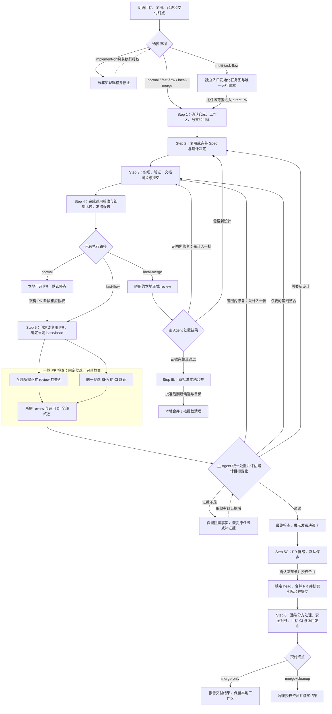

# 工程流程指南

[project-engineering-workflow](../skills/project-engineering-workflow/SKILL.md) 串联本地实现、验证、PR 审查、合并与发布。流程入口确定执行授权和停止位置；Git、文档、视觉证据与资源管理分别由对应 Skill 负责。

章节：[计划与契约](#计划与契约) · [流程与终点](#执行流程与交付终点) · [开发生命周期](#直接交付的生命周期) · [review 与修复](#code-review-与修复收敛) · [PR 与集成](#pr-发布与并行集成) · [合并与发布](#合并发布与交付完成) · [文档维护](#文档证据与持续维护) · [流程恢复](#等待阻塞与流程恢复) · [dot-codex 维护边界](#在-dot-codex-中维护这套流程)。

## 计划与契约

Spec、ADR 和执行计划分别保存长期契约、设计决定与本次执行安排：

| 内容 | 作用与保存位置 | 与实现的关系 |
| - | - | - |
| 主题规格 | `docs/specs/<topic>/SPEC.md` 保存长期行为、接口与边界；配套 `IMPLEMENTATION.md`、`HISTORY.md` 记录实现覆盖和演进 | 已有主题继续引用或同步；新的长期契约按需建立规格 |
| 架构决定 | `docs/adr/` 保存难逆转、非显然且有真实取舍的决定及理由 | 未决决定先收敛；ADR 与现行 Spec 冲突时先明确解决两者关系 |
| 执行计划 | 会话中的临时计划安排本次范围、步骤、验收、执行流程与停靠点 | 计划得到执行授权后进入开发；不把进度清单写进长期 Spec |

[topic-spec](../skills/topic-spec/SKILL.md) 负责主题规格；`grill-with-docs` 用于收敛未决设计。需要清理旧规划资料时由 [docs-migrate](../skills/docs-migrate/SKILL.md) 处理。已有规格可直接复用；普通实现不必为每项改动新建 Spec 或 ADR。规格目录是工程知识目录，不能把其中的 `active` 状态当成待办队列。

普通 Plan Mode 使用 Codex 内置行为。在 Plan Mode 中显式调用 [dev-plan](../skills/dev-plan/SKILL.md)，才启用本仓库的自定义计划合同：优先保留明确选择的流程；没有明确选择且无歧义时，直接任务默认采用 `fast-track + merge-ready`。文件多、改动大或预计耗时长本身不足以改变直接交付路径。

`dev-plan` 输出一份决策完备的临时计划，锁定一个顶层流程；计划输出本身不开始实现。后续执行沿用获准的目标、验收和停靠点。新的规划默认值不会改写一个已经执行中的流程。

## 执行流程与交付终点

流程入口分别承担实现规划和直接交付；`multi-task-flow` 是独立的多任务运行时，不属于 `dev-plan` 的顶层路由。任务内部的单个 PR 仍复用直接交付阶段，不把父级协调和子任务收口混成一个流程。

| 流程入口 | 工作范围 | 默认产出与停点 |
| - | - | - |
| [implement-only-flow](../skills/implement-only-flow/SKILL.md) | 规划实现目标、技术决定、接口、失败场景和验收 | 可直接实现的规格；当前契约仅做规划，不修改实现，也不安排提交、PR 或合并 |
| [normal-flow](../skills/normal-flow/SKILL.md) | 本地实现、验证、文档同步和提交 | 本地候选可开 PR，停在 Step 4；尚未 push 或创建 PR |
| [fast-flow](../skills/fast-flow/SKILL.md) | 本地开发，push，创建或更新 PR，处理范围内的收敛修复 | 已有 PR 通过合并前检查并展示发布决策卡，停在 Step 5C；尚未合并 |
| [local-merge-flow](../skills/local-merge-flow/SKILL.md) | 本地开发、验证、提交和适用 review | 本地候选待批准合并，停在 Step 5L；不创建 PR，不默认 push |
| [multi-task-flow](../skills/multi-task-flow/SKILL.md) | 依赖驱动的多任务会话、任务账本、子 PR 与 parent PR 协调 | 按计划完成任务、批次、发布和验证收口；每个任务的直接 PR 阶段复用 `$fast-flow` |

`implement-only`、`normal` 和 `local-merge` 需要明确选择。规划完成后，经执行授权进入对应的开发流程。

PR 路径还要确定交付终点：

| 停靠目标 | 完成范围 |
| - | - |
| `merge-ready` | PR 已就绪，发布决策卡已展示，停在合并前 |
| `merge-only` | 获准合并后，核实合并与合并范围内的收尾事实、目标分支 CI 和适用发布；保留本地工作区 |
| `merge+cleanup` | 完成上述交付，再执行授权的本地分支、工作区等清理 |

普通“合并 PR”表示 `merge-only`。远端实现分支的处理和主工作区安全对齐属于合并范围；删除本地工作区属于另行选择的本地清理。授权绑定当前任务及交付范围。

[flow-continue](../skills/flow-continue/SKILL.md) 恢复已有流程及其未完成阶段，沿用停靠目标和累计修复次数。`normal-flow` 的普通续推可进入 PR 设置，但可写的 PR 收敛需要明确的收敛或 `fast-flow` 授权；续推保留原流程类型。

## 直接交付的生命周期

直接交付围绕一个明确的实现范围展开，通常对应一个实现分支和一个 PR。主 Agent 负责修改、验证、提交及结果处置；reviewer 和 CI tracker 只读检查并返回证据。

候选版本是准备验证或交付的一组确定改动。PR 的 head 是实现分支当前提交，base 是要合入的目标版本；SHA 是这些提交的身份。绑定这些身份，是为了确保测试和 review 描述的就是正在交付的内容。

下图展开直接交付的完整路径。正式 review 的检查数量由风险评估决定；无需正式 review 的候选仍须完成适用验证、CI 和最终仓库检查。

### 工作区与开发基线

开始开发时，先确认仓库、现有分支与 PR、未提交改动及交付目标。开发从具体的基线开始；目标优先取主人明确指定的引用，其次是唯一已有 PR 的 base、明确的集成上游，最后才是仓库主干。从某个 SHA 开始开发，不自动表示交付目标永久固定在该 SHA。

实现应位于非默认主题分支。已有可用工作区优先复用，需要隔离时使用独立 worktree；worktree 是共享 Git 历史、文件目录彼此独立的工作副本。用户已有的无关改动必须保留，不能为了得到干净状态而擅自 stash、丢弃或覆盖。主干有新提交时先检查是否影响本次集成，再决定是否对齐。

这一阶段的产出是明确的实现位置、开发基线和交付目标。分支、同步和工作区操作分别由 [git-branch](../skills/git-branch/SKILL.md)、`git-sync` 和 [git-worktree](../skills/git-worktree/SKILL.md) 负责；远端连接异常交给 `git-remote-troubleshoot`，不通过暗改 remote、协议或 upstream 绕开授权。

### 实现、验证与候选形成

设计和验收稳定后，按完整、可撤回的切片实现。每个切片完成相关验证、适用文档同步，再用英文 conventional commit 和 signoff 提交。状态或并发改动应先执行关键行为验证，再扩大实现范围；只有编译通过，或测试因环境问题未能运行，都不能证明行为正确。

验证服务于验收，主要包含三个相互补充的方面：

| 验证内容 | 证明的事情 | 对候选就绪的影响 |
| - | - | - |
| 仓库内验证 | 测试、构建或静态检查证明代码满足可重复检查的要求 | 按改动选择覆盖范围，并完成仓库要求的检查 |
| 经验验收 | 通过必要的实际场景观察，证明无法仅由确定性本地检查覆盖的要求 | 被声明为必需时，结果须对应当前候选、验收约定和场景集 |
| 视觉比较 | UI、显示或渲染产物的实际表现符合预期 | 适用时在正常 PR 发布前完成比较，需要确认的结果须展示并获得确认 |

经验验收所需证据缺失、过期或无法取得时，候选尚未就绪。如果同一验收条件下，新候选相对于曾通过的可比候选出现失败，流程先比较相关差异并进入诊断；不能自动继续普通修复循环或放宽验收。详见[经验验收契约](../skills/project-engineering-workflow/references/empirical-acceptance-short-contract.md)。

视觉比较由 [ui-visual-evidence](../skills/ui-visual-evidence/SKILL.md) 负责。已有 Storybook 的组件按需维护稳定状态与故事，整页流程优先使用可控演示。比较一致时可继续，需要确认时展示结果并等待确认。真实程序截图需逐次确认程序与范围；确认视觉结果不授予 PR 合并或发布权限。没有可行本地渲染来源时，可在相应授权下创建用于远端反馈的 Draft；比较完成前，它仍是反馈状态，不能进入正式 review、CI 收敛或合并。恢复流程时若当前任务的视觉证据交接缺失，重新完成比较，不能从旧 Spec 或计划推断本次所用图片。非 UI 工作省略视觉环节。

重型测试和 Docker/Compose 验证使用 `agent-vm` 管理的会话 VM；长驻本地演示使用 [global-port-manager](../skills/global-port-manager/SKILL.md) 分配并登记端口。验证环境和后台服务由创建它们的任务负责管理，不能接管其他任务的端口或进程。

最终验证前，应完成待交付的源码、测试、契约和文档，确定干净的候选版本。候选就绪意味着目标、验收与设计已稳定，相关验证和视觉比较已完成；PR 路径此时可以发布 PR，本地合并路径还要完成适用的正式 review。它不表示 PR 已经存在，也不表示已经获准合并。

## Code review 与修复收敛

Code review 从既定契约、状态与并发、失败和数据安全、测试覆盖等方面检查候选。CI 是代码托管平台对提交执行的自动检查。Review 与 CI 各自提供证据，不能互相替代；检查结束也不等于结果通过。

### 风险评估与检查职责

主 Agent 根据本次实际风险选择 review 等级并说明理由，不按“文档”或“重构”等类别机械定级：

| 等级 | 审查安排 |
| - | - |
| Tier 1 | 无 code review 门禁 |
| Tier 2 | 可在明确请求后进行 advisory review，不作为必需门禁 |
| Tier 3 | 必须完成四个固定检查面 |
| Tier 4 | 四个固定检查面，再增加一到两个相关专项检查 |

四个固定检查面也称 lane，分别检查契约是否得到满足、状态与并发是否正确、失败处理与数据安全是否可靠、测试与平台覆盖是否充分。专项检查根据风险选择 UI 无障碍、安全、数据库迁移或发布基础设施。每个正式检查面由只读子代理审查并返回当前候选的有效结果，主 Agent 统一处置；reviewer 不自行修改、提交或发起嵌套修复。

正式 review 在候选就绪后启动。PR 路径先绑定真实 PR 的 base/head，同轮启动所需 review 与 CI 跟踪；本地合并路径在 Step 5L 前完成本地正式 review。额外建议审查只有明确请求才启动，并等必需正式检查全部结束后再做。

共享交付流程按上述风险分级直接组织审查，不再维护另一套独立的 review/fix 循环。正式 review 结果必须绑定当前候选、范围和共享 review-proof 合同。

### 检查轮次与修复批次

上方流程图中的“一轮 PR 检查”仅包含固定候选上的只读 review 和 CI 跟踪。从绑定 base/head 开始，到全部所需结果终态为止；结果分类、修复和重新发布位于这个子流程之外，由主 Agent 负责。某个 reviewer 先发现问题时，主 Agent 仍须等这一轮其余检查结束，才能写候选、提交或 push。

主 Agent 把已证明的问题与批准的要求对照后，作出三类处置：

| 结果类别 | 工程含义与后续工作 |
| - | - |
| 范围内缺陷 | 已证明违反既定要求，修复保持既定设计与范围；满足优先级门槛时按根因整理为一批修复，否则记录低优先级修复决议并通过 |
| 需要返回设计的缺陷 | 解决它需要新行为、新契约或扩大范围；先解决设计决定，再审查改变后的候选 |
| 建议或观察 | 没有证明违反本次范围内要求；在报告中说明，不自动增加修复任务 |

证据缺失、过期或格式无效是审查尚未得到证明，既不能当作通过，也不能凭空当作代码缺陷去修复。一轮正式 review 通过，需要所有必需检查面都有有效结果，并且没有未解决的当前 PR `repair_required` 或设计返回问题；满足下述条件并明确承接的延期项可以保留，其他验证与 CI 门禁仍须通过。

修复义务还受 review wave 与优先级共同约束。P0/P1 是高级别问题；P2、P3 及更低级别是非必修问题。当前流程的第一次 Formal Review Wave 中，最高只有 P2 时允许主 Agent 自主选择一次修复；写入后按正常 Repair Batch 验证并重新 review。第二次及之后，只有当前终态结果含 P0/P1，或含有可归因于当前 Candidate 的代码、测试或配置 CI 失败时，才允许把符合范围和根因条件的 P2 顺手放进该 Repair Batch。P3 及更低级别不进入修复目标。

只有 P2/P3 或更低级别问题时，review 仍可通过；主 Agent 在当前 review evidence 中记录 `repair_not_required_low_priority`，并在下一次 owner-facing 停靠点报告。已证明的问题不会改写成 `Review Observation`。`Design-Returning Review Finding`、安全边界、必需 acceptance 和不可让步的 CI/证据门禁继续按各自规则处理，不因优先级降低。

迁移任务遇到审查问题时，主 Agent 先对照已批准目标、旧契约、基线行为和候选差异。迁移引入的回归按范围内缺陷处理；原契约已接受的限制不会自动变成新增保证，确需新增保证则返回设计。归因不明时先调查；旧行为不能豁免失败的验收或不可让步的安全边界。

主 Agent 按根因组织修复批次，一批可包含多个本地提交与验证；只在该批最终候选形成后复查，中间提交不各自启动 review。每批在首次写修复之前计数，CI 单独发现的行为修复也计入；换 SHA、rebase、续推或会话压缩不清零。只整合基线或收集结果不消费批次，也不重置次数。

**修复计数用于诊断和恢复，不是授权额度。** 接近三批或同一根因反复出现时，主 Agent 先回查批准范围、基线、实现方案和测试，必要时简化或撤回本任务引入的不必要复杂度，然后自主继续已授权范围内的修复。需要新增行为、契约或扩大范围时，仍须返回设计和主人决策。

当主 Agent 在候选验证和整轮 review、CI 终态后考虑具体延期时，先筛选“有修复价值＋可证明＋范围内”的问题，再应用优先级修复门槛；没有修复资格的建议不会自动进入后续 PR。当前 PR 直接引入的 P0/P1 优先留在当前 PR 修复；优先级或引入关系不明时先保留待判定。没有已授权的具体延期时，满足当前 review wave 触发条件的合格问题留在当前 PR 修复；低优先级且没有触发条件的问题记录为 `repair_not_required_low_priority`。延期本身不消费批次，也不授予新的写入权限。

延期由主 Agent 在证据和 PR 说明中保留 finding、优先级、引入依据、延期理由、已授权范围与承接状态，不改变 reviewer 输出或把真实缺陷说成已修复。来源 PR 未合并时明确等待主人批准合并；合并并完成必要收尾后，从包含实际 merge SHA 的最新主干按独立 `$fast-flow` 实现清单、验证、审查并交付 follow-up PR 到 Step 5C Ready，两个 PR 互相引用。续推复用已存在的后续 PR，保留来源计数；后续有自己的证据和计数，不自动合并或递归开新 PR。只读调用不因此获得发布权限，延期也不豁免 CI、验收证据或不可让步的安全边界。

首次正式 review 覆盖全部所需检查面。后续修复只有在 Git 差异能证明影响范围时，才保留未受影响的证据并刷新相关检查；保留的证据必须仍可检查其原始版本及差异。影响不明、共享审查契约或高风险边界改变时刷新全部检查；实际采用另一条 review 基线也必须全部刷新。正式证据通过后继续最终事实检查，不额外增加一轮重复的 AI 合并 review。完整规则见 [review-proof 契约](../skills/project-engineering-workflow/references/review-proof-short-contract.md)。

## PR 发布与并行集成

PR 发布把本地候选放到确定的目标仓库和目标分支上，使验证与审查结果可以对应实际交付对象。Agent 先核实干净的本地候选、目标版本和授权，再 push 并创建或复用唯一匹配的 PR；已有 PR 保留原来的身份与自定义说明。PR 描述应让审查者看懂问题、改动、验证和影响。

发布时按目标仓库的显式策略同步其拥有的发布标签；没有适用策略时保持发布标签不变，继续正常 PR 发布。是否发布版本在合并前的发布决策中单独确认。具体操作由 [PR publication procedure](../skills/project-engineering-workflow/references/pr-publication-procedure.md) 维护。

候选自身改变后，原 SHA 的测试与 CI 结果不能直接当作新版本的证明；完成相应验证并刷新所需 review。UI 结果是否需要重新比较，取决于可见内容或渲染输入是否改变。候选冻结后，新增行为需要明确重新开放同一 PR 的范围或另开后续 PR；正常收敛修复仍须符合现有授权、范围与诊断规则。

### 目标分支推进

多个 PR 并行时，其他改动合入主干是正常情况。流程把“看到目标分支有新提交”与“实际更换本次审查基线”分开处理，减少无关变更对正在执行检查的打断：

| 变化 | 当前检查与后续集成 |
| - | - |
| 目标普通前进或仅显示 `BEHIND` | 记录目标变化，继续原先绑定的一轮，包括尚未启动的剩余检查面；轮末一次评估累计变化 |
| 真实冲突、冲突抑制必需 CI，或接口、依赖与验证前提确实失效 | 及时诊断；候选写入仍须等已拥有的检查任务结束，再进行授权范围内的整合 |
| 实现分支 head 被改变 | 原轮身份失效；先处理原有任务，再绑定新候选并取得适用证据 |
| 实际采用了另一条 review 基线 | 在新基线上刷新全部必需检查；旧结果保留原版本，不能换标签复用 |

例如，一轮 review 期间三个无关 PR 合入主干，先完成手头检查，再统一分析这些变更。只有仓库要求或实际集成需要时才对齐；必要对齐与下一批候选更新合并处理。最终合并仍须满足当时的仓库规则和 freshness 检查，不能凭旧结果直接合并，也不能因主干持续推进而无限 rebase 和 review。详见 [PR diagnosis](../skills/project-engineering-workflow/references/pr-diagnosis-short-contract.md)。

### CI 结果与检查等待

CI tracker 绑定当前候选，等待适用的自动检查结束。没有结果时，要区分仓库确实无需 CI、所需结果尚未出现、冲突导致检查未触发，以及平台或权限使策略无法确认；空列表本身不能证明无需 CI。平台显示 `BLOCKED` 也只是一种汇总状态，须继续找到实际的检查、审查或仓库规则阻塞。

同一阶段与 SHA 由一个 tracker 负责观察，当前 CI 跟踪预算为十分钟。符合契约的瞬态基础设施故障最多重跑原失败 run 一次；缺少证据不能通过另派发检查或改规则获得通过。具体判定和恢复规则见 [CI tracking 契约](../skills/project-engineering-workflow/references/ci-tracking-short-contract.md)。

## 多任务流程

`$multi-task-flow` 是独立的多任务运行时，负责显式任务依赖、账本、子 PR、parent PR 和只读视图。它不读取或要求 `$dev-plan` 的 handoff、digest 或计划字段；新运行只接受自身的任务图和运行时输入合同。

波次只用于计划展示和 dispatch cohort，运行时就绪状态由账本中的显式依赖图决定。任务 Agent 若需要单任务 direct PR，可在自己的任务范围内进入 `$fast-flow`；这只改变任务的直接交付阶段，不改变父级 `multi-task-flow` 的流程身份或收口责任。

历史协调状态、迁移输入和回放资料只按各自的兼容合同读取，不作为当前交付入口或新的流程类型。

## 合并、发布与交付完成

PR 就绪时，Agent 展示发布决策卡，说明发布适用性、组件、渠道、版本规则和预期、目标、策略来源、必要准备、触发方式及版本冲突处理。即使预期不发布，也应说明依据；策略或事实不明时保留阻塞。

`merge-ready` 展示决策卡后即可停下。主人明确确认完整发布卡及版本预期并要求合并时，卡内的发布准备和触发也获得授权；卡外独立运维动作仍需另行授权。合并前核对当前候选、验证、review 和仓库规则，并锁定实际合并的 head。见[发布决策契约](../skills/project-engineering-workflow/references/release-planning-short-contract.md)。

合并请求发出后，还要确认 PR 已实际合并并取得真实合并 SHA；进入 merge queue 只表示排队。命令结果不明确时先读平台事实，不能盲目重试。取得合并 SHA 后立即启动目标分支 CI 跟踪，并行核对发布适用性及开展不依赖 CI 终态的已授权准备；实际触发遵守目标仓库的发布门禁。手动工作流尚未触发，不代表无需发布。

同时处理合并范围内的工作：核实本仓拥有的远端实现分支已删除或不存在，检查主工作区与目标分支的关系，并仅执行安全的跟踪引用更新或快进。受保护、身份不明、脏区、领先或分叉等情况按实际处置报告。目标 CI 和适用发布分别跟踪至终态或明确未完成，不能用 PR head 检查代替合并后的检查。

发布成功要求所有声明的交付面都有实际结果，包括适用的 Release、包、镜像或流水线负责的部署。构建成功、workflow 成功或已经派发部署都不能单独证明全部发布完成。记录实际版本、tag、产物及对应提交；发布提交与原合并提交不同时，需要可核实的变更链路，不能悄悄改写发布起点。发布失败或未完成时应明确报告失败面与后续动作。详见 [PR merge procedure](../skills/project-engineering-workflow/references/pr-merge-procedure.md) 与[发布跟踪契约](../skills/project-engineering-workflow/references/release-tracking-short-contract.md)。

`merge-only` 在这些合并范围事实得到处理后保留本地工作区。`merge+cleanup` 再通过 [git-cleanup](../skills/git-cleanup/SKILL.md) 清理获准的本地资源；托管 worktree 使用原生归档方式保存可恢复状态。拥有 VM 的任务按剩余工作决定保留、续约或释放；仍交付给使用者的本地服务须有运行会话与有效端口租约。会话归档、worktree 归档及服务释放分别说明，避免把“PR 合并”当成所有资源已清理。

本地合并路径在 Step 5L 等待批准，获准后刷新基线与候选再本地合并。冲突或需要历史改写时停止；它不会自动创建 PR、push 或进入远端发布。本地清理同样只在明确选择后执行。

## 文档、证据与持续维护

交付既改变实现，也可能改变项目的使用或维护方式。源码、测试、契约与需要入库的文档应在最终候选验证前完成；当前 SHA 的测试、review、CI 结果保存在会话流程证据或绑定该 SHA 的外部产物中。单纯收集结果不再产生一个“补结果”提交，以免刚取得的证据又因 SHA 改变而过期。仓库要求跟踪的记录应提前准备，并说明其描述的实现或运行。

文档与证据的职责如下：

| 位置 | 长期职责 |
| - | - |
| README 与人读项目文档 | 介绍项目当前行为、使用方法、结构与维护方式 |
| Skills 与 references | 规定 Agent 执行流程的操作、授权和检查规则 |
| Spec 与配套文档 | 维护长期主题契约、实现覆盖和演进关系 |
| ADR | 保存重要边界决定的理由与取舍 |
| Solutions | 保存可供以后任务复用的诊断与解决经验 |

实现涉及已有 Spec 时按 [spec-sync](../skills/spec-sync/SKILL.md) 同步或证明无需变更；形成可复用经验时按 [solution-sync](../skills/solution-sync/SKILL.md) 查阅和整理。项目结构、用法、维护方式等人读事实发生稳定变化时，通过 [project-doc-promote](../skills/project-doc-promote/SKILL.md) 同步到相应项目文档。验证和生命周期收据用于审计，不能代替实际执行、审查或发布结果。

## 等待、阻塞与流程恢复

Agent 接管正在运行的测试、review、CI 或发布任务后，只要下一步仍是同一路径的等待与结果收集，就继续到终态、真实阻塞、需要主人决定或适用预算耗尽。阶段完成本身不构成新的批准点。需要主人决定时，应说明当前事实、要改变的行为或权限，以及决定对后续的影响。

各类任务有各自的预算与恢复规则。CI 跟踪当前每阶段、每 SHA 为十分钟；发布观察通常从合并或明确派发起三十分钟，只有获准的恢复操作可延长到起点后一小时。重建 tracker、续推或会话压缩不重置预算。Review 等待超时不自动等于审查失败，也不允许启动重复 reviewer。流程不把心跳或定时任务当成继续跟踪的替代办法。

[flow-continue](../skills/flow-continue/SKILL.md) 先恢复锁定流程、已接管任务、停靠点及阶段，再读取仓库、候选、PR 和外部检查的最新事实，从首个未完成的适用检查继续。相同候选已有运行任务时等待原任务；证据过期时按变化刷新；tracker 不可用时保留原身份、重试记录与恢复位置，按契约处理。

交付报告区分已完成结果、未完成事实和下一步：本地可开 PR、PR 合并前就绪、已合并、已发布及已清理各有自己的证据。预算耗尽须明确说明；有发布或清理遗留时不能宣称全部交付结束。长任务的责任边界见[持续任务契约](../skills/project-engineering-workflow/references/active-long-task-short-contract.md)。

## 在 dot-codex 中维护这套流程

dot-codex 同时包含配置源码与运行时集成，开发时必须区分候选 worktree 和启动当前 Codex 的 runtime home。修改、提交与验证位于候选工作区；运行中的 `CODEX_HOME` 默认只读。合并源码、对齐本地主分支与把配置应用到运行环境是不同的事实，不能自动互相推导。

[dot-codex-development](../skills/dot-codex-development/SKILL.md) 的上下文检查负责确认候选位置和写入边界。修改后既要运行与变更相关的验证，也要完成该 Skill 的固定候选检查；这些检查不会部署配置或替代任务验收。运行目录中的已有本地改动须保留，安全对齐或其他会影响它们的操作按具体事实和授权执行。

本仓库的私有 Skills 维护 Codex 集成；独立可复用 Skills 的公共源由 agent-toolkit 维护。相关实现见[私有 Skills 索引](../skills/README.md)，项目文档与主题规格见[文档总览](README.md)。
