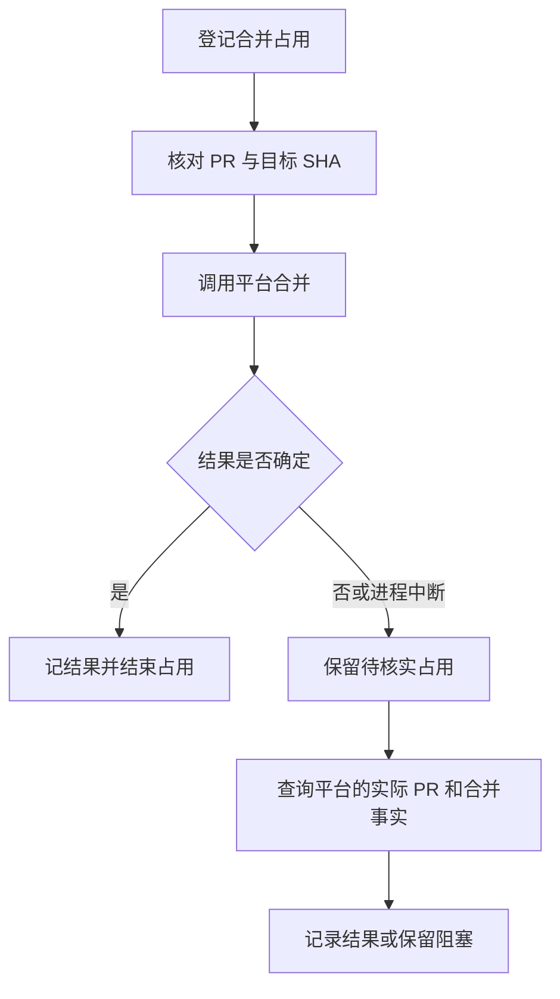

# 编排数据与脚本方案

本文描述新编排 Skill 的数据模型、脚本边界和一致性方案。关联文档：[编排方案](orchestration.md)、[执行方案](execution.md)、[网页模板方案](web-template.md)。

## 设计目标

同一编排中的主 Agent（main Agent）、交付协调者（Delivery coordinator） 和任务 Agent（Task Agent） 共享可读、可恢复的本机 JSON 账本。任务图、状态、事件和操作占用必须来自同一个权威账本；HTML 和 Markdown 要求文档不作为第二份调度状态。范围仅限一个编排，不为其他编排提供全局锁。

Skill 自带 Bun + TypeScript 固定脚本，所有账本操作通过脚本完成。Agent 不直接编辑 JSON；要求 Markdown 可由 Agent 普通编辑，不强制生成或硬校验。脚本接口须支持机器可读的成功、等待、冲突与错误结果，并附可读原因。

交付单元的数量由主 Agent 在计划上下文中根据需求结果和 contribution Task 归纳，账本只保存批准后的原子 scope 归属。每个 contribution 或 documentation work 原子必须携带唯一 `task_id` 和 `delivery_unit_id`；DeliveryUnit 定义不复制任务清单，也不新增 Proposal 类型。计划批准后，同一 `delivery_unit_id` 下一个 contribution Task 使用共享交付拓扑，多个 contribution Task 使用独立任务对话和 child PR 的多任务集成拓扑；验证、发布和部署任务不计入该数量。

## 目录与身份

```text
<运行时 multi-task-flow Skill 目录>/data/
├── .gitignore
└── runs/<编排 ID>/
    ├── ledger.json            # 唯一权威账本
    ├── ledger.previous.json   # 上一份完整快照
    ├── ledger.migration-v1-<request_id>.json # schema v1 迁移前的完整备份
    ├── locks/                 # 同一编排的本机锁资源
    ├── requirements/          # Agent 编写的 Markdown
    └── view/                  # 项目专用的只读页面
```

运行数据放在实际加载的 `multi-task-flow` Skill 目录内部的 `data/`，不放进目标项目工作区；该目录的 `.gitignore` 是受版本管理的保留文件，内容为 `*` 和 `!.gitignore` 两行，忽略运行数据并保留目录。运行时目录以实际加载的 Skill 目录为基准，不把候选工作区误认为当前运行时。Skill 更新、安装和卸载不得悄然覆盖或删除未完成账本。必须使用明确路径解析和 ID 校验，防止指向其他目录或覆盖已有编排。

编排 ID 不依赖会话 ID；交付单元、子任务、原子任务、事件、计划版本和外部操作各有稳定身份。会话 ID 只在原生会话实际创建后绑定；创建中的临时标识不能冒充已存在的任务会话。fork 后无法确定绑定或控制权时，实际使用时询问主人，未确认前不调度、不切割、不合并。

## 账本契约

下表是账本字段分交付单元；具体结构、状态和脚本接口见本文“账本格式与脚本命令”。未认识的必要语义或不兼容结构不得静默解释为成功。

| 数据 | 最少记录内容 |
| - | - |
| 身份与版本 | 格式版本、编排 ID、项目仓库身份、账本单调递增版本、更新时间 |
| 计划与授权 | 目标、约束、批准事实与授权范围、计划版本、并发目标、切割规则 |
| 图 | 原子任务、子任务、交付单元、具体依赖和里程碑；各自稳定 ID、名称及归属 |
| 工作与状态 | 子任务类型、负责人会话绑定、状态、基线、预期范围、验收与证据引用、阻塞和等待原因 |
| PR 与交付单元 | 父分支、父 PR、子 PR、实际归属及变更历史、切割点 SHA、实际合并身份、follow PR 与收口义务 |
| 时间 | 计划估时、依据与可信度；真实开始、等待、恢复、结束时间，以及明确时区 |
| 外部操作 | 操作 ID、类型、目标、发起者、预期版本和 SHA、占用状态、实际结果或待核实状态 |
| 事件和通知 | 稳定事件 ID、发生与记录时间、来源、结果证据、接收对象、通知确认与待处理状态 |
| 资源 | 本机服务及端口租约、会话、工作区和清理目标的已知身份及独立收口结果 |

例如，一条事件可表达“某子 PR 的平台合并已核实”，携带任务 ID、PR 身份、实际合并 SHA 和证据引用；其通知状态独立记录。任务开始、阻塞、已集成、已收口及交付单元完成不是同一个状态。缺失身份、时间或证据应明确为未知或待核实，不推断成已完成。

依赖既可指向贡献子 PR 合入，也可指向父 PR 合并、CI、发布、部署或验证等具体事实。子任务的原子任务串行；跨子任务的贡献交接以 PR 合入为准。计划的目标、范围和依赖可以引用人写的要求文档，但要求文档不参与格式硬校验。

## 账本格式与脚本命令

编码与版本。采用 UTF-8 JSON 对象，新的 ledger 使用 `schema_version: 2`；不认识的版本或必需语义拒绝写入。

兼容读取与迁移。schema v1 默认只能通过规范化读取为内存中的 v2 视图；需要持久升级时，主 Agent（main Agent）必须显式调用 `orchestrate.ts migrate --input -`，指定准确 `run_id`、owner-only actor、唯一 `request_id` 和当前 `expected_revision`。

迁移边界。迁移在维护锁和 run 锁内校验完整 v1 ledger，先保存 `ledger.migration-v1-<request_id>.json` 完整旧快照，再原子替换为 `schema_version: 2`、`contract_version: 1`；迁移新增 request record，因此 `revision` 单调增加 1，记录的 `committed_revision` 与返回 revision 相同。

幂等与安全。相同 request ID 和 canonical input 只返回已提交结果；不同内容、版本冲突、损坏或不安全路径拒绝写入。所有持久身份为非空 ASCII 稳定 ID，使用字母、数字、`-`、`_`；文件名不得直接使用未经校验的 ID 或用户路径。

未知值与时间。缺失的生命周期事实保持 `unknown`，不得伪造 publication 或 merge 通过，也不得由普通更新回写旧文件。时间是带 `Z` 的 UTC RFC 3339 字符串；实际发生时间和记账时间分开，未知为 `null`，禁止用当前时间替代未知事实。未知 SHA、链接和会话 ID 一律为 `null`，不生成占位值。

账本顶层字段固定为：

```ts
type Ledger = {
  schema_version: 2;
  source_schema_version: 1 | null;
  orchestration_id: string;
  revision: number;                       // 初始为 0，每次成功变更增加 1
  repository: { provider: string; host: string; owner: string; name: string; target_branch: string };
  control: { owner_thread_id: string | null; ownership: 'pending' | 'bound' | 'uncertain'; approval_id: string | null };
  config: { max_running_tasks: number; display_timezone: string; conversation_links_verified: boolean };
  plans: PlanRevision[];                   // 保留原计划和之后批准的计划
  active_plan_id: string;
  groups: Group[];
  tasks: Task[];
  follow_prs: FollowPR[];
  facts: Fact[];                           // 合并、CI、部署等带来源事实
  operations: Operation[];                 // 包含持久占用及结果
  milestones: Milestone[];                 // 自由追加，不具备门禁权限
  events: Event[];
  requests: RequestRecord[];               // 幂等请求及其已提交结果
  notifications: Notification[];
  resources: Resource[];
  updated_at: string;
};
```

初始化后、任务图尚未录入且尚未批准时的账本示例：

```json
{
  "schema_version": 2,
  "source_schema_version": null,
  "orchestration_id": "run-example",
  "revision": 0,
  "repository": {"provider":"github", "host":"github.com", "owner":"example", "name":"project", "target_branch":"main"},
  "control": {"owner_thread_id":"thread-example", "ownership":"bound", "approval_id":null},
  "config": {"max_running_tasks":3, "display_timezone":"Asia/Shanghai", "conversation_links_verified":false},
  "plans": [{"id":"plan-a", "supersedes_id":null, "approval_id":null, "created_at":"2026-01-01T00:00:00Z", "start_at":null, "atoms":[], "atomic_edges":[], "nodes":[], "edges":[], "cut_rules":[], "actions":[]}],
  "active_plan_id": "plan-a",
  "groups": [],
  "tasks": [],
  "follow_prs": [],
  "facts": [],
  "operations": [],
  "milestones": [],
  "events": [],
  "requests": [],
  "notifications": [],
  "resources": [],
  "updated_at": "2026-01-01T00:00:00Z"
}
```

此状态只允许编辑计划、查看和批准，不能派发任务。示例中的项目、会话和日期均为示意，不是运行时事实。

各集合以对象 ID 关联，不复制第二份权威任务清单。字段必须存在；未知使用 `null`，不使用空字符串冒充已知值。类型中的具体字段如下：

#### 计划与图

| 对象 | 字段与约束 |
| - | - |
| `PlanRevision` | `id`, `supersedes_id: string \| null`, `approval_id: string \| null`, `created_at`, `start_at: string \| null`, `atoms: AtomicPlan[]`, `atomic_edges: AtomicEdge[]`, `nodes: PlanNode[]`, `edges: Dependency[]`, `cut_rules: CutRule[]`, `actions: PlannedAction[]`；active multi-task initialization requires the envelope to bind the raw-plan digest, `flow_type`, exact task IDs, owned surfaces and batch/task acceptance scopes |
| `AtomicPlan` | `id`, `title`, `task_id`, `purpose`, `output`；每个原子任务在一个计划版本中只归属一个子任务 |
| `AtomicEdge` | `id`, `from_atom_id`, `to_atom_id`；先构造并验证原子图，再按 `task_id` 映射为子任务图，禁止映射后形成环 |
| `PlanNode` | `id`, `kind: 'main_start' \| 'main_end' \| 'group_start' \| 'group_end' \| 'task' \| 'milestone'`, `ref_id: string \| null`, `group_id: string \| null`, `label`, `estimate_minutes: number \| null`, `estimate_basis: string \| null`, `estimate_confidence: 'low' \| 'medium' \| 'high' \| null`；非负整数估时，未知全为 `null` |
| `Dependency` | `id`, `from_node_id`, `to_node_id`, `requires: 'integrated' \| 'completed' \| 'merged' \| 'ci_passed' \| 'published' \| 'deployed' \| 'verified'`；只有受支持的证据满足对应条件，不把不同里程碑混为一谈 |
| `CutRule` | `id`, `group_id`, `priority: number`, `required_task_ids: string[]`, `status: 'pending' \| 'claimed' \| 'applied' \| 'cancelled'`；相同交付单元按优先级处理，已应用规则不可重复执行 |
| `PlannedAction` | `id`, `kind: 'publish_branch' \| 'publish_pr' \| 'release' \| 'deploy'`, `task_id: string \| null`, `group_id: string \| null`, `target_identity`；主人确认时逐项授权，执行目标须完全匹配 |

#### 交付与任务

| 对象 | 字段与约束 |
| - | - |
| `Lifecycle` | `workspace_ready`, `pr_created`, `pr_merged`, `closed`，值为 `unknown`、`pending`、`passed` 或 `blocked`；交付单元与贡献任务共用，阶段只能由对应 receipt/closeout 推导 |
| `Group` | `id`, `title`, `agent_thread_id: string \| null`, `state: 'planned' \| 'active' \| 'merged' \| 'closed' \| 'blocked'`, `parent_branch: string \| null`, `parent_pr: ExternalRef \| null`, `cut_sha: string \| null`, `current_sha: string \| null`, `merge_sha: string \| null`, `requirements_path: string \| null`, `lifecycle: Lifecycle`, `atoms: GroupAtom[]`, `coordination_execution: CoordinationExecution` |
| `Task` | `id`, `title`, `kind: 'contribution' \| 'release' \| 'deployment' \| 'verification' \| 'coordination'`, `group_id`, `thread_id: string \| null`, `state: 'planned' \| 'ready' \| 'starting' \| 'running' \| 'waiting' \| 'blocked' \| 'integrated' \| 'completed' \| 'closed'`, `atoms: Atom[]`, `owned_surfaces: string[]`, `branch: string \| null`, `base_sha: string \| null`, `pr: ExternalRef \| null`, `requirements_path: string \| null`, `started_at: string \| null`, `finished_at: string \| null`, `blocker: string \| null`, `assignment_history: Assignment[]`, `lifecycle: Lifecycle` |
| `Atom` | `id`, `title`, `status: 'planned' \| 'running' \| 'completed' \| 'blocked'`；按数组顺序串行，原子任务跨子任务依赖必须通过子任务交接点表达 |
| `GroupAtom` | `id`, `group_id`, `title`, `purpose`, `output`, `lifecycle_stage: 'workspace_ready' \| 'pr_created' \| 'pr_merged' \| 'closed' \| null`, `status: 'planned' \| 'running' \| 'completed' \| 'blocked'`；按交付单元顺序串行，生命周期绑定步骤必须由对应证据驱动 |
| `CoordinationExecution` | `state: 'unknown' \| 'idle' \| 'running' \| 'waiting' \| 'blocked'`, `reason: string \| null`, `waiting_for_task_ids: string[]`；等待必须显式引用同一交付单元的贡献任务 |
| `Assignment` | `group_id`, `effective_at`, `reason`, `cut_operation_id: string \| null`；只追加，保持切割前后的归属历史 |

#### 外部对象与事实

| 对象 | 字段与约束 |
| - | - |
| `ExternalRef` | `provider`, `repository`, `id`, `url: string \| null`；`url` 仅存实际取得并校验的链接，证据中的 SHA 使用 Git 平台支持的完整对象 ID |
| `FollowPR` | `id`, `origin_task_id`, `origin_group_id`, `pr: ExternalRef`, `target_branch`, `state: 'open' \| 'merged' \| 'blocked'`, `merge_fact_id: string \| null`, `affected_task_ids: string[]`；归属原交付单元，目标按原父 PR 是否已合并选择 |
| `ProviderReceipt` | `provider`, `repository`, `resource_type: 'branch' \| 'pr'`, `resource_id`, `branch`, `target_branch`, `base_sha`, `head_sha: string \| null`, `pr`, `state: 'exists' \| 'open' \| 'merged' \| 'absent' \| 'unknown'`, `evidence_ref`；publication resolve 必须保存远端查询得到的完整 receipt，失败/不确定查询分别使用 `absent`/`unknown` |
| `Fact` | `id`, `kind: 'task_quality' \| 'pr_merged' \| 'branch_published' \| 'pr_published' \| 'ci_passed' \| 'published' \| 'deployed' \| 'verified'`, `subject_id`, `status: 'passed' \| 'failed' \| 'unknown'`, `source`, `observed_at`, `sha: string \| null`, `evidence_ref: string \| null`, optional task-owned quality proof, `receipt: ProviderReceipt \| null`；不同阶段和目标独立记录；多任务拓扑的贡献任务 `pr_merged` 绑定自己的 child merge receipt，单贡献拓扑的共享任务复用所属交付单元 PR 的 merge receipt；发布或部署产物 SHA 可以因构建产生新对象，但必须由对应 `Operation.receipt_fact_id` 和 `expected_sha` 证明来源 lineage |

#### 操作与服务

| 对象 | 字段与约束 |
| - | - |
| `Operation` | `id`, `kind: 'dispatch' \| 'merge' \| 'cut' \| 'publish_branch' \| 'publish_pr' \| 'release' \| 'deploy'`, `actor_id`, `target_id`, `status: 'claimed' \| 'succeeded' \| 'failed' \| 'unknown'`, `request: object`, `expected_sha: string \| null`, `receipt_fact_id: string \| null`, `created_at`, `updated_at`；`request` 保留目标身份、原始调用身份及精确预期，不能存凭据 |
| `Event` | `id`, `type`, `subject_id`, `actor_id`, `occurred_at: string \| null`, `recorded_at`, `data: object`；事件只追加，同一 ID 不同内容视为冲突 |
| `RequestRecord` | `request_id`, `command`, `canonical_input`, `result`, `committed_revision`；仅保留已提交的非敏感请求和结果，供进程中断后的幂等恢复 |
| `Notification` | `id`, `event_id`, `recipient_thread_id`, `ledger_status: 'committed'`, `status: 'pending' \| 'sent' \| 'failed' \| 'unknown' \| 'acknowledged'`, `delivery_status: 'pending' \| 'sent' \| 'failed' \| 'unknown'`, `ack_status: 'unacknowledged' \| 'acknowledged'`, `attempts: number`, `last_attempt_id: string \| null`, `last_reconciliation_id: string \| null`, `last_error: string \| null`, `updated_at`；账本提交、平台投递和收件确认彼此独立，发送不等于处理确认 |
| `Resource` | `id`, `kind: 'conversation' \| 'worktree' \| 'branch' \| 'port' \| 'service'`, `target: string \| null`, `status: 'unknown' \| 'active' \| 'pending' \| 'closed' \| 'not_applicable'`, `evidence_ref: string \| null` |

#### 事件数据字段

| 事件范围 | data 字段与约束 |
| - | - |
| 任务时间事件 | `task_id`, `group_id`, `state`, `reason: string \| null` |
| 交付单元事件 | `group_id`, `state` |
| `group_atom_updated` | `group_id`, `atom_id`, `state` 和生命周期证据 |
| `group_execution_updated` | `group_id`, 协调执行状态、原因和等待任务 |
| 操作事件 | `operation_id`, `outcome: string \| null`, `fact_id: string \| null` |
| `group_base_reconciled` | `operation: "update-branch"`, `branch`, `previous_sha`, `sha`, 已登记的 `parent_pr`、provider `source` 和 `evidence_ref`；`previous_sha` 必须等于账本原 `current_sha` |
| `cut_claimed` | `operation_id`, `group_id`, `rule_id`, `expected_sha` |
| `cut_applied` | `cut_sha`, 已核实的 `cut_evidence`, `old_group_id`, `old_group_current_sha`, 完整的 `old_group_snapshot`, `new_group_id`, `new_group_state`, `new_group_agent_thread_id`, `new_group_parent_branch`, `new_group_parent_pr`, `new_group_cut_sha`, `new_group_current_sha`, `new_group_merge_sha`, `new_group_requirements_path`, 完整的 `new_group_snapshot`, `included_task_ids`, `reassigned_task_ids`, `task_snapshots`；用于证明唯一 operation 的切割边界、任务状态和下一交付单元的干净创建状态 |
| 事实、follow PR 和通知事件 | `fact_observed` 引用 `fact_id`，`follow_pr_recorded` 引用 `follow_pr_id`，通知事件引用 `notification_id` |

上述事实与对象变更须在同一账本更新中提交。

`kind` 和 `type` 由固定脚本限定，页面不可增写。任务的运行中和等待时间区间由有序 `Event` 推导；报告事件必须提供可靠来源，未知结束时间不产生伪造的闭区间。`integrated` 只表示贡献 PR 合入，`completed` 表示该项实际工作完成，`closed` 仅在适用的 follow PR、检查及归档条件满足时记录；资源清理仍分别记账。

### 调用格式

入口为 `multi-task-flow flow <command> --input -`，标准输入为一个 JSON 对象；禁止通过命令行传递凭据。输出只有一个 JSON 对象到 stdout，诊断写 stderr。读命令不修改账本；写命令必须先有本编排操作权限，且共同遵循以下信封：

```json
{
  "run_id": "run-example",
  "actor": {"role": "main", "thread_id": "thread-example"},
  "request_id": "op-example",
  "expected_revision": 12,
  "payload": {"task_id": "task-a"}
}
```

`role` 限 `main`、`group`、`task`；脚本核对账本绑定的身份和允许操作，主机同一用户的进程不被视为强身份隔离。每次不同命令使用独立 `request_id`，同一外部动作的 claim、resolve 则使用同一个 `operation_id`；重试同一命令沿用其 `request_id`。写入先查 `request_id`：相同 ID 和规范化请求完全一致时返回原结果，即使调用方携带旧 revision；规范化内容为命令、run ID、actor 和 payload，不包括 `expected_revision`。相同 ID 内容不同返回 `ID_CONFLICT`。新请求再比较 revision，不匹配返回 `REVISION_CONFLICT` 且不写入。成功变更一次递增一次 revision；单个事件不能先写状态后写通知再分别成功。

```json
{"ok": true, "code": "APPLIED", "revision": 13, "result": {"operation_id": "op-example"}}
```

失败输出 `{"ok":false,"code":"...","revision":null,"message":"...","details":{}}`，不泄露凭据；调用者需重新读取账本获取当前版本。退出码 `0` 成功或幂等重放，`2` 输入无效，`3` 版本或身份冲突，`4` 等待前驱或操作占用，`5` 外部状态未知或恢复阻塞，`6` 本地 I/O 或锁故障。等待和未知不是成功。

### 固定命令

#### 初始化、计划与任务

| 命令 | 字段与效果 |
| - | - |
| `init` | 字段：`repository`, `config`, `initial_plan`, `groups`, `tasks`，主会话来自 `actor`；效果：仅接受未绑定且 `planned` 的 group/task（atom 也必须为 `planned`），并要求分支、PR、SHA、时间、阻塞、requirements path 和 assignment history 等运行时身份字段为空；拒绝 dev-plan handoff、digest 或外部计划字段，失败返回 `INVALID_INITIAL_STATE` 或 `INVALID_INPUT` 且不产生 run 目录、锁或 ledger；成功只创建唯一 run 和初始 revision，不创建任务会话 |
| `binding-resolve` | 字段：`owner_decision`, `previous_owner_observation`；效果：根据主人明确决定和前任会话的停止事实转移控制权；未知 fork 不能自行接管 |
| `link-verification` | 字段：`verified`, `evidence`；效果：主 Agent（main Agent） 可记录当前候选的一次性会话跳转实测结果及证据引用；证据覆盖且页面合同未变时复用，不重复测试。真实会话 ID 或 canonical anchor 合同缺失时阻塞；缺少可选原生观察本身不阻塞 |
| `show` | 字段：`section`，可为 `summary`、`plan`、`tasks`、`operations`、`notifications`、`full`；效果：返回一致快照及 revision；无需 `request_id` 或预期 revision |
| `plan-propose` / `plan-approve` | 字段：前者 `plan`；后者 `plan_id`, `approval_id`, `authorized_actions`；效果：新增计划版本 / 记录对应主人确认；不自动更改未授权范围 |
| `dispatch-claim` / `dispatch-group-claim` / `dispatch-bind-request` / `dispatch-resolve` | 字段：`task_id` 或 `group_id`, `operation_id`；resolve 另带原生结果或失败证据；效果：原子检查依赖和容量、登记原生请求身份并绑定真实 thread ID；未知时保留占用 |
| `lifecycle-record` / `milestone-record` | 字段：目标类型、目标 ID、阶段或 milestone、资源/证据；效果：记录交付单元和贡献任务的 `workspace_ready`，或追加不具备门禁权限的自由 milestone |
| `publish-branch-claim` / `publish-branch-resolve` | 字段：`target_type`, `target_id`, `branch`, `expected_head_sha`, `action_id`, `operation_id`；resolve 加精确 Provider receipt；效果：独立占用并记录远端分支存在性；必须先有 workspace-ready |
| `publish-pr-claim` / `publish-pr-resolve` | 字段：`target_type`, `target_id`, `branch`, `pr`, `target_branch`, `expected_base_sha`, `expected_head_sha`, `action_id`, `operation_id`；resolve 加精确 Provider receipt；效果：独立占用并记录远端 PR identity/base/head；必须先有成功 branch receipt |
| `task-update` | 字段：`task_id`, `state`, `occurred_at`, `detail`, `evidence`, 可选 `notification: { mode: 'auto' \| 'deliver' \| 'none', recipient: 'owner' \| { thread_id } }` 或兼容字段 `notify_main: true`；效果：按状态前提记事件和状态；`auto` 保留 completed/closed 的原默认规则，`deliver` 创建主动通知意图，`none` 不创建，普通阻塞不默认通知主 Agent（main Agent） |
| `atom-update` | 字段：`task_id`, `atom_id`, `state`；效果：由任务会话按数组顺序更新原子任务状态 |
| `group-atom-update` | 字段：`group_id`, `atom_id`, `state`；效果：由绑定交付协调者（Delivery coordinator） 或主 Agent（main Agent） 按顺序更新交付单元原子状态；生命周期绑定步骤必须有对应通过证据 |
| `group-execution-update` | 字段：`group_id`, `state`, `reason`, `waiting_for_task_ids`；效果：明确记录交付协调实际执行、等待、恢复和阻塞；等待贡献任务必须引用同组有效任务 |
| `group-update` / `group-base` | 字段：前者 `group`，后者 `group_id`, `provider_observation`；效果：更新交付单元信息或记录首次/同 SHA 的核实分支基线；已建立 SHA 的推进必须使用 `group-base-reconcile` |
| `group-base-reconcile` | 字段：`group_id`, `provider_observation`（`operation: "update-branch"`, `previous_sha`, `sha`, `branch`, `parent_pr`, `source`, `evidence_ref`）；效果：在无未决 merge/cut operation 时，使用精确 provider 证据原子记录同一父分支的外部 update-branch SHA 推进；不表示 PR 合并 |
| `task-pr` / `task-base` / `task-quality-record` | 字段：`task_id` 和 PR、基线或任务 Agent 自证；效果：v2 下只允许绑定已有 PR publication receipt；多任务拓扑绑定 child PR，单贡献拓扑复用交付单元 PR；任务 Agent 自己记录当前 head/base、验收引用和 checks，不需要交付协调 Agent 审核 child PR |

#### 合并、通知与收口

| 命令 | 字段与效果 |
| - | - |
| `merge-claim` / `merge-resolve` | 字段：`operation_id`, `pr`, `target_branch`, `expected_head_sha`, `expected_base_sha`；resolve 加 `outcome`, `provider_evidence`，可选 `notification` 或 `notify_main`；效果：登记合并占用 / 记录可验证结果；未经核实的结果为 `unknown`；`auto` 只在成功时按原规则创建通知意图 |
| `cut-claim` / `cut-apply` | 字段：`operation_id`, `group_id`, `rule_id`；apply 加 `cut_sha`, `included_task_ids`, `next_group`, `provider_evidence`；效果：阻止新合入、等待已有操作 / 原子固定归属、创建下一交付单元及任务归属历史 |
| `action-claim` / `action-resolve` | 字段：`operation_id`, `kind`, `target`, `expected_identity`；resolve 加 `outcome`, `provider_evidence`；效果：为已授权发布或部署登记持久占用并记录结果，未知时先核实，不盲目重试 |
| `follow-pr-update` | 字段：`follow_pr_id`, `origin_task_id`, `origin_group_id`, `pr`, `target_branch`, `affected_task_ids`；效果：登记 follow PR；后续合并结果通过 `merge-resolve` 记账并保留原交付单元归属 |
| `fact-record` | 字段：`fact`；效果：记录核实的非合并、非子 PR 验收事实 |
| `notification-deliver` | 字段：`notification_id`, `delivery_attempt_id`, `outcome: 'sent' \| 'failed' \| 'unknown'`, `provider_receipt`，失败可带 `error`；效果：由 CLI 在 Codex Agent API 返回后写回真实结果；`ledger_status` 已提交后，失败不得回滚通知意图；同一 attempt 不得重复记账 |
| `notification-send` | 字段：普通请求信封，`payload.notification_id`；效果：`notification-prepare` 的兼容名称：持久领取一条新尝试，返回原生发送参数；主对话发送后显式写回平台回执。只允许 `pending` 或明确 `failed`，`unknown` 必须先对账 |
| `notification-reconcile` | 字段：查询形式带 `run_id`, `actor`, 可选 `status`；写入形式另带 `request_id`, `expected_revision`, `notification_id`, `reconciliation_id`, `outcome`, `provider_receipt`；效果：查询形式列出待处理通知；写入形式只允许核对 `unknown`，不得发送消息，必须由发送方或 `main` 提交平台查询证据 |
| `notification-ack` | 字段：`notification_id`, `handling_evidence`；效果：只有 `recipient_thread_id` 对应会话可以确认；`sent` 不自动变成 `acknowledged` |
| `view` | 字段：可选 `plan_id`；效果：生成只读视图，不改变调度状态 |
| `group-close` / `run-complete` / `resource-update` | 字段：`group_id`、完成证据或 `resource`；`group-close` 可选 `notification` 或 `notify_main`；效果：核查交付单元和编排的完成条件，分别记录各资源收口；`group-close` 默认按原规则创建通知意图 |

复合通知通过持久领取、原生发送、回执对账完成。记账命令提交 pending 意图后领取唯一 attempt 并设 unknown，返回 should_send、tool_request 和回执 identity；只有新领取者可调用桌面内置 send_message_to_thread。随后 notification-reconcile 必须带相同 delivery_attempt_id 和真实 provider/evidence_ref/message_id，区分 sent、failed、unknown。重放 should_send=false，不重复调用平台；未知结果先对账。历史 CLI 发送的在途文件锁继续保护，原生领取不跨工具调用持有文件锁。通知发送接受不代表已读或实际开工。

### 状态与就绪判定

任务派发检查明确前驱和空闲名额；绑定会话后进入 `starting`，实际开始时进入 `running`。`running → waiting/blocked` 时释放运行名额，恢复前重新检查依赖和容量。交付单元与贡献任务按 `workspace_ready → pr_created → pr_merged → closed` 记录生命周期；workspace-ready 绑定 active worktree/branch Resource，pr-created 只由 `publish_pr` 成功 receipt 推导，pr-merged 只由 `merge-resolve` 成功 receipt 推导，closed 只由现有 closeout 条件推导。多任务拓扑的贡献任务以核实的 child PR 合入进入 `integrated`；单贡献拓扑的共享任务复用交付单元 PR 的发布、检查和合并事实。非贡献任务以明确证据进入 `completed`。已集成的后继可以开始；`closed` 还需检查已知 follow PR。失败不自动推导 `completed` 或 `closed`。

同一编排的 `merge-claim` 对同一目标父分支与 `cut-claim` 互斥；切割期间新合入返回等待，已有合入处于未知状态时不能切割。切割 SHA 是归属交接点；后续 follow PR 使原父分支前进时，追加事实、更新 `current_sha` 并刷新合并证据，不更改已切出的归属。新交付单元任务可以继续推进，目标分支和合入须按上一批合入主干后的规则更新。

`cut-claim` 首次成功时即持久登记切割占用，并返回 `APPLIED` 与 `result.drained: false`（有未完成合并）或 `true`（没有未完成合并）；这一步不得返回声称“无写入”的等待错误。已登记的合并仍能写入 `merge-resolve`，新 `merge-claim` 返回等待。主 Agent（main Agent） 在已有占用结束后使用最新 revision 执行 `cut-apply`；若仍有未知合并，则返回等待且不改变归属。`cut-apply` 必须核对平台当前 SHA，并把切割点、已合入集合、下一交付单元及未合入任务重新分配作为一个账本变更提交。

计算理论甘特图时，按依赖拓扑和预计耗时模拟最多 `max_running_tasks` 个任务；同一时刻就绪任务先按解锁后继数量降序，再按计划声明顺序、稳定 ID 排序。没有起点、耗时或必要前驱时间时，对受影响节点保留未知，不将未知按零分钟处理；模拟结果不是外部事实。

### 身份绑定与创建恢复

`control.owner_thread_id` 和每个 `thread_id` 是权威绑定。`init` 只绑定传入的主会话并写入初始账本，不创建 group/task 会话；派发前写 `dispatch-claim` 和唯一操作 ID。调用原生创建工具后，只有真实返回的 thread ID 才能 `dispatch-resolve`；初始输入中的 group/task thread ID 和非 `planned` 运行状态均无效。临时创建确认不是会话 ID，也不能用于通知、链接或归档。

创建调用结果未知时保持 `unknown` 和执行名额占用，先利用运行时返回的原始请求身份及可查询事实核对；当前可用工具尚未证明能查询每一种中断状态。若无法证明成功或失败，保留阻塞并请求主人处理，不释放占用后盲目再次创建。fork 后控制权不明确同样停止写入与派发，待主人确认绑定。

## 脚本接口

固定脚本的命令、输入及返回值定义在本文“账本格式与脚本命令”。能力与所有权如下：

| 操作族 | 输入与行为 |
| - | - |
| 初始化与绑定 | 创建唯一编排，绑定仓库和会话；检查已有身份，无法确定 fork 控制权时返回需主人决定 |
| 计划与图 | 读取或更新已授权计划、原子任务、子任务、交付单元、依赖、切割条件和计划时间；检查依赖环及引用完整性 |
| 执行与调度 | 原子申请就绪任务执行名额、记录会话创建占用及结果、更新状态和时间；未知创建结果先核实，避免重复派发 |
| 合并与切割 | 登记、检查、等待和结束操作占用；固化实际 SHA、分配与结果；受影响目标不能并发越过同一编排的切割边界 |
| 事件与通知 | 写入事件、登记通知需求、列出待处理项、确认处理；按事件 ID 去重并拒绝同 ID 的冲突内容 |
| 读取与展示 | 输出当前一致版本的只读 JSON 视图；页面订阅更新，不直接写入账本 |
| 恢复与收口 | 校验账本及快照、列出未决操作、记录平台核实结果、服务和资源清理状态 |

每项写操作都携带编排 ID、调用者身份、稳定操作或事件 ID 及预期账本版本。版本不符时返回冲突，由调用者重新读取当前版本并判断；不得以旧内存快照覆盖新状态。重试同一 ID 且内容一致应返回已有结果；同一 ID 不同内容应拒绝。

脚本只裁决账本中的协调条件，不能替代交付协调者（Delivery coordinator） 对子 PR 的验收，也不能将缺失平台事实视为通过。外部 PR、CI、发布和部署事实须由对应平台操作或查询核实；计划外行为须经过主人决定。

## 写入、锁与崩溃恢复

```text
读取当前版本
取得本编排写锁
  重新读取并校验版本、身份、依赖及操作条件
  产生包含状态和事件的完整下一份 JSON
  写入同目录临时文件并持久化
  原子替换账本，并保留上一份完整快照
释放写锁
```

实现使用操作系统支持的进程间锁和同一文件系统内的原子替换。不能用“锁文件存在”或仅凭锁文件时间来判断持锁进程是否失效。锁的创建、持有、超时和进程退出行为需有可复现测试；快照更新和目录持久化按下述顺序执行。

固定实现方案为 Bun 的 `bun:ffi` 加载系统 C 库调用 `flock`，打开不随账本原子替换而更换 inode 的 `<run>/locks/ledger.lock`，用非阻塞排他锁和有界重试取得锁；句柄在 `finally` 中释放，进程退出由操作系统释放。读取系统错误码区分锁忙与其他系统错误，不能把全部失败都当成竞争。锁文件仅由创建该 run 的流程建立，运行中不删除、不换名；不得依据文件存在、PID 或时间直接强制解锁。当前 macOS 使用 `libc.dylib`；Linux 动态库路径须在目标环境探测，无法加载或无法取得锁时停止写入。上述锁只针对同一 run，并非跨编排锁。

在锁内的确定写入顺序：校验当前账本；把当前完整字节写入同目录的 `previous.tmp` 并 `fsync`，原子替换 `ledger.previous.json` 后 `fsync` 目录；将新账本写入唯一同目录临时文件并 `fsync`；原子替换 `ledger.json` 后再次 `fsync` 目录；最后释放锁。临时文件使用独占创建且限制权限。任一步失败返回错误；若 `ledger.json` 已替换但响应未返回，调用者以同一请求 ID 重试，由账本的幂等记录判断，不重新执行外部操作。仅在锁内打开账本并完整读取，避免读取到中间版本。

外部合并不能依靠短期写锁包住整个网络请求。脚本先登记**持久操作占用**，释放写锁后由 Agent 核对平台并执行操作，再以同一操作 ID 写入结果。切割开始时先取得相关目标的切割占用，阻止新的相关合并，并等待已有占用完成或查明；随后固定 SHA 并一次性写入分配变化。



账本或快照损坏时不得静默回退到可能丢失操作占用的旧版本。恢复需先隔离损坏数据，核对版本、操作占用及平台事实；不能确定时保留阻塞并向主人说明。旧快照用于恢复证据，不自动证明其中未记录的合并没有发生。

## 本机只读服务与通知

服务通过脚本取得一致的账本视图，向浏览器提供初始快照及变更推送；断线重连时发送当前完整版本。页面不得写入账本或运行事实；服务仅额外提供 tokenized 的 `GET/POST /api/preferences`，且只允许写入 schema-1 的全局主题偏好。其余视图、事件和文档接口保持只读。服务仅监听本机，并限制允许的资源和来源；要求文档只按账本中明确引用的路径提供，不能提供任意文件读取。数据中不存放凭据或敏感令牌。

服务启动前按现有全局端口租约流程申请并注册端口；the installed user service 负责登记自身 PID、心跳和退出释放自己的服务租约，不接管其他进程或端口。向主人提供可持续访问的 URL 前，Agent 必须确认当前任务由 Codex host 提供且仍被保留的 native background session 和有效租约。Skill 不创建或推断该宿主会话；没有受支持的宿主后台路径时只能保留 live preview。

需要主动通知的事件先提交账本事实和通知意图，再由 CLI 调用 Codex Agent API；确认状态也写入账本。一般阻塞只需记账并留在相应任务或交付单元对话；确实影响调度时才使用 `notification.mode: "deliver"` 通知指定收件会话。断线、发送失败或确认缺失时，待处理通知保留并可通过 `notification-reconcile` 恢复查询；`unknown` 在平台对账前不得直接重试，恢复器不得伪造发送或 ack。

## 验证与待核实技术点

- 模型：无环校验、子任务分组造成的等待、动态切割后的历史归属、显式依赖和条件。
- 并发：多个进程并发更新、版本冲突、重复事件、同一目标合并与切割竞争、不同目标的合法并发。
- 恢复：在临时文件写入、替换、占用登记、平台请求和结果记账各阶段中断；验证不会丢失事件、重复派发或盲目重复合并。
- 身份：创建请求结果未知、实际会话未绑定、fork 控制权不明确及恢复时的平台事实核验。
- 页面：数据版本一致、推送和断线重连、只读边界、路径限制、链接可用性和端口租约。
- 已做基础可行性验证：当前 macOS 的 Bun 1.4.4 可通过 `bun:ffi` 调用 `flock`，另一 Bun 进程对同一对象的非阻塞锁请求在锁被持有时失败、释放后成功；当前机器可对目录执行 `fsync`。这不证明其他操作系统、文件系统或全部崩溃恢复场景可靠。

## 对话输出投影

服务只读取 run 内任务绑定的 `thread_id`，通过已有 app-server socket 执行 `initialize`、`initialized` 及只读历史读取，不开放任意对话代理接口。对已绑定且 `thread/loaded/list` 确认存在的会话，可仅传 `threadId`、`excludeTurns: true` 调用 `thread/resume` 加入订阅；不传配置覆盖、历史或路径，不发送消息，不调用 `turn/start`。未加载会话仍只读历史。优先 `thread/items/list` 倒序分页；明确不支持时退回 `thread/turns/list` 的完整 items，旧 `thread/read includeTurns` 仅在确认协议支持时使用。

`latest_agent_output` 包含 `state`（`available | no_conversation | empty | unavailable`）、`text`、`thread_id`、`turn_id`、`message_id`、`phase`、`message_status`、`observed_at` 和 `stale`。快照以服务实例 `output_epoch` 和实例内单调 `output_revision` 标识；内存缓存按 thread 去重，观察结束释放连接。可用的原生通知按 turn/item identity 合并；完整消息覆盖同项增量，历史请求不能覆盖更新的事件或重绑结果。增量推送最多每 100ms 一次，完成与错误立即推送。

为补齐重连和宿主缺少通知时已落盘的回答，观察期间默认每 2 秒补读历史；连接或读取失败按 1、2、4 秒至最多 30 秒退避。补读成功且无新消息不使投影过期，也不产生输出版本变化。该路径不宣称提供原生 delta；旧 `includeTurns` 未获能力证明时保持不可用。

桌面与独立 app-server daemon 可能是不同实例。`CodexDesktopFollower` 只使用当前用户拥有的桌面 IPC socket，按已绑定 thread 发现现有 owner，以跟随通道获取公开 assistant 快照和文本补丁。只支持已核实的 stream version 11；按平台 islands/entries/item 顺序选择消息。保留索引占位但丢弃工具、用户与推理正文；验证 owner 和本地 host，重复旧版本丢弃，revision 缺口重新订阅取得快照。取消绑定及连接结束释放跟随关系；它不暴露任何执行或配置控制请求。

- 会话链接：当前候选已证明真实 ID、原生 `codex://threads/<thread_id>` 锚点合同，并记录了 Codex 原生导航结果，证据见 `packages/multi-task-flow-runtime/examples/orchestration-viewer/link-verification.json`。该记录不声称证明宿主浏览器点击桥接；后续候选只有在链接合同或绑定身份变化时才需要新的观察；不得编造链接或自动重复创建。

## 执行配置与创建接口

每个新运行持有一个完整的 `config.execution_profile`。对象的 `execution_profile=null` 独立解析到该默认值；交付单元配置不参与任务解析。`execution_profile_source` 与版本化 `execution_profile_rule` 记录手动选择或类型推荐的来源，推荐只有新对象或显式重新应用时物化。

`execution-profile-update`、`execution-profile-default-update`、`execution-profile-recommend` 与 `execution-profile-migrate` 使用标准 request/revision/owner envelope。CLI 与认证 dashboard 的 `/api/execution-profile` 共用 mutation contract，能力组合来自 app-server `model/list`。缺失默认 pair 的旧运行可以读取，写入须先显式迁移；schema2/contract2 任务缺少 execution policy 键时，普通写入先由 `HISTORICAL_LEDGER_READ_ONLY` 拒绝，独立的 contract maintenance 只能补显式 null，不能推断执行归属、对话或交付事实。

`dispatch-claim` / `dispatch-group-claim` 捕获完整有效 profile，`conversation-create` 绑定唯一 native request ID，再通过独立的 `codex exec --worktree --json` 进程创建、命名和初始化线程。创建 adapter 必须核对返回的实际模型与思考强度；返回值不是请求配置的自我回显。只有真实 thread ID 与匹配 request/operation/profile 的 CLI 证据才能成功绑定。unknown 保留 claim 和已观察到的 thread ID，对账通过 `dispatch-resolve` 记录匹配证据；禁止自动重复创建。初始化首条消息只确认握手并在进程退出后由主对话通过内置 `send_message_to_thread` 发送正式任务。

已有 thread 或尚未明确失败的 native request ID 都冻结对象配置。编辑无 native request 的 claim 时保留旧 pair 与原因、终止旧 claim，并要求重新 claim；运行默认值更新保留已冻结对象的原有效配置。对话创建后的会话内模型调整不进入该账本。

## 主人授权的维护迁移

service 的 `ledger-maintenance-check` / `ledger-maintenance-apply` 提供独立维护边界；它们与 orchestration 的 bound-main migrate、service 的目录导入 migrate 各自独立。合同与完整 execution profile 分别授权；对 schema2/contract2 的历史策略键缺口，`action: "contract"` 把完全缺失的字段声明为 null，部分声明则拒绝，普通 migrate 不扩大范围。维护请求保留准确 owner、revision、源文件摘要、动作摘要、实际维护线程、批准引用和暂停写入声明，不改变控制权。提交使用维护锁、run 锁、完整 `ledger.maintenance-<request_id>.json` 备份、原子替换及 request 幂等；同 ID 异内容拒绝，已提交重放先于旧 revision 校验。源/目标均须被已安装 viewer 读取，未决 claimed/unknown 操作拒绝。详细 JSON 输入及恢复步骤以 Skill 的 shared-viewer 引用为准。
