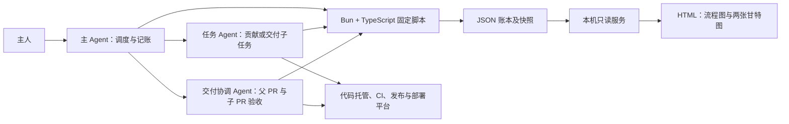
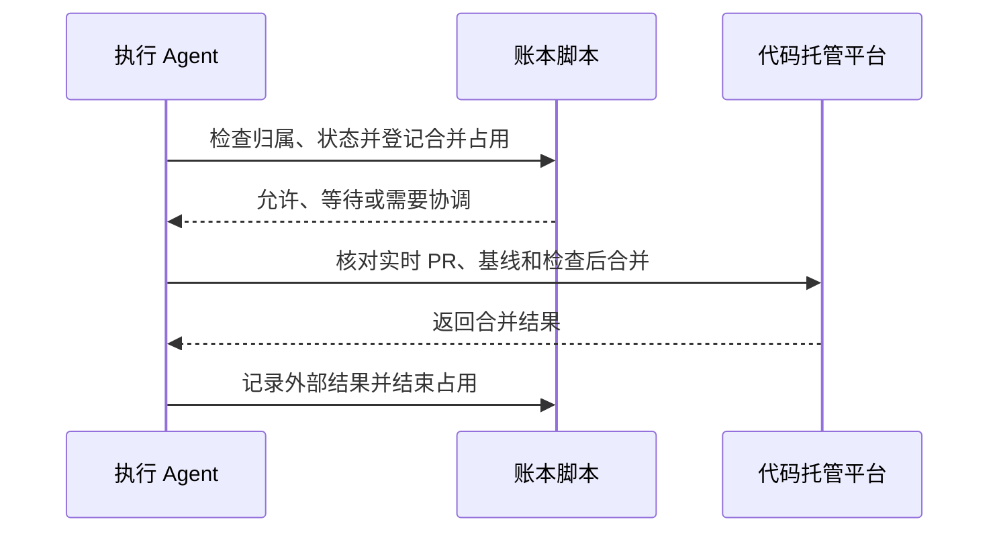

# 编排执行方案

本文用于审阅新编排 Skill 的运行方式，与[任务编排方案](orchestration.md)配套。目标是使多个 Agent 在同一编排中可靠地共享进度、协调合并与切割，并让主人查看实时状态。数据契约见[数据与脚本方案](data-and-scripts.md)，页面设计见[网页模板方案](web-template.md)。

## 组件与职责

### 主 Agent 的首次交付顺序

收到明确的任务编排请求后，主 Agent 先核对当前会话是否绑定未完成 run；若没有，则构造并校验 planned 任务图，调用 `orchestrate.ts init` 写入正式账本。随后调用 `service.ts ensure` 和 `service.ts login`，使用 Agent 内置浏览器打开对应 run 页面，确认真实 revision、任务节点和依赖。任务保持 `planned`，除非主人另行授权派发或外部操作。

proposal、Markdown requirements 和 Mermaid 只能作为输入或补充材料，不能作为首次交付。任一步骤失败都必须报告具体阶段、命令结果和阻塞。



主 Agent 创建和直接管理交付协调 Agent、任务 Agent，维护全局依赖、归属和收口。交付协调 Agent 只是主 Agent 委派的交付单元级协调者，负责父 PR、贡献子 PR 的验收及合并条件；任务 Agent 负责所属子任务和相关 follow PR。贡献、发布、部署、验证和协调任务都按需调度；非贡献任务无需强制创建 PR。交付单元是虚拟整合边界，不是原生会话层级，也不转移主 Agent 的直接管理权。

实际 PR、CI、发布和部署状态以对应平台事实为准。账本记录计划、协调状态与证据引用，不因记录一条事件就自行证明外部操作成功。

## 首个交付单元

主对话保留前期 SPEC、ADR 和任务编排的原工作区，在初始化 planned bootstrap 后直接承担首个父 PR 的完整协调职责。账本通过 `delivery_unit_kind=bootstrap`、`owner_kind=main` 表达该边界，以 run 的 `control.owner_thread_id` 解析实际 owner，而不伪造 group dispatch。后续 regular 单元通过正常 dispatch 绑定独立会话。bootstrap 的子任务仍可并行运行，父 PR 的验收、合并、CI 和收口条件保持一致。

新增约束在完整账本校验执行，计划修订会比较已有单元的类型、owner 和会话绑定。当前版本拒绝既有单元原地转移所有权；需要改变职责边界时保留旧 run 的真实历史，由主人明确决定新的编排，不把 task-migrate 当作 group 所有权迁移。

## 本机数据与工具

在运行时 `multi-task-flow` Skill 目录内部建立 `data/` 及其 `.gitignore`，目录本身保留，运行数据不进入版本控制。每个编排使用独立、稳定的编排 ID；会话 ID 与编排 ID 分别记录，通过绑定信息关联。

```text
<multi-task-flow Skill 目录>/data/
├── .gitignore
└── runs/<编排 ID>/
    ├── ledger.json           # 计划、当前状态和事件
    ├── ledger.previous.json  # 上一份完整快照
    ├── requirements/         # 交付单元和任务的 Markdown 要求
    └── view/                 # 该编排的 HTML、JS 和 CSS
```

目录名和内部格式由实现确定。Skill 自带模板及 Bun + TypeScript 脚本；安装或更新 Skill 时须保留未完成的运行数据。当前方案只考虑所有相关会话在同一台机器上运行。

JSON 必须通过固定脚本读取和修改，Agent 不直接编辑。脚本提供任务和交付单元的状态更新、事件与通知、操作占用、切割和会话绑定等操作；具体接口见[数据与脚本方案](data-and-scripts.md)。Markdown 要求文档由 Agent 按需编写维护，不要求脚本生成或做硬校验。

## 记账与恢复

每次修改通过同一编排内的锁串行化：读取最新账本，检查版本和必要条件，将状态和事件一起写入临时文件，并原子替换账本；保留上一份完整快照。记录稳定的事件 ID，重复事件不得重复派发或重复推进。损坏或版本不一致时停止写入并报告，不能自行猜测恢复结果。

文件锁只保护账本写入；它的释放不代表外部操作完成。合并、切割等跨步骤操作还需要账本中的**持久操作占用**，记录目标、身份和进度。进程中断后先核实外部平台事实，再恢复、结束或重新安排操作；结果未知时不得盲目重试。

计划批准时记录实际授权范围。执行时以明确授权、当前目标、SHA、检查和验收证据为前提。未授权的计划外外部操作或范围变化不能由账本自行批准。

## 合并与动态切割的协调

同一编排中的任务 Agent 和交付协调 Agent，无论执行什么 PR 合并，都要先通过固定脚本检查账本、目标和状态，取得相应操作占用；需要等待时登记等待或通知需求。



动态切割使用同一协调机制：先阻止新的相关合并占用，等待已登记的相关合并得到明确结果，核对父分支 SHA，再原子记录切割、实际归属和下一交付单元待办；尚未完成的贡献任务转入下一交付单元，已切出的交付单元的发布、部署和验证等后续任务留在原交付单元。任务继续执行，下一父分支按编排方案在主干合并后建立。外部状态若与账本不符，暂停受影响操作并核实。若代码托管平台因 update-branch 推进同一父分支，交付协调 Agent 必须通过 `group-base-reconcile` 提供旧 SHA、新 SHA、同一父 PR、分支、provider 和 update-branch 证据；该记录不会伪装成 merge/follow PR，受影响任务仍需按新的 `current_sha` 重新建立基线。

锁和协调仅覆盖同一个编排，不对其他编排或项目建立全局限制。即使如此，执行前仍须核对实时平台状态，处理目标分支漂移或代码冲突。

## 通知、阻塞与用户介入

需要通知主 Agent 的关键事件先记到账本，之后发送，并记录处理确认。包括会话创建成功、PR 合入、任务完成，以及需要调度的其他变化。通知失败或会话中断时，待处理通知保留；恢复后按事件 ID 去重处理。

一般阻塞不必主动通知主 Agent：交付协调 Agent 或任务 Agent 将状态和原因写入账本，在自己的对话中等待主人；主人可从 HTML 或 Agent 界面进入相应会话处理。确实需要主 Agent 重新调度时，才通知主 Agent。等待期间可释放执行名额，但依赖它的后继不能因此启动。

主人可直接在交付单元或任务对话中作决定。若变更影响其他任务的范围、依赖、验收或调度，相关 Agent 先记账并通知主 Agent 协调；仅影响本任务内部执行的决定由该 Agent 处理。交付协调 Agent 的验收职责来自主 Agent 委派，不改变主 Agent 的直接管理权。

follow PR 合入后，负责它的 Agent 通知主 Agent；主 Agent 再通知受影响且尚未完成的任务 Agent 更新基线。任务“已集成”与“已收口”分开记录：前者可解锁后继，后者要求相关检查和已知 follow PR 结束后才归档会话、清理资源。

## 页面与本机服务

Skill 提供以 daisyUI 和 Tailwind CSS 为基础的模板，尽量使用单个 HTML 和少量 JS、CSS。图形依赖及是否使用前端框架由实现时按实际需要选择。每次编排从共享模板生成自己的页面，主 Agent 可按项目调整外观和展示；模板保持不变，页面不能隐藏依赖、阻塞和实际进度等关键信息。

由 Bun 启动只监听本机的只读服务，从账本提供当前视图并推送后续更新。服务使用端口租约；`serve.ts` 在 registry 锁内原子校验预分配租约，拒绝已有 owner 的重复启动，持锁绑定 listener，并只在 listener 确认后登记自身 PID，运行期间心跳，退出时只释放自身服务租约。连接中断时页面明确显示，不能把旧信息冒充实时信息。页面支持流程图、理论和实际甘特图、筛选、详情，以及对话、PR 和要求文档链接。技术实现须验证各类链接在实际运行环境中可打开。

Agent/host 负责取得并保留真正的 Codex native background session；Skill 只接收宿主实际提供的 `agent_session` 元数据，不创建、猜测或用可见终端/前台 exec 替代它。没有受支持的宿主后台路径时，服务只能用于当前回合验证，不能交付 owner-facing URL。

页面不修改账本，也不执行派发、切割或合并；外部状态仍通过对应平台核实。理论安排保留计划版本及估时依据，实际视图使用已记录的真实时间。

## 绑定、完成与清理

编排 ID 独立于会话 ID。fork 或恢复后，如果可验证的信息不足以确定是继续原编排、转移控制权还是开始独立编排，实际需要使用账本时询问主人；控制权不明确期间暂停派发、切割和合并，避免两个主 Agent 同时驱动同一编排。

交付单元完成需满足父 PR 合并、相关 CI、计划中的后续任务和已知 follow PR；全部交付单元和主任务条件完成后才报告全部完成。完成后先保留账本和页面供主人查看；主人确认查看或明确执行收口时，停止服务并只清理该编排的数据目录。未完成或需要恢复的记录保留，其他编排不受影响。

## 对话创建与桌面交接

本节规定本机 CLI 创建与桌面交接合同；ADR 0046 替代 ADR 0044 的创建传输决定。源码测试不能替代当前候选的桌面接管实证。

组对话与任务对话统一通过独立 CLI 进程的 `codex exec --worktree --json` 创建，沿用账本锁定的模型和推理配置、dispatch claim、请求身份和结果对账机制。覆盖范围为本机；远程主机创建另行设计。桌面能识别实际线程和工作区是验收依据，`project_id` 为空不单独判失败。

每个组建立基线前获取远程主干，固定并记录具体 commit SHA；获取失败暂停该组派发，不退回旧缓存或当前 checkout 的 HEAD。子任务在 Codex 创建的工作区内对齐所属组父分支的已核验 commit，以继承组内已完成的依赖。远程主干后续更新通过显式同步推进，不自动移动已有工作区的基线。`--worktree` 默认起点只记录为 initial_head；创建成功不要求它已对齐开发基线。正式工作回合内安全对齐基线，通过 workspace readiness 后才能进入 running。

创建与正式工作分开。CLI 首轮仅回复初始化确认，不调用工具或执行实际任务；取得真实线程 ID，确认独立 worktree 与起始 commit、初始化回合完成且 CLI 退出后，才完成创建成功的账本绑定。主对话随后通过桌面内置 `send_message_to_thread` 发送正式工作指令与后续调度消息，不以外部 CLI 启动长时间工作回合。发送接受、账本绑定与实际开工分别记录，不将消息接受视为任务已经运行。

发送通道的桌面接管行为须实测。目标是缩短 CLI 持有时间，本次不要求解决外部运行回合的底层占用机制；若内置发送仍导致桌面无法接管，应明确报告限制，不静默退回长时间 CLI 执行。CLI 创建过程超时、进程异常或结果不明时保留 claim，核对真实线程、工作区与回合状态后恢复，不自动重复创建。

新方式适用于升级后尚未发起的创建操作，包括既有运行后续新建的任务。已有对话保留线程和工作区，结果不明的历史创建先对账，不自动重建、迁移或打断正在运行的 CLI 回合。
