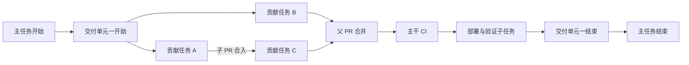
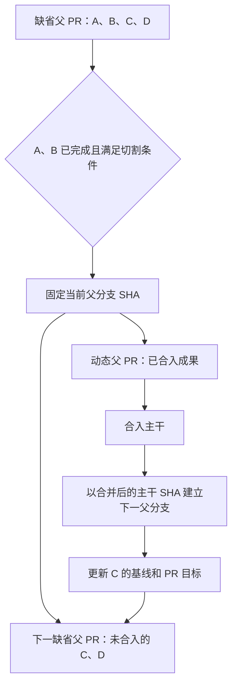

# 任务编排方案

本文用于审阅新编排 Skill 的设计。它描述如何从需求得到可调度的任务图，不授权启动实际贡献、创建 PR 或发布。执行和恢复机制见[执行方案](execution.md)。

## 目标与范围

新 Skill 服务于一个包含一个或多个父 PR 的交付任务。它先建立原子任务关系，再组织子任务与父 PR，按照依赖和实际进度调度。目标是在尽早交付可发布成果的同时，控制并发、冲突和协调成本。

该 Skill 与历史协调会话并存。历史会话保持原样；新方案不使用旧调度语义，也不自动迁移旧会话。PR、发布、部署和清理等专项操作继续复用对应流程。

## 编排单元

| 单元 | 含义 | 主要责任 |
| - | - | - |
| 主任务 | 一次完整交付的编排 | 主 Agent（main Agent） 建模、创建会话、调度并汇总完成状态 |
| 交付单元 | 共享父分支和父 PR 路径的子任务虚拟整合单元 | 主 Agent（main Agent） 直接管理；交付协调者（Delivery coordinator） 受委派处理交付单元级父 PR 协调、子 PR 验收和收口证据 |
| 子任务 | 可独立调度和追踪的工作 | 任务 Agent（Task Agent） 按需执行；贡献任务通常对应一个子 PR，非贡献任务对应操作目标和完成证据 |
| 原子任务 | 编排时不可再拆分的最小工作单元 | 在所属子任务内串行完成，不要求是功能上的绝对原子 |

交付协调者（Delivery coordinator） 和任务 Agent（Task Agent） 是平级会话，均由主 Agent（main Agent） 按需创建和直接管理。交付单元是账本中的虚拟整合边界，不是原生会话的父子层级；`group_id` 只表达任务的虚拟分组、父 PR 路径和批次验收范围。交付协调者（Delivery coordinator） 负责在主 Agent（main Agent） 授权范围内执行交付单元级父 PR 协调、贡献子 PR 验收和合并条件判断；实际合并由获得相应授权的 Agent 执行。主 Agent（main Agent） 仍保留任务调度、账本、跨交付单元依赖、范围变更和最终收口控制，不因绑定交付协调者（Delivery coordinator） 而转移直接管理权。

## 从原子任务到任务图

1. 明确目标、非目标、验收条件、交付边界和项目基线。
2. 拆分原子任务，标注各自产出及真实前驱和后继，检查依赖图无环。
3. 将适合连续完成的一个或多个原子任务组合为子任务，写明目标、范围、依赖、产出、验收和预计修改范围。
4. 将子任务虚拟分配到一个或多个交付单元，并建模共享父分支上的父 PR 合并、CI、发布、部署、验证和其他后续工作；该分配不建立原生会话父子关系，也不转移主 Agent（main Agent） 的直接管理权。
5. 按实际依赖和全局并发目标计算理论安排，展示等待与切割选择的成本；主人批准后执行。

子任务内部的原子任务串行执行。跨子任务的贡献依赖以子 PR 合入为交接点，不对外开放未合入的中间成果。

例如，A1 → B1 → A2 中，A1 和 A2 不能放在同一个子任务：否则 B1 既要等待 A 的子 PR 合入，又要在 A2 之前执行。必须将 A1、A2 分为两个子任务。

若 B1 只依赖 A1，A1 和 A2 则可以组合，但 B1 必须等待 A1、A2 一起完成并合入。编排应展示这项额外等待，权衡拆分 PR 的成本和并行收益；允许组合不等于默认组合。

## 依赖与调度

上图是示例：C 的前驱满足后即可开工，不需要等待无关的 B。父 PR 合并前仍须满足该交付单元的实际合并条件。

- 只根据明确的子任务或里程碑依赖决定开工时机，不设波次或全局波次屏障。
- 整个主任务默认同时运行三个任务，可在计划中调整。交付协调者（Delivery coordinator）、主 Agent（main Agent） 和单纯等待外部 CI 的工作不占运行名额；等待主人回复的任务可释放名额。
- 就绪任务优先考虑能够解除更多后继阻塞的工作，同时尊重资源、基线和实际风险。
- 多个交付单元可以并行。交付单元之间不自动建立笼统依赖；需要时指向具体的子任务、主干合并、发布、部署或验证节点。
- 若交付单元 B 的贡献依赖交付单元 A 的代码，B 的父分支须基于包含 A 父 PR 主干合并结果的已验证 SHA；若还依赖 A 的部署或验证，还须等待相应节点。
- 预计修改范围显著冲突时，优先调整任务边界或安排顺序。轻微重叠不禁止并行；预期外的重叠可以通过更新基线、解决冲突和重新验证处理。
- 失败或阻塞只阻止其依赖后继；其他就绪任务可以继续。阻塞不自动变成完成或跳过。

## 父 PR 与动态切割

计划可直接声明多个父 PR，也可先将相关子任务安排到一个缺省父 PR，并为动态切割声明一个或多个有序条件。满足条件后，当前缺省父 PR 按实际已合入进度切出，未合入的进行中和未开始任务转入下一缺省父 PR。

- 切割时短暂暂停该父分支的子 PR 合入，以已核实的父分支 SHA 作为交接点；其他贡献可继续。
- 当前交付单元包含该 SHA 实际已有的成果；尚未完成的贡献任务归入下一交付单元，进行中的任务 Agent（Task Agent） 保留原会话。已切出的交付单元的发布、部署和验证等后续任务保留在原交付单元，待该交付单元父 PR 合并后按依赖执行。
- 进行中的贡献任务可继续推进；下一父分支在前一动态父 PR 合入主干后，基于包含该合并的 SHA 建立。随后更新已有子 PR 的基线和目标并重新验证；暂不向尚未就绪的下一父分支合入。
- 原交付协调者（Delivery coordinator） 在主 Agent（main Agent） 的委派范围内继续处理已切出的父 PR 及其收口证据；下一交付协调者（Delivery coordinator） 按需创建，主 Agent（main Agent） 始终保留直接管理权。
- 可以计划多个有序切割条件；每次切割后按剩余任务重新计算，防止重复切割。创建动态父 PR 不需要等待 follow PR。
- 父 PR 的提交记录可以包含原定内容以外的记录。交付协调者（Delivery coordinator） 应核对实际差异：已有基线历史或不扩大已批准范围的内容可以继续；引入未批准的功能或行为时请主人决定。

如果原父 PR 尚未合入主干，后续 follow PR 可以继续指向原父分支，从而使其 SHA 前进。切割时的 SHA 是**任务归属的交接记录**，不永久冻结最终合并 SHA；follow PR 合入后更新当前 SHA，并在父 PR 合并前重新检查实际差异、CI 和证据，已切出的任务归属不随之改变。

## 交付与完成

贡献子 PR 合入后，子任务进入“已集成”，可解锁相应后继。任务会话在相关检查和已知 follow PR 完成后才“已收口”，避免过早归档；不为假设中可能出现的 follow PR 无限等待。

原父 PR 尚未合入主干时，针对其成果的 follow PR 指向原父分支；原父 PR 已合入时，follow PR 指向主干。follow PR 合入后通知主 Agent（main Agent）；如影响尚未完成的任务，由主 Agent（main Agent） 通知有关任务 Agent（Task Agent） 更新基线。已发现、属于本次交付的 follow PR 在完成前阻止相关交付单元收口。

交付单元的结束条件包含父 PR 合入、相关 CI 通过、计划中的合并后任务及已知 follow PR 完成。所有交付单元和主任务要求均完成后，主 Agent（main Agent） 才报告全部完成。

主人批准完整编排计划时，可以同时授权计划中明确列出的合并、发布和部署；执行仍核对实际目标、SHA 和检查结果。计划未覆盖的发布、部署或范围变化须另行决定。

## 图与时间安排

页面呈现主任务开始和结束、交付单元开始和结束、贡献任务及交付单元的发布、部署、验证等后续节点。依赖图展示真实前驱与后继；颜色或其他可辨识方式标明子任务与父 PR 的归属，动态切割后展示实际归属。

提供两张甘特图：

- **理论安排**：根据任务依赖、全局并发上限和有依据的预计耗时计算，标明估时依据与可信度；无法估计时标为未知，不虚构日期。计划调整保留原安排并产生新安排供对照。
- **实际进度**：展示真实开始、完成及等待时间；未发生的事件不填成事实。

页面可筛选、展开依赖、查看任务详情，并打开任务对话、PR 和要求文档。它是只读视图，不直接派发任务或执行合并。
