# Multi-task Flow：多任务编排

## Context and Scope

- 背景：通过显式依赖和可恢复的本地账本，协调主人已批准的任务会话与父 PR 交付。
- 范围内：原子任务规划、任务调度、交付单元整合、动态切割、安全记账和只读 dashboard。
- 范围外：迁移旧的会话内协调流程、跨机器或跨 flow 锁，以及未经批准的外部动作。

## 术语与接口

- 领域术语定义在根目录 `GLOSSARY.md`。
- 主 Agent 直接控制整个编排。交付单元是共享父分支和父 PR 路径的子任务虚拟整合单元；为兼容账本而保留的内部字段 `group_id` 只表达分类和验收范围，不表示原生会话父级或管理权转移。交付单元会话与任务会话仍是由主 Agent 直接管理的平级会话。交付协调 Agent 只承担获授权的协调职责，不是第二个主 Agent。
- Skill 负责本地 Bun/TypeScript 命令接口、JSON 账本和账本投影的 loopback dashboard。共享 viewer 可以保存服务认证、使用租约和明确的全局 UI 主题偏好，但可通过认证 API 写入明确支持的执行配置，其他编排事实保持只读。

## Requirements

### REQ-ORCH-015

- 一个 run 最多包含一个 `bootstrap/main` 交付单元，其 owner 由绑定的 main conversation 唯一确定，`agent_thread_id` 保持为空。bootstrap 必须位于交付单元依赖的最前端，不得经由无 group 节点间接依赖其他单元。首次初始化仍仅接收 planned 状态；随后主对话在原工作区提交前期文档并记录父 PR 发布证据，无需额外文档贡献任务。
- 后续 `regular/group` 单元必须由独立交付协调会话负责；激活前必须绑定真实会话。主对话同时承担首个单元的完整交付协调职责，包括原子任务、任务调度、子 PR 验收、父 PR 发布、合并与收口；平台证据、合并 claim 和收口条件继续适用。
- 数量、所有权和依赖顺序约束必须覆盖完整账本及计划修订，不能只检查新增单元。普通 group-update 和 plan-propose 不得改写既有单元类型、owner 或会话绑定；当前版本不提供在原身份上转移所有权的命令，历史运行不自动改写。
- 缺失新增字段的旧数据按 `regular/group` 读取；dashboard 展示实际拥有者会话和类型，bootstrap 下任务的 ready 状态与运行时调度一致。父 PR 默认串行推进；普通单元只有在显式依赖允许时才并行。

### REQ-ORCH-012

- Dashboard 交付与检查必须先检查当前宿主实际暴露的浏览器能力；在 ChatGPT Desktop 或 Codex Desktop 中优先使用可用的宿主内置浏览器，此场景优先于通用 ego-browser 默认路由。内置能力缺失时才按获准的 ego-browser 路由回退；打开或登录失败须先诊断，Chrome／Computer Use 与真实截图仍遵循原有授权门禁。交付完成必须以渲染页面核实目标 run ID 和当前 revision，并保持页面打开；无可用路径时报告 blocker，不能仅凭打开工具成功宣告交付。
- 一个 OS 用户的所有项目和 `CODEX_HOME` 安装必须共用一个生产 viewer。viewer 必须能在无需管理员权限时按需启动，使用相互独立且会过期的 Agent/browser 租约，在所有租约过期后退出，并保留每次 run。Agent 租约默认 60 分钟，browser 租约默认 5 分钟且每 60 秒续租；未完成的 run 本身不得使服务常驻。
- 生产状态必须位于独立于安装代码和 worktree 的 `~/.local/share/multi-task-flow/`。开发和测试实例必须显式隔离数据、服务身份、端口和凭据；只有已订阅的 run 可以持有实时 watcher。
- 服务必须提供固定的 loopback 入口 `/runs/<run_id>/` 和可选的 `?plan=<plan_id>`，run 链接不得包含凭据。首次安装必须分配并持久化端口；冲突必须失败，不能修改端口或接管其他进程。
- 软件构建、API、frontend 和账本合同必须有独立身份。服务必须发布明确的兼容性，兼容时保留每个 run 的自定义 view，不兼容时显式回退，并将损坏或不支持的 run 与其他列表隔离；CLI 不兼容不得触发自动升级或静默转换数据。
- macOS 用户级 `launchd` 必须独立于任何会话拥有生产进程，既不随登录启动，也不无条件重启。并发 `ensure`、空闲退出、过期 PID 清理和升级必须有 generation fence；端口租约必须属于用户服务，不得伪造原生 Agent 会话元数据。
- 代码安装、升级和回滚必须是独立的显式维护操作，与数据导入/迁移分开。代码健康检查失败必须恢复上一个兼容构建；导入必须列出精确来源、阻止旧路径写入、保留身份和备份、拒绝冲突 ID，并生成新的 URL 映射而不保留旧 listener。
- 持久凭据必须跨重启和升级保留。一次性登录 ticket 不得复用；认证写入必须拒绝跨源请求；轮换/撤销必须显式执行，日志不得包含密钥。

### REQ-ORCH-017

- 共享服务升级对所有保留 run 检查读取兼容，不按归档、完成或使用租约筛除；已有只读合同不得强制迁移。自定义 view manifest 若存在但不安全或不可读必须拒绝；悬空符号链接不能按声明缺失处理。当前构建可写而目标构建不可写时，必须以绑定当前/目标构建及全部 run 合同、revision、原始摘要的预检报告取得准确写入降级确认。损坏、不可读或自定义 view 不兼容不能确认绕过；安装无旧构建时只要求读取兼容，回滚使用相同规则。
- 兼容与维护预检必须只读。维护合同迁移和执行配置迁移是两个独立授权的 CLI 动作，保留 owner 与历史事实，不要求恢复原主会话，不授予调度权限；普通迁移继续仅限绑定 main。维护引用属于同 OS 用户信任域中的主人批准审计，不是独立认证凭据。
- 应用必须绑定准确 run、原 owner、revision、源文件摘要、动作摘要和唯一请求；旧写入器须明确暂停，claimed/unknown 操作拒绝维护。在维护锁、run 锁内复核，完整备份后原子提交、revision 单增、记录真实维护身份并支持同内容幂等。已提交重放先于旧 revision/摘要校验，异内容拒绝。
- 先安装同时可读源/目标合同的展示构建，再维护迁移；当前构建不支持目标数据时拒绝迁移。健康失败恢复代码并验证原构建，不覆盖已有新数据；不兼容旧构建回滚拒绝。锁只约束协作写入器，不宣称隔离同用户旧二进制或手工写入。

### REQ-ORCH-001

- 系统必须校验无环的原子依赖图及任务分组，只有声明的前置条件满足后才能调度任务。
- contribution task 的跨任务依赖只有在对应 child PR 已集成后才满足；默认同时运行任务数为 3。

### REQ-ORCH-002

- 每个编排必须保留一个权威账本，跨本地进程串行化更新，防止过期或重复请求覆盖已接受事实。
- 外部操作 claim 必须跨中断保留，在匹配结果被核实前保持未解决。
- 创建 run 前，初始化必须拒绝已预绑定的 group/task conversation ID，以及任何非 `planned` 的 group、task 或 atom 状态；初始化必须返回 `INVALID_INITIAL_STATE` 且不创建 run 文件；任务会话只能通过带真实原生创建证据的 dispatch resolve 绑定。

### REQ-ORCH-003

- 系统必须协调 child PR 集成和动态切割，使切割记录精确边界，并在不丢失身份的情况下重新分配未完成的 contribution task。合并后的 release、deployment 和 verification task 仍归属于被切出的交付单元。
- 后续 follow PR 可以推进原父分支 SHA，但不得改变切割归属；必须刷新该分支的当前证据。

### REQ-ORCH-004

- 系统必须区分任务集成、任务收口、交付单元完成和资源清理，并保留需要调度处理的通知直到收到确认。
- 普通任务或交付单元阻塞应记录在其所属会话中，只有影响调度时才需要通知主 Agent。

### REQ-ORCH-005

- 原子任务清单与依赖列表必须复用“状态图标、名称、完成时间”的展示结构；依赖条件和路径说明位于名称下方。原子任务行支持悬浮、聚焦和长按查看依赖，关闭 tooltip 不得连带关闭详情。详情字段标签按详情容器宽度统一置顶或居左。
- 完成时间只能读取同一归属和稳定 ID 的真实完成记录，缺失时不显示。时间点使用浏览器当前时区：过去不足12小时显示时分，满12小时不足7天显示相对时间，满7天及未来时间显示月日时分；悬浮或聚焦时间显示含年份和秒的完整本地时间，不显示时区名称，并定时刷新。该规则覆盖原子任务和依赖完成时间、任务详情与悬浮预览的开始及完成时间，以及数据更新时间；持续用时和时间轴日期坐标保持各自语义。

- 系统必须提供只读 dashboard，展示依赖图、计划与实际时间线、状态筛选、任务详情，以及可用的 PR、requirements 和原生会话链接。
- 所有耗时只显示时间或“未知”，不混入状态文字；任务卡片不显示“当前用时”等重复标签；任务卡片用图标表达状态，悬浮卡片和详情保留独立状态文字。同一行卡片等高时，标题距上边缘的距离保持一致，不随输出长度或空状态变化。
- 最新 Agent 输出只读取任务已绑定对话的最新非空 assistant 消息，包含进展、最终回答及实际可取得的流式文本，排除工具、用户、系统和推理内容，不拼接不同消息，不回退到账本输出。卡片最多三行，普通卡片悬浮预览只展示任务事实，不展示对话正文或输出空状态；详情与对话图标浮层保留完整纯文本和换行。
- 对话输出使用独立的内存投影、`output_epoch` 和 `output_revision`，通过 `agent-output` SSE 自动更新；不写账本、不增加账本 revision。重连补齐历史，拒绝旧请求和旧绑定结果。无对话、无回答、读取失败分别显示明确空状态；失败时可保留最近成功内容并显示不可用提示。实际增量能力必须经宿主观察验证，不把历史轮询称为流式。
- 观察连接不得创建回合、发送消息或覆盖会话配置。仅对 run 已绑定且加载列表确认存在的对话允许使用最小参数 `thread/resume` 加入订阅；未加载对话只读历史。桌面会话使用现有宿主的跟随通道取得实时公开回答，不将独立 daemon 的历史读取当成桌面流式事件；私有跟随协议必须校验版本、宿主来源和连续 revision，缺口重新取快照，不执行跟随控制命令。
- dashboard 必须根据真实任务 `started_at` 事实推导单调的 planning/implementation 展示阶段，保留三个权威视图，并在不改变用户当前上下文的情况下显示非阻塞过渡提示。
- dashboard 必须通过 URL 参数（`tab`、`layout`、`q`、`group`、`state`、`kind`、`plan`、`selected`、`detail`、`plannedStart`、`plannedEnd`、`actualStart`、`actualEnd`）编码可分享的视图上下文，省略默认值，忽略无效 ID，且不得包含任务数据、凭据或服务 token。`layout=board` 是默认值并省略，`layout=grid` 可分享。图表缩放必须只保留在交互状态中，新生成 URL 不得序列化缩放；可以读取旧缩放参数。
- dashboard 必须在页头展示当前计划版本。版本选择必须使用原生 hyperlink 以保留浏览器新窗口行为；选择非默认版本时 URL 写入 `plan=<id>`，当前/默认版本则省略 `plan`。
- 任务与交付单元详情必须限定在当前可用视口内并随窗口高度调整；桌面保留详情列，中屏保留图表全宽布局，窄屏保留浮层或底部抽屉。打开、关闭和切换详情不得主动移动背景页面；当前页面已滚动时，详情标题和首项内容仍须立即可见。标题、状态与关闭按钮固定在正文滚动区外，字段、输出与链接共用一个纵向滚动区，边界滚动不得传递至背景。切换对象时正文回到顶部；同一对象刷新或窗口变化时保留阅读位置，超出有效范围时收敛。
- dashboard 必须提示数据过期或断开，刷新时保留上一次有效快照和当前视图上下文，并在桌面与移动端提供可访问的响应式详情界面。
- dashboard 必须采用清晰的 developer control-plane 层次：技术范围栏、明确的 planning/implementation 阶段轨迹、分隔的状态摘要、带下划线的 view tabs、紧凑筛选控件、带边框的时间线/图表表面和结构化 inspector。视觉系统采用 data-terminal 方向：选择使用单条强调线，数字使用技术等宽字体，色彩只用于数据和状态标记而非 chrome；浅色和深色主题共享层次，并排除渐变、玻璃、装饰 orb 和营销式 hero。详情表面必须遵循 `docs/design/multi-task-flow/web-template.md` 的宽度矩阵：宽屏可以使用右侧 inspector，中屏必须让图表在任务区和 inspector 上方占满宽度，窄屏使用响应式底部 drawer。中屏的 grid task card 与 board group column 必须共享 243–360px 的外宽，嵌套 board task card 自然扣除 group padding 和 border，显示/隐藏详情不得改变宽度。Inspector 最小/最大宽度必须固定为 243px/740px，取自 task card 设计限制而不是当前卡片宽度；任务区应在保留 inspector 最小宽度的前提下尽量显示完整列，剩余空间交给 inspector。布局控件必须与首个可见 section heading 对齐，并提供 hover/keyboard-focus 提示。

### REQ-ORCH-014

- The runtime MUST model delivery-unit atoms independently from contribution-task atoms. A plan MAY define ordered `group_atoms`; a runtime `Group.atoms` preserves stable IDs, ownership, purpose, output, lifecycle bindings and `planned`/`running`/`blocked`/`completed` state, while the existing `Task.atoms` and task dependency semantics remain unchanged. New delivery units default to prepare parent branch, create parent PR, verify integration, merge parent PR and closeout, with lifecycle bindings for `workspace_ready`, `pr_created`, `pr_merged` and `closed`; release and deployment work MUST NOT be duplicated automatically.
- `group-atom-update` MUST be idempotent, revision-checked and serialized like other mutations, and may be called only by the bound delivery coordinator or main Agent. Atoms execute in order; lifecycle-bound completion requires the matching passed lifecycle evidence, and generic `group-update` MUST NOT overwrite atom or coordination execution state. Closing a group MUST complete its final closeout atom in the same transaction. Dynamic cuts MUST create an independent planned atom list without copying execution history.
- A delivery unit MUST expose separate `coordination_execution` state (`unknown`, `idle`, `running`, `waiting`, `blocked`), reason and waiting contribution-task IDs. `group-execution-update` MUST be explicit, owner-authorized and reject invalid task references; waiting on contribution work requires a valid task ID and reason, and the dashboard MUST NOT infer coordination state from unfinished-task counts. Merged units may perform closeout; closed units cannot execute again.
- Delivery-unit cards and details MUST show only their own atom progress and existing delivery-unit fields, while task cards and details show their own atoms and output. Dependency tooltips MUST list dependency names and status with hover, focus and long-press access, viewport clamping, scrolling, Escape/outside-click close and accessible tooltip semantics. Waiting for contribution work MUST use a non-rotating hourglass with a 1.8s opacity pulse, static under reduced motion; only explicit coordination execution uses the running spinner.
- New writes MUST use `schema_version=2`/`contract_version=2`; legacy contracts remain read-only until explicit migration. Plan selection MUST join execution facts by stable IDs and ownership, and missing atom configuration MUST remain an explicit unconfigured state rather than fabricating history.

### REQ-ORCH-009

- dashboard 可以在经过认证的共享 loopback 服务上提供 `GET /api/preferences` 和 `POST /api/preferences`，但接口只能接受 schema-1 的 `system`、`light` 或 `dark` 主题偏好。它必须在全局数据根目录使用 OS 锁、`0600` 权限和原子替换保存偏好；缺失或损坏的数据必须回退到 `system`，不得自动修复。

### REQ-ORCH-010

- runtime 必须由首个真实 `task_started` 事件推导 `execution_phase`。在该事件前保持 `planning`，之后保持 `implementation`；dispatch claim、会话创建、`starting` 状态和计划选择都不得跨越阶段边界。
- `plan_lifecycle`、`active_plan_id` 和 `execution_plan_id` 必须独立表达。高影响候选修订可以处于 active，而旧的 approved 版本继续作为 execution plan。计划内容在提出后不可变，批准、替代和放弃只是元数据状态转移。
- runtime 必须根据 canonical diff 和阶段推导 `change_class`。设计阶段修订需要非空 diff 和重新批准；实现阶段低影响修订需要理由但不暂停且不重新批准；实现阶段高影响修订需要理由和证据，只暂停受影响后继并等待重新批准。
- 已开始任务不得原地改写运行身份或边界。任务迁移必须使用新的 planned 任务身份，保留旧任务的事件与事实，并记录理由、证据、继承产出、未继承产出和新基线。

### REQ-ORCH-011

- Zod 领域合同必须是 runtime 校验、JSON Schema、dashboard 字段投影和 LLM 局部语义投影的唯一可执行来源。`schema_version` 必须与 `contract_version` 分开；必填字段、状态含义或转移规则变化时必须明确迁移或拒绝。
- dashboard 和 API 必须把阶段、候选计划、执行计划、生命周期、变更级别、diff 和 hold 原因作为独立事实展示。不得把 `active_plan_id`、dispatch 状态、`starting` 或计划终点标签当作执行完成。

### REQ-ORCH-006

- 系统必须把 runtime 数据放在项目 worktree 和 Skill 安装目录之外的 `~/.local/share/multi-task-flow/data/`，跨 Skill 更新保留未完成 run，并且只在主人确认收口后清理明确的目标。
- 无法识别的 fork 绑定或未解决操作必须阻塞受影响的变更，不能推断所有权或重复外部操作。

### REQ-ORCH-007

- 新 Skill 必须与旧协调会话共存，不得修改它们的 runtime、状态或现有会话。

### REQ-ORCH-008

- `dev-plan` 必须将 `multi-task-flow` 识别为 active 顶层 `flow_type`，并将计划绑定到 `$multi-task-flow` 作为唯一顶层 flow skill。
- multi-task plan 必须保留至少两个 task node、显式 task/batch 依赖、互不重叠的 owned surface 以及 batch/task acceptance scope；必须拒绝降级为单任务 direct `main-agent`。
- 已批准计划必须通过 `dev_plan_handoff` envelope 为 Skill 的唯一 runtime 账本提供初始事实，将 raw-plan digest 和 `flow_type` 绑定到精确 task ID、plan-node group ownership、owned surface 及 batch/task acceptance scope。runtime bridge 必须把主人提供的 opaque raw-plan digest 和规范化 surface/scope 事实作为临时来源，只从已解析的 canonical plan 派生精确 task ID，并在 `init` 前附加 envelope；不得持久化或重新解析面向主人的 Markdown。Runtime 必须将 owned surface 规范化为仓库相对路径，拒绝重复和跨任务重叠，要求每个初始 runtime group 有 batch acceptance scope、每个 task 有 task acceptance scope，并在创建 run 文件前拒绝缺失或不匹配的绑定。动态切割后，只有 assignment history 和匹配的 cut event 同时证明新归属时，task 才能换 group。task-local `$fast-flow` 可以管理单个 task 的 direct PR，但不得改变父 flow type 或收口所有权。
- 动态切割后的计划修订必须重放账本已核实的 cut assignment evidence 和 dynamic-group identity，以验证现有 task/group 绑定；必须保留 handoff envelope，并拒绝缺少 assignment history 和匹配 cut event 的重新分配。
- dynamic cut event 必须绑定先前匹配的 cut claim、已应用 cut rule、精确 cut SHA 的 provider evidence、完整的新旧 group snapshot，以及证明每个 task 被纳入或重新分配边界的切割前 contribution-task snapshot。
- dynamic cut replay 必须校验不可变的 group/task 边界字段和切割前 task 状态历史，不得要求旧 group 在后续 merge 或 closeout 后仍保持切割时状态。成功的 `thread_bound` event 是 task 在切割前进入 `starting` 的边界证据。
- 账本初始化和每次原子替换必须使用 no-follow、no-replace 文件操作，在发布前校验 staging directory identity，只清理已核实的 staging 或 published identity，并在每次替换后对包含它的 run directory 执行 fsync。锁获取和每次账本路径操作必须把预期 run directory、lock directory 和 lock-file identity 绑定到打开的 descriptor；任何已绑定 identity 被替换都必须 fail closed。若发布成功但 directory fsync 不确定，已发布 run 必须保留供显式恢复检查，清理不得删除它。更新必须要求已有 ledger lock file；缺失或变化的 lock identity 必须 fail closed，不能重新创建。
- handoff 中的 raw-plan digest 是已批准 `dev-plan` 边界提供的 opaque identity。Runtime 必须校验其形状并保留它，但不得通过重新解析 init contract 中不存在的主人 Markdown 声称完成认证。
- acceptance digest 必须覆盖 handoff 携带的 canonical scope。scope membership 和 raw-plan authenticity 仍是主人批准边界的事实；runtime 只校验 envelope 自洽性和所有权，不声称重建缺失的批准材料。
- runtime 的 owned-surface 比较是词法的、仓库相对的，不得声称解析 host 文件系统的大小写折叠或 symlink alias；当 host 等价 alias 重要时，批准边界必须提供 canonical repository-relative path。
- 初始 group/task runtime identity 字段必须为空：初始化前不得预置绑定会话、branch、PR、SHA、时间戳、blocker、requirements path 或 assignment history。
- dashboard launcher 必须在绑定 listener 前原子校验并 claim 当前预分配租约；遇到已有 PID 或已监听的重复实例必须拒绝，不能视为转移授权；绑定 listener 时持有 registry lock，仅在 listener 确认后记录自身 PID，运行中 heartbeat 该服务租约，关闭时只释放该服务租约。Heartbeat 和 release 必须以检查到的 port 与预期 PID 状态为护栏，避免旧进程修改被替换的租约。Registry 必须区分被记录的 PID 与 expected owner PID：首次绑定可以要求 PID 为空，已有 PID 必须匹配 expected owner guard。
- 明确安装的共享 viewer 必须使用用户级系统服务所有权和 PID 绑定的活动端口租约。临时主人预览必须使用 Codex host 提供的 native background session；Skill 只能接受 host 提供的 session identifier，不得创建、推断或替代为可见终端或前台 exec session。没有受支持的 host background route 时，URL 只能作为 live preview，handoff 必须阻塞。

### REQ-ORCH-013

- 记账命令必须接受结构化通知选项，`mode` 为 `auto`、`deliver` 或 `none`；`auto` 保留该命令已有默认规则，`deliver` 请求主动投递，`none` 禁止主动投递。兼容迁移期间，旧输入 `notify_main: true` 必须继续解析为向 owner thread 的 `deliver`。
- 通知投递必须以一个 Agent 可调用的复合操作暴露。它必须先提交账本事实和通知意图，再调用当前平台 adapter，最后记录真实投递结果；投递失败不得回滚账本提交。
- 通知收件人必须解析为当前 run 已绑定的会话。`owner` 解析为 `control.owner_thread_id`；显式会话 ID 必须根据 run binding 校验。
- 账本必须区分 `ledger_status`、`delivery_status`（`pending`、`sent`、`failed`、`unknown`）和 `ack_status`。`sent` 只表示平台返回成功投递，不得推断收件人已经阅读或处理；只有收件会话可以确认通知。
- 每条通知必须有稳定的 `notification_id`，每次投递尝试必须有唯一 identity。重放同一 `request_id` 必须返回原结果，不能创建重复通知或投递尝试。明确失败可以按有界退避重试；`unknown` 结果必须先对账才能重试。
- flow 必须提供 run 级恢复与对账，覆盖 pending、failed、unknown 和长期未确认的 sent 通知。恢复不得伪造投递或确认事实。
- 通知账本合同必须保持平台中立。当前实现可以使用 Codex Agent API adapter，未来 adapter 仍必须保留 recipient、attempt、delivery 和 acknowledgement 语义。

### REQ-ORCH-016

- 编排运行必须保存一个全局 `execution_profile` 默认值，由完整的 `model` 与 `thinking` 组成；二者必须同时存在，不允许部分覆盖。
- 交付单元和任务可以分别保存自己的完整 `execution_profile` 覆盖值。交付单元与任务之间没有继承关系；未覆盖的对象独立使用运行级默认值。
- 执行配置只属于编排、调度和对话创建边界。对话创建成功后，Agent 在对话内自行调整模型或思考等级不回写账本、不触发计划修订，系统不得主动修改已创建对话的运行配置。
- 首次生成对象时，系统可以按任务类型应用静态、可解释的推荐规则；主人手动设置后，后续规则升级不得覆盖该值，只有新建对象或主人显式请求重新推荐时才重算。
- dashboard 必须允许编辑尚未创建对话的交付单元和任务的完整执行配置，并显示当前解析值与默认值来源。详情面板只编辑当前对象；模型与思考强度放在可展开的 dropdown 面板内，分别使用模型列表下拉框与离散滑动选择器。运行默认配置使用详情外的独立入口。已有线程或已提交 native 创建请求的对象必须冻结编辑。
- 已有未完成 dispatch claim 的对象发生配置修改时，系统必须取消旧 claim、记录旧值与原因并要求重新 claim；不得让旧 claim 使用过期配置。
- 对话创建必须通过 multi-task-flow CLI 的领域命令完成。CLI 必须读取当前配置、调用受支持的 native 创建能力、记录 native request ID 与真实 thread ID，并以完整配置证据完成 dispatch resolve；Agent 内置会话创建工具不属于正式创建路径。
- 创建请求必须使用账本绑定的 native request ID 作为 app-server RPC identity，并保留创建参数与最终结果；重复的同内容请求不得创建第二个对话，不同内容复用 ID 必须被拒绝。
- CLI 与 dashboard 都必须根据当前能力验证完整模型/思考强度组合。创建结果为 `unknown` 时必须先按 native request ID 对账，禁止直接重复创建；创建失败保留配置事实，修正后才能重新 claim。

## Verification

### VER-ORCH-001

- 方法：图和调度器行为测试。
- 覆盖: `REQ-ORCH-001`
- 通过条件：循环、分组边界、独立就绪状态和容量限制均得到正确评估。

### VER-ORCH-002

- 方法：初始化守卫、多进程锁、原子更新和中断测试。
- 覆盖: `REQ-ORCH-002`、`REQ-ORCH-006`
- 通过条件：无效初始 runtime state 不产生 run 文件；有效初始化创建未绑定的 revision-zero 账本；并发下已提交事实保留；不确定操作不能重复执行。

### VER-ORCH-003

- 方法：fake-provider 集成、cut 和通知 replay。
- 覆盖: `REQ-ORCH-003`、`REQ-ORCH-004`
- 通过条件：merge、cut、follow PR 和通知均保留正确 lineage 与收口边界。

### VER-ORCH-004

- 方法：Bun 合同测试、browser interaction、响应式视觉检查、canonical conversation-link 合同，以及可用时的一条已记录 native conversation-link observation；host 专用的 browser protocol bridging 不作为单独 Skill gate，也不重复验证未变化的 observation。
- 覆盖: `REQ-ORCH-005`、`REQ-ORCH-009`
- 通过条件：图和时间线反映账本状态；phase 与 URL context 正确恢复；主题通过全局偏好文件跨 reload 保留；过期状态可见；canonical anchor 包含精确真实会话 ID；已有 native observation 与该 ID 一致。Skill 不声称证明 host 专用的 browser click bridging。

### VER-ORCH-005

- 方法：现有兼容性测试和 Skill index 校验。
- 覆盖: `REQ-ORCH-007`
- 通过条件：新入口可发现，现有兼容行为不变。

### VER-ORCH-006

- 方法：`dev-plan` raw-plan checker、canonical projection、handoff bridge、finalization、dynamic-cut replay、安全账本发布以及 multi-task downgrade fixture。
- 覆盖: `REQ-ORCH-006`、`REQ-ORCH-008`
- 通过条件：显式 `flow_type=multi-task-flow` 计划在保留 task graph 的情况下通过；approved-plan handoff source 派生一个内存 envelope 并初始化账本；单个 direct task 被稳定的 downgrade finding 拒绝；不匹配 handoff 在创建账本前被拒绝；task/group ownership 和 acceptance coverage 完整；不安全或重叠 surface 被拒绝；cut 证明的重新分配仍有效；task-local direct delivery 仍嵌套在父 route 中。

### VER-ORCH-007

- 方法：dashboard service-wrapper 集成测试和合同抽查。
- 覆盖: `REQ-ORCH-005`、`REQ-ORCH-006`
- 通过条件：租约 dashboard 只有在原子 claim 租约后才能绑定，记录自己的 process/session 元数据，执行受保护的 heartbeat，在 signal 下干净退出，只释放自己的租约，拒绝重复启动且不替换当前 owner，并且不声称创建或证明 host native background session。Registry 测试还必须证明首次 PID 绑定、listener 先于 PID 记录以及同端口替换被拒绝。

### VER-ORCH-008

- 方法：执行确定性的阶段修订、任务迁移、合同投影和 Loomhelm v2 到 v3 回放测试。
- covers: `REQ-ORCH-010`, `REQ-ORCH-011`
- 通过条件：同一依赖 diff 在设计阶段和实现阶段得到不同分类；理由、证据和批准边界有效；双计划指针、定向 hold、放弃/批准转移和迁移历史均保留；dashboard/API/LLM 投影独立表达这些事实；四条 Loomhelm 依赖删除保留在 canonical diff 中。

### VER-ORCH-009

- 方法：服务兼容、迁移及生命周期集成测试，初始化意图与首屏交付合同检查，以及原子状态、权限和浏览器交互验收。
- covers: `REQ-ORCH-012`, `REQ-ORCH-013`, `REQ-ORCH-014`
- 通过条件：生产服务生命周期及兼容声明满足隔离要求；初始化和调度授权分离；交付单元原子任务独立、迁移不补造历史、协调等待以明确事实驱动；浏览器中的等待动画和依赖交互满足合同。测试结果须绑定当前候选，不由此条款推定已通过。

### VER-ORCH-010

- 方法：复合通知合同测试，覆盖中断、重复请求、明确失败、超时、恢复和收件确认，并加入基于 rev22 pending-notification 事故的 replay fixture。
- 覆盖: `REQ-ORCH-004`、`REQ-ORCH-013`
- 通过条件：已提交的任务事实不能丢失通知意图；成功投递只记录一次；unknown 在对账前不得重试；重复请求幂等；只有收件会话可以确认；发送方 turn 结束后恢复查询仍能发现 pending 通知。

### VER-ORCH-015

- 方法：初始化、完整账本与计划修订校验测试，以及 bootstrap/regular 两种 owner 下的调度、child review、merge 和 closeout 回归测试。
- covers: `REQ-ORCH-015`
- 通过条件：唯一 main-owned bootstrap 可执行全部交付阶段；非法 owner、反向依赖、重复 bootstrap 与身份改写被拒绝且不改变已提交账本；旧 regular 行为与 dashboard readiness 保持一致。

### VER-ORCH-016

- 方法：执行配置 schema、推荐规则、dashboard 编辑边界、dispatch claim 替换、CLI 创建证据和 unknown 对账的合同与回放测试。
- covers: `REQ-ORCH-016`
- 通过条件：默认值和对象覆盖值均为完整 profile pair；交付单元与任务互不继承；已冻结对象不可编辑；修改 claim 后旧配置不能派发；CLI 证据包含完整配置和真实线程身份；运行中对话内的模型变化不会改变账本或计划。

### VER-ORCH-017

- covers: `REQ-ORCH-017`
- 方法：隔离兼容矩阵、维护权限与故障注入测试，以及 macOS 原生服务跨构建验收。
- 通过条件：历史只读合同升级不改文件；新增写入降级需准确报告确认；不可读和过期确认在停服前拒绝；合同与 profile 维护独立授权、保留 owner、完整备份、幂等恢复；claimed/unknown 操作和并发变化拒绝，真实服务健康失败恢复原构建与租约，迁移后不兼容回滚拒绝。

## Visual Evidence

### 执行配置

执行配置使用与现有主题一致的下拉菜单和离散滑杆；滑杆仅显示当前强度。详情只编辑当前任务或交付单元，全局默认配置使用页头独立入口，保存按钮右对齐。选中对象后直接以对象名称作为详情标题，不显示空态引导文案。

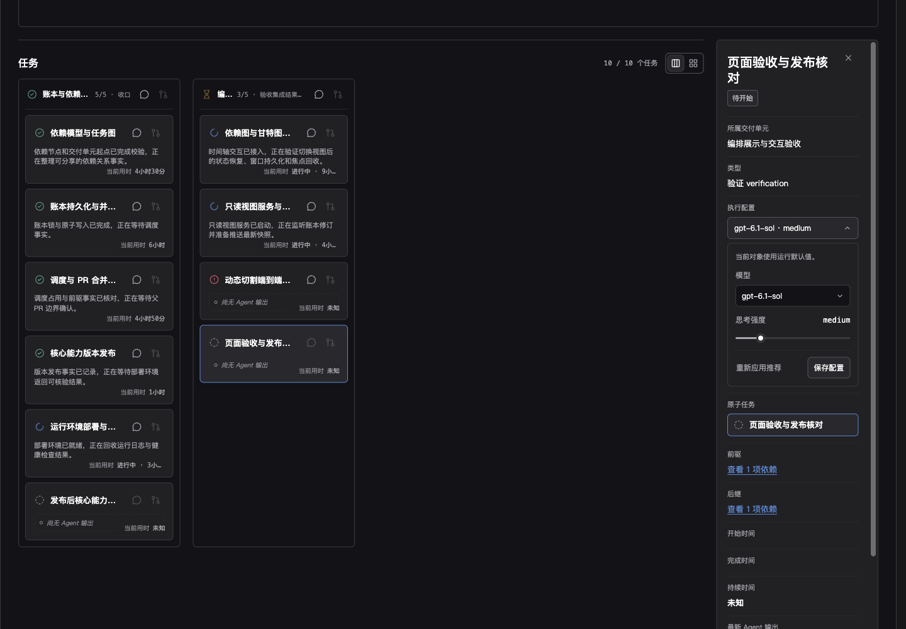

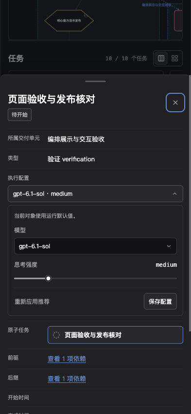

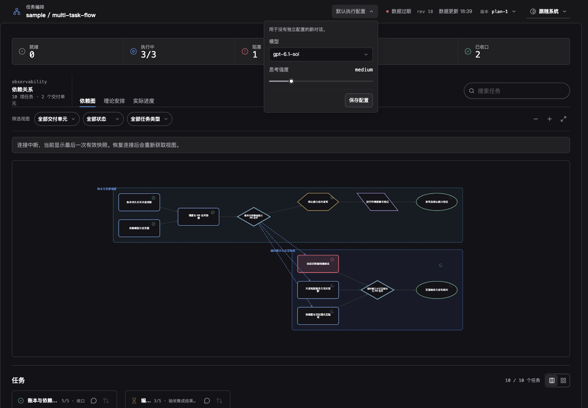

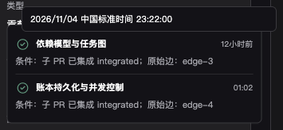

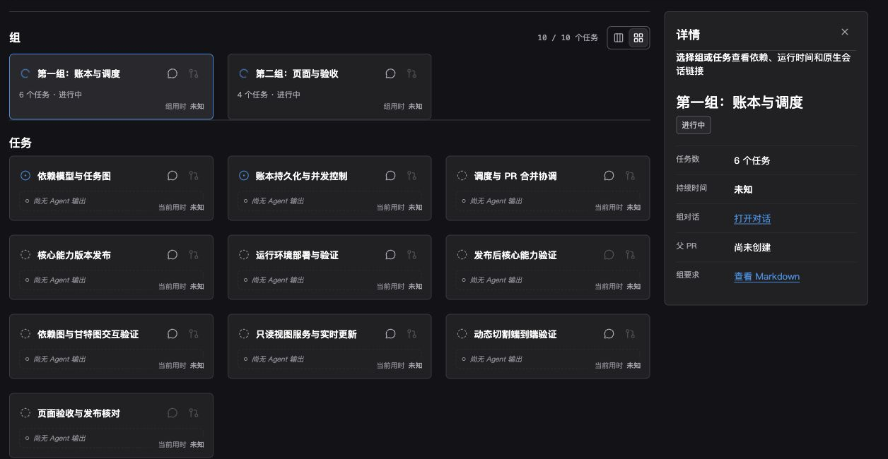

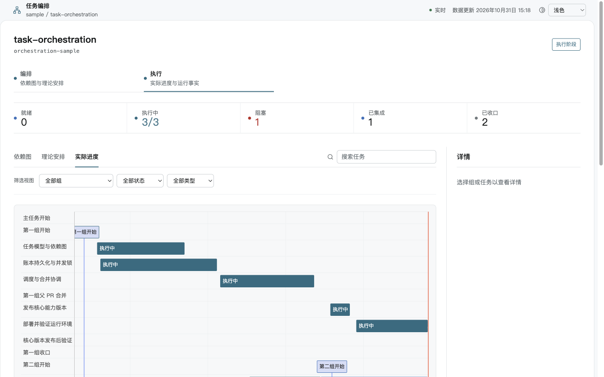

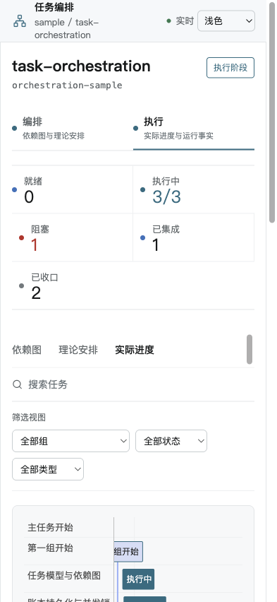

### 卡片悬浮信息

合成 `ui_demo` 覆盖桌面1440×1000与移动端393×852 CSS视口，复用生产卡片和浮层组件，不连接真实对话或远端 PR。对话与 PR 浮层保留480px宽度上限，用时浮层采用288px紧凑布局；移动端仍保留8px视口边距。图片保留原页面上下文，未裁去组件内部留白。

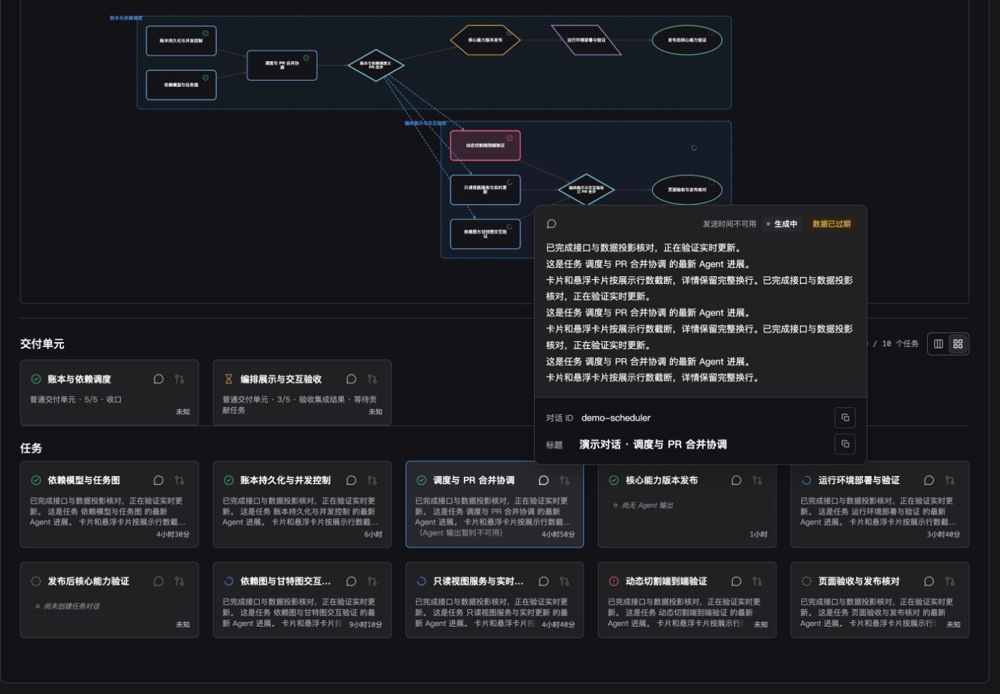

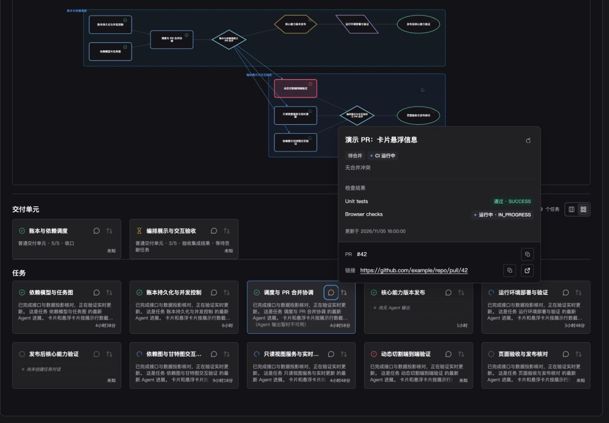

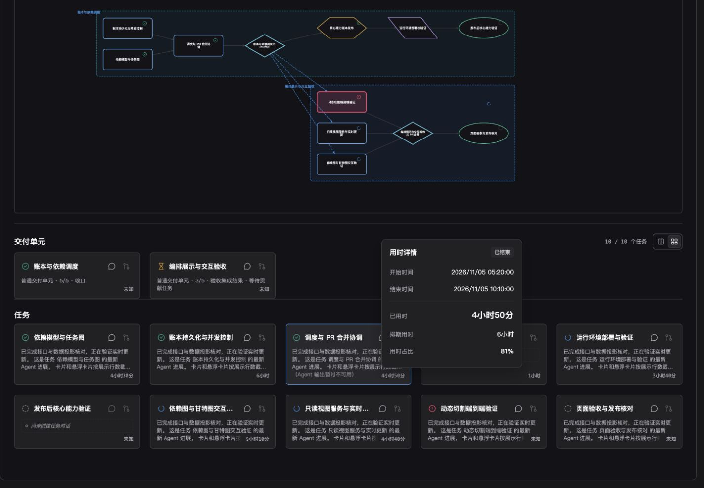

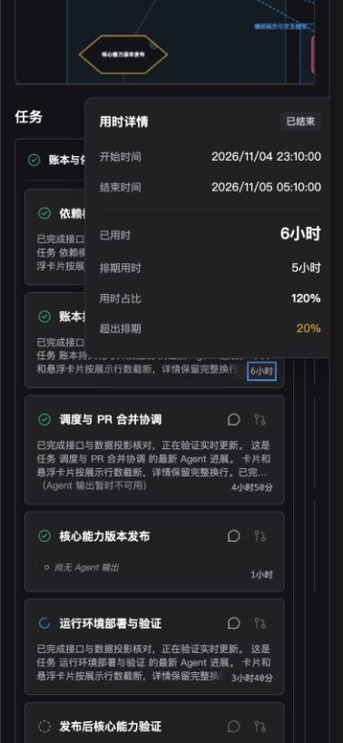

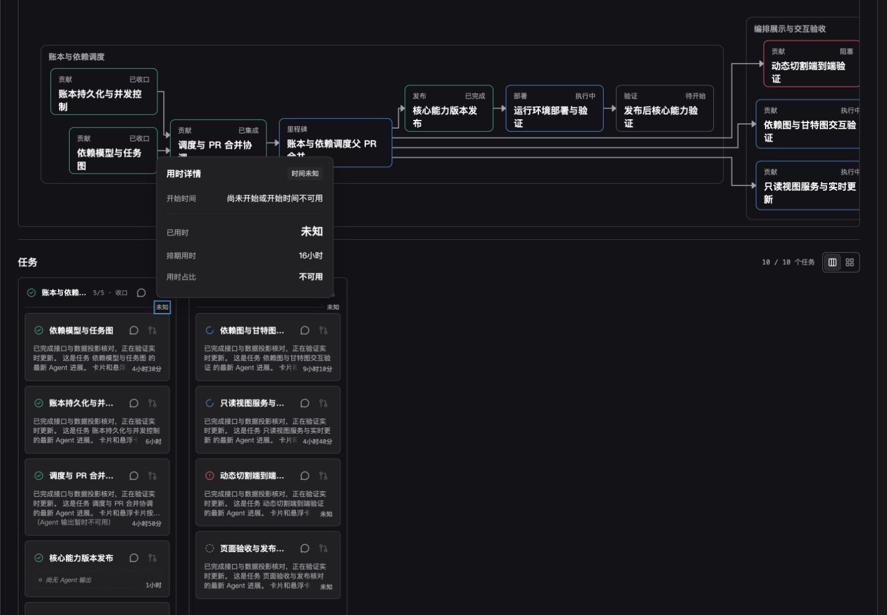

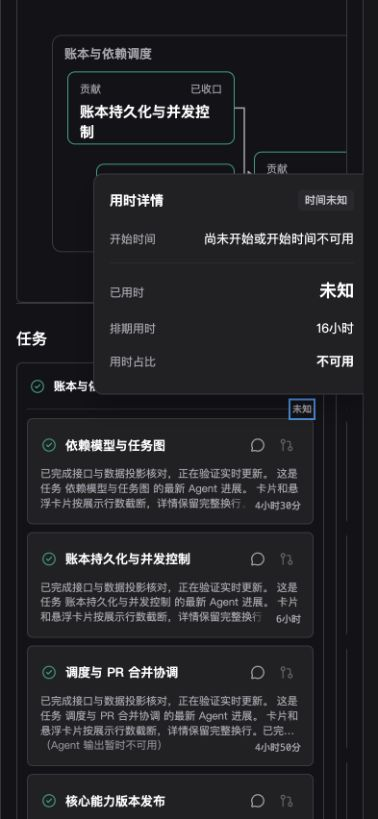

### 源码开发预览

- 示例必须按 `examples/<scenario-id>/` 独立目录组织，目录包含该示例的数据入口、需求内容和说明；源码预览读取具名示例并将需求文档复制到隔离账本目录。
- shared viewer 的返回入口必须融入既有页头；连接提示复用仪表盘状态区，不得在 body 顶部追加游离导航或暴露运维命令。

- example 开发预览复用正式 shared viewer 的服务实现，直接运行本地源码与构建资源，使用独立 development profile、实例锁和活动端口租约，与已安装正式服务并存。
- 预览使用隔离的合成示例数据，不安装、升级或替换正式 viewer，不改写真实 run。前端源码变化后自动构建并刷新打开的页面；失败构建不替换上一次成功的资源。后端源码变化后重启预览。

## Related ADRs

- [0035: Task Orchestration Ledger](../../adr/0035-task-orchestration-ledger.md)
- [0037: Dev-plan Multi-task Flow Routing](../../adr/0037-dev-plan-multi-task-flow-routing.md)
- [0040: Phase-aware Plan Revision Audit](../../adr/0040-phase-aware-plan-revision-audit.md)
- [0041: Task Orchestration Dashboard Experience](../../adr/0041-task-orchestration-dashboard-experience.md)

- [0042: Shared Orchestration Viewer](../../adr/0042-shared-orchestration-viewer.md)
- [0043: Composite Notification Delivery](../../adr/0043-composite-notification-delivery.md)
- [0044: Multi-task Execution Profiles and CLI Conversation Creation](../../adr/0044-multi-task-execution-profile-and-cli-conversation-creation.md)
- [0045：共享展示兼容与维护迁移](../../adr/0045-viewer-compatibility-and-maintenance.md)

## 参考资料

- [Orchestration design](../../design/multi-task-flow/orchestration.md)
- [Execution design](../../design/multi-task-flow/execution.md)
- [Data and scripts design](../../design/multi-task-flow/data-and-scripts.md)
- [Web template design](../../design/multi-task-flow/web-template.md)
- [Dev-plan bridge](../../design/multi-task-flow/dev-plan-bridge.md)
- [Plan revision and change audit](../../design/multi-task-flow/plan-revision-and-change-audit.md)
- [Shared viewer design](../../design/multi-task-flow/shared-viewer.md)
- `./IMPLEMENTATION.md`
- `./HISTORY.md`

## Shared Viewer Visual Evidence

合成的 `ui_demo` 截图只使用 mock render data，不展示主人 runtime。共享 run index 和移动端 run view 构成 Task Evidence Set。

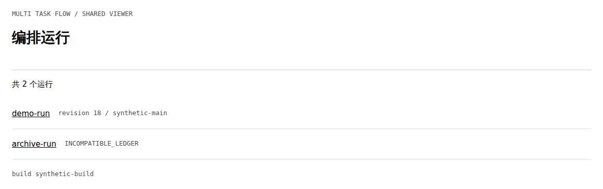

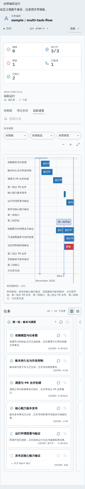

最新输出与纯时长的合成数据证据：卡片标题在等高布局内保持一致上边距，卡片三行，详情保留完整纯文本；普通卡片悬浮预览不再展示回答正文，历史截图仅作既有实现记录。

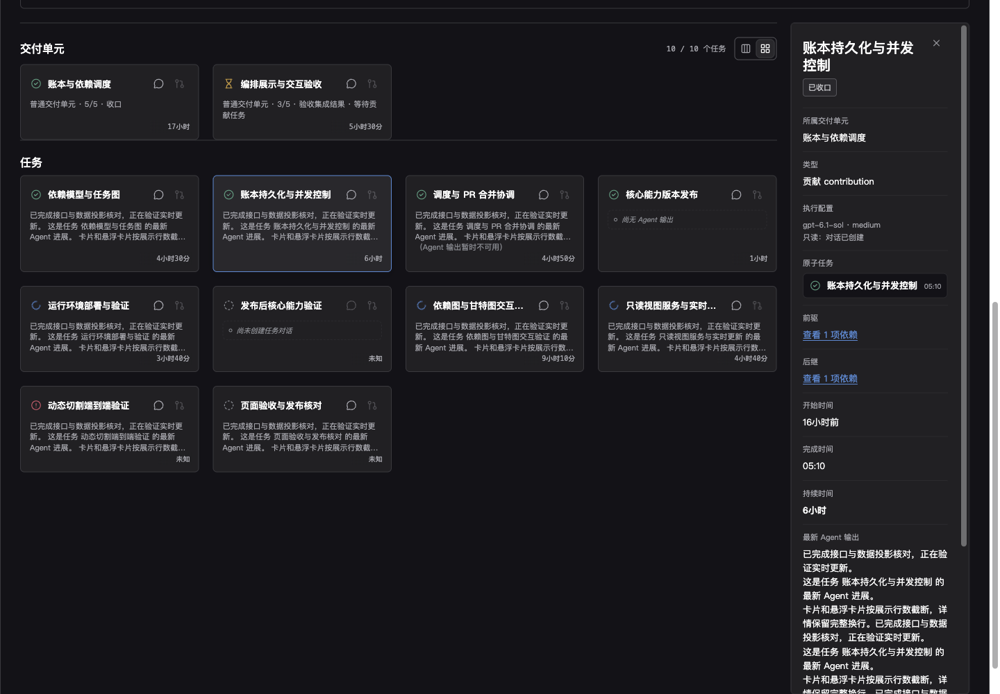

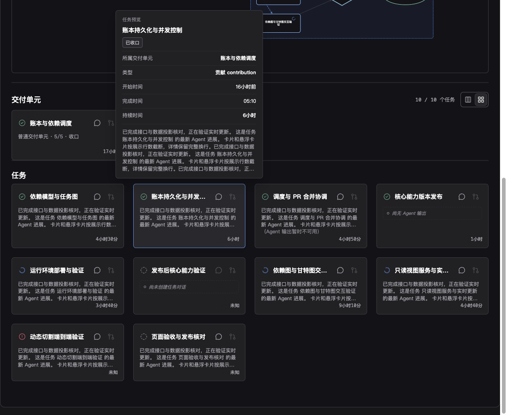

### 卡片资源浮层合同

任务与交付单元卡片在网格和看板布局中统一提供对话、PR、时间三个独立、可移入操作的浮层。卡片时间绝对定位于右下角，不占行、不撑高，也不为其预留正文底部空间，允许覆盖回答。浮层支持悬停、聚焦、键盘进入和触屏长按，Escape、外部点击及离开后延迟关闭；浮层操作不触发卡片选择。含操作控件的浮层使用可交互的非模态 dialog 语义。看板交付单元列头同样提供这三个入口，用时悬浮于既有列头间隙，不增加列头高度。

普通卡片悬浮预览宽度上限280px且不超出视口；对话、PR、时间三个专用触发区不触发普通预览。对话浮层以消息气泡图标及消息自身发送时间代替回答标题，时间缺失时明确不可用；展示真实 ID、真实标题及最新助手消息全文，包含生成中内容，只为 ID 和标题提供复制按钮。上方浮层将身份区放在底部，下方浮层将身份区放在顶部；回答区独立滚动，实时更新保持阅读位置。交付单元观察自身绑定对话，首个交付单元观察主对话；同线程观察去重，任务与交付单元身份分区，继续使用 epoch/revision 防止旧响应倒灌。消息和标题均为临时投影，不写入账本；缺失或失败时明确说明。

认证 run dashboard 提供只读 `GET api/resource-details?kind=task|group&id=<id>&refresh=1`，只解析该 run 中对象已绑定的 GitHub PR，拒绝任意目标参数，其他托管平台明确报告不支持。服务通过参数数组执行 `gh pr view` 获取编号、标题、链接、合并与冲突状态、CI 汇总和逐项结果，编号和链接可复制。CI 不将未知视为成功。缓存30秒，同 PR 查询合并，强制刷新至少间隔2秒，命令超时10秒；先显示已有缓存，过期查询和失败保留旧数据并标注状态。关闭浮层停止前端刷新，不改变 PR 或检查状态。

时间浮层宽度上限288px且不超出视口，标签列60px、列间距12px，避免通用资源浮层宽度造成中间空白。计时使用首次实际开始至当前或实际结束的经过时间，包含等待、阻塞和暂停。交付单元只使用自身 `group_execution_updated` 开始及 `group_updated` 收口事实，缺失时不从贡献任务推断。排期取计划节点区间，非正或缺失排期不计算比例；用时占比与超出比例取整数。绝对时间采用浏览器时区，含日期和秒，不显示时区名称。所有新增字段均为可选读取投影，旧账本无需迁移。
